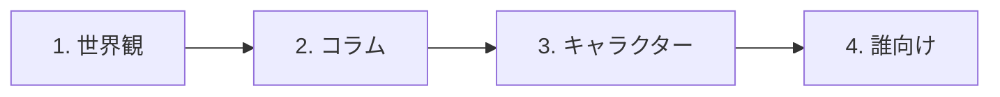

# anime-guide

**図とグラフで、アニメ作品の世界観を誰にでも分かりやすく伝える解説リポジトリ**

[世界観から読む](works/fullmetal-alchemist/world.md) · [誤りを指摘する](https://github.com/maco165/anime-guide/issues/new) · [書き方の約束 (CONTRIBUTING)](CONTRIBUTING.md)

> [!IMPORTANT]
> **内容は AI (Claude) がまとめています。** 資料集め、文章、図は AI が作り、人は公開前に全体を確認します。記述を一つずつ原典と照らしてはいないので、誤りが残ることがあります。見つけたら Issue か Pull Request で教えてください。

## 公開している作品

| 作品 | ページ |
|---|---|
| **鋼の錬金術師** FULLMETAL ALCHEMIST | [世界観](works/fullmetal-alchemist/world.md) · [能力の図鑑](works/fullmetal-alchemist/abilities.md) · [ホムンクルスと七つの大罪](works/fullmetal-alchemist/seven-sins.md) · [コラム](works/fullmetal-alchemist/column.md) · [参照ページ](works/fullmetal-alchemist/references.md) |

## 読み方

| 順 | ページ | 書いてあること |
|:-:|---|---|
| 1 | 世界観 | 世界の仕組み、用語、図をまとめた中心のページ。事実と考察を分けて書きます |
| 2 | コラム | 現実の歴史や文化との関係。公式の説明か、通説か、推測かを項目ごとに示します |
| 3 | キャラクター | どういう人物か。物語の展開や結末は追いません |
| 4 | 誰向け | どんな人におすすめかを、書き手の見立てとして短く書きます |

> [!WARNING]
> ページの先頭に、対象の版と、設定のネタバレを含むことを書いています。ネタバレは伏せないので、読む前に確認してください。

> [!TIP]
> 文の末尾にある `[src-001]` は出典の id です。同じ作品の `sources.yml` で同じ id を探すと、URL と権利者が分かります。

## このリポジトリの立ち位置

| | |
|---|---|
| **非公式** | 作品の権利者や制作会社とは関係のない、非公式の解説です |
| **読者** | 作品を知っている人と、作品を人に説明したい人 |
| **扱う範囲** | 中心は世界観です。あらすじ、物語の展開、結末はまとめません |
| **公式との関係** | 公式の情報の代わりにはなりません。確かな情報は、各ページの出典から公式の資料を確かめてください |

## 実現したいこと

1. 作品の世界観を、図とグラフで誰にでも分かりやすく説明する
2. 考察や、現実の歴史や文化との関係も、事実と分けて紹介する
3. どういう人物がいて、どんな人に向いた作品かを伝える
4. 読んだ人の指摘で、内容を直し続ける
5. 公式サイトやブログなど多くの情報を定期的に見比べ、記述を見直す *(これから整えます)*

## 規則

要点は次のとおりです。詳しくは [CONTRIBUTING.md](CONTRIBUTING.md) にあります。

- **出典**: すべての記述に出典を付けます。
- **許諾**: 許諾の無い文章や画像は載せません。短い文章でも同じです。
- **自分の言葉**: 公式の図をなぞったり、1 つの資料に沿って全体を要約したりしません。
- **記述の種類**: 公式の説明、通説、推測、考察、見立てを、印で分けて書きます。名前の由来のように確かめられないものは、断定しません。
- **感想**: 書いた本人の言葉だけにします。
- **ページの先頭**: AI でまとめたことと、設定のネタバレを含むことを知らせます。
- **申し出**: 権利者や筆者の方から申し出があれば、手順に沿って対応します。公開の履歴や fork に残る場合があります。

## 作品ごとの置き場所

作品ごとに `works/<slug>/` を作ります。slug は、作品名を英小文字で表した短い名前です。新しいページは `templates/` の雛形から作ります。

| ファイル | 中身 | 種類 |
|---|---|---|
| `world.md` | 世界観 | 読むページ |
| `abilities.md` | 能力の図鑑 | 読むページ |
| `seven-sins.md` | ホムンクルスと七つの大罪 | 読むページ |
| `column.md` | コラム | 読むページ |
| `characters.md` | キャラクター | 読むページ |
| `audience.md` | 誰向けか | 読むページ |
| `references.md` | 参照ページ。全ての出典と読めなかった元 | 生成物 |
| `sources.yml` | 出典の台帳 | データ |
| `figure-sources.yml` | 図ごとの出典 | データ |
| `unreachable.yml` | 読めなかった元 | データ |
| `figures/` | 画像にした図 | 図 |

## 誤りを指摘する

| 方法 | こんなとき | 書くこと |
|---|---|---|
| [Issue](https://github.com/maco165/anime-guide/issues/new) | 誤りに気づいた | ページと箇所、正しいと思う内容。出典が分かれば添えてください |
| Pull Request | 直し方が分かっている | 直した内容と、その出典 |

詳しい書き方と、権利者や筆者の方が削除を申し出る手順は [CONTRIBUTING.md](CONTRIBUTING.md) にあります。

## ライセンス

本文と自作の図は [CC BY-SA 4.0](LICENSE) です。引用や許諾を得た文章、作品そのものと公式の素材は対象外で、それぞれの権利者のものです。詳しくは [CONTRIBUTING.md](CONTRIBUTING.md#本文のライセンス) にあります。
