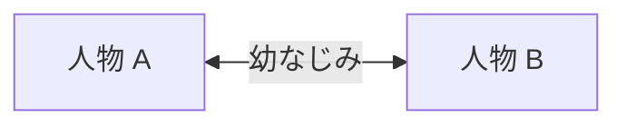

<!--
キャラクターのページの雛形です。works/<slug>/characters.md にコピーして書き換えます。
作品名、地域、人物はすべて架空の見本です。文と表の行に sources.yml の id を付けます。
どういう人物かを説明し、物語の展開や結末は追いません。
-->

# 架空の作品のキャラクター

[← anime-guide のトップ](../../README.md) · [参照ページ](references.md)

> [!IMPORTANT]
> **このページは AI (Claude) がまとめました。** 資料集め、文章、図を AI が作り、人は公開前に全体を確認しました。記述を一つずつ原典と照らしたものではないので、誤りがあれば [Issue か Pull Request](../../README.md#誤りを指摘する) で教えてください。

> [!WARNING]
> **このページは設定のネタバレを含みます。** あらすじ、物語の展開、結末は書きません。

主な人物は、人物 A と人物 B の 2 人です。[src-001]

## 人物 A

地域 A の役所で通行証を発行する職員です。[src-002] 規則を細かく確認する性格です。[src-001]

## 人物 B

地域 B に住む見本機関の技術者です。[src-002] 人物 A の幼なじみです。[src-001]

## 人物の関係

<!-- 図を置く場所: Mermaid で書きます。画像にするなら works/<slug>/figures/ に置きます。 -->

図 1: 人物 A と人物 B は幼なじみです。[src-001]

## 人物の一覧

| 人物 | 住んでいる地域 | 出典 |
| --- | --- | --- |
| 人物 A | 地域 A | [src-002] |
| 人物 B | 地域 B | [src-002] |
