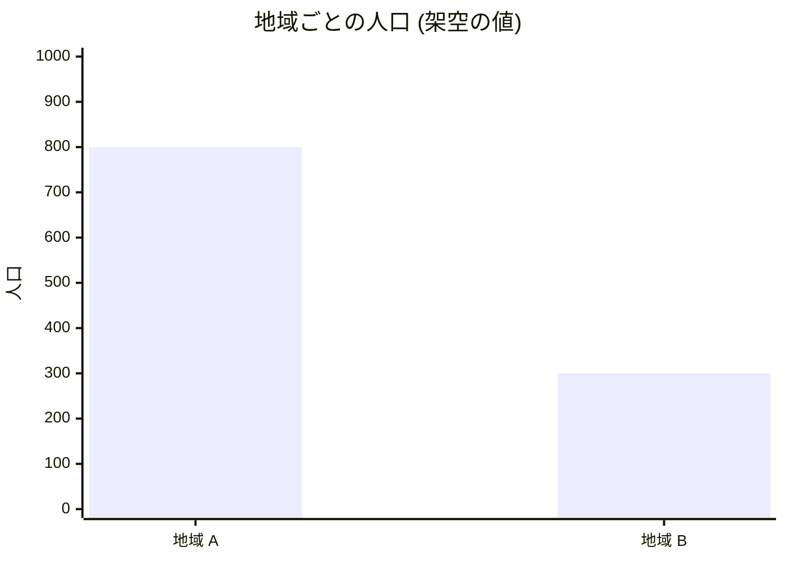

<!--
世界観のページの雛形です。works/<slug>/world.md にコピーして書き換えます。
作品名、地域、数値はすべて架空の見本です。文の直後に sources.yml の id を付けます。
-->

# 架空の作品の世界観

物語の舞台は、川で隔てられた地域 A と地域 B です。[src-001]

## 地域のつながり

<!-- 図を置く場所: Mermaid で書きます。画像にするなら works/<slug>/figures/ に置きます。 -->

図 1: 地域 A と地域 B を結ぶ橋 [src-001]

## 地域の人口

<!-- グラフを置く場所: 数値にも出典の id を付けます。 -->

図 2: 地域 A の人口は 800 人、地域 B の人口は 300 人です。[src-002]
