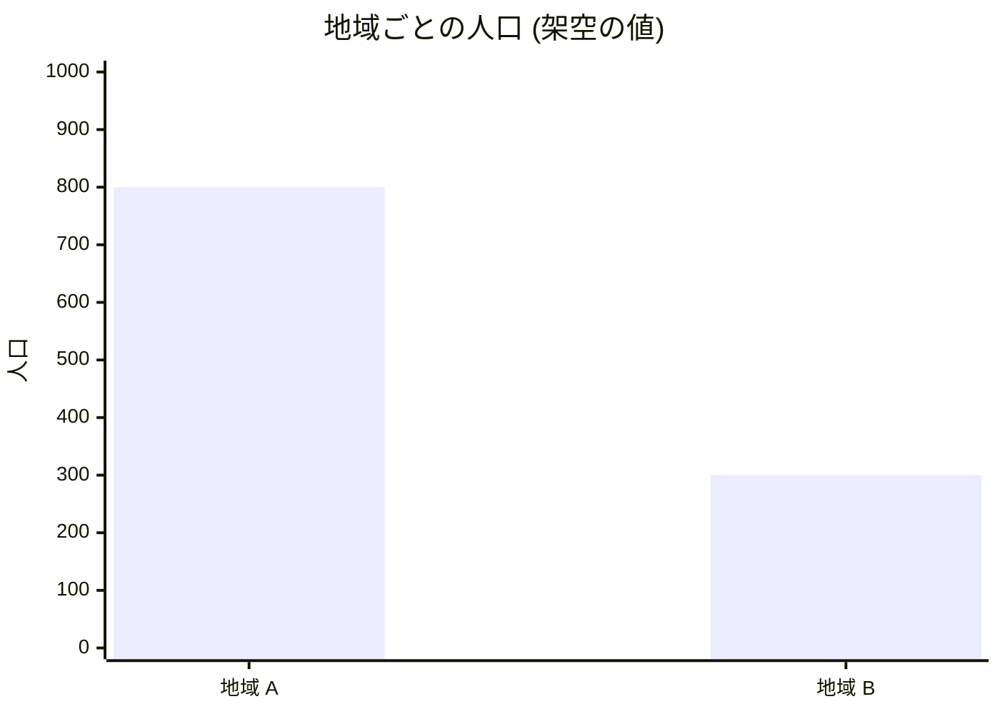

<!--
世界観のページの雛形です。works/<slug>/world.md にコピーして書き換えます。
作品名、地域、用語、数値はすべて架空の見本です。文の直後に sources.yml の id を付けます。
世界の仕組みを説明し、あらすじ、物語の展開、結末は書きません。
事実は「事実」の見出しの下に、考察は「考察」の見出しの下に分けて書きます。
-->

# 架空の作品の世界観

この世界では、川で隔てられた地域 A と地域 B の間の移動を、通行証の制度が決めています。[src-001]

## 事実: 世界の仕組み

### 地域と境界

世界は地域 A と地域 B に分かれています。[src-001] 2 つの地域を結ぶ道は、川にかかる橋の 1 本だけです。[src-001]

### 通行証の制度

橋を渡るには通行証が必要です。[src-001] 通行証は地域 A の役所だけが発行します。[src-002]

### 動力

橋の開閉には見本機関を使います。[src-002] 見本機関は川の水を燃料にします。[src-002]

## 用語

| 用語 | 意味 | 出典 |
| --- | --- | --- |
| 通行証 | 橋を渡るために必要な証明書 | [src-001] |
| 見本機関 | 川の水を燃料にする動力 | [src-002] |

## 図

<!--
図を置く場所: Mermaid で書きます。画像にするなら works/<slug>/figures/ に置きます。
図の説明の文に出典の id を付けます。
-->

### 地域のつながり

図 1: 地域 A と地域 B は橋で結ばれ、通行証は地域 A の役所が発行します。[src-001] [src-002]

### 地域の人口

図 2: 地域 A の人口は 800 人、地域 B の人口は 300 人です。[src-002]

## 考察

<!-- 考察は 1 件ごとに行頭へ【考察】を付け、根拠にした出典の id を文の直後に書きます。 -->

【考察】通行証を発行できるのが地域 A だけなので、人の移動の決定権は地域 A にあると考えられます。[src-002]

【考察】人口の差が大きいのは、橋を自由に渡れないためかもしれません。[src-001] [src-002]
