# 鋼の錬金術師 FULLMETAL ALCHEMIST の能力

国家錬金術師と錬成陣の種類を、図にまとめたページです。人物ごとの二つ名、得意な術、方法、制限、階級をカードで見比べ、陣の置き場所と術の種類を行列で引けます。基準は 2009 年版です。

**このページは設定のネタバレを含みます。** あらすじ、物語の展開、結末は書きません。

## このページの確かさ

**原作は直接読んでおらず、解説サイトを通して確かめました。複数のサイトが一致していても、写し合いの可能性があり、正しさの保証にはなりません。** 対象は 2009 年版で、原作の情報は確認の補助に使います。2003 年版の人物は載せません。

図の番号は、図の下の行の印と出典に対応します。同じ番号は同じ印と出典です。

| 印 | 図の記号 | 意味 |
| --- | --- | --- |
| `公式` | 黒丸 | 公式サイトで確かめた内容です。 |
| `複数サイト` | 黒丸 | 別々のサイト 2 つ以上に同じ内容があります。同じドメインは 1 と数え、Wikipedia は言語が違っても 1 と数えます。 |
| `1 サイトのみ` | 白丸 | 元が 1 つしか見つかっていません。特に確かめが要る内容です。 |
| `説が割れている` | 破線の枠 | 元によって内容が違います。違いをそのまま並べます。 |

定型的な解説サイトの daddyjim は補助扱いで、サイトの数に入れません。これが唯一の根拠の記述は「とする資料も」と書き、断定しません。図の下の行は出典を 3 つまで載せ、残りは「ほか」と書きます。番号ごとの出典の全件は [参照ページ](references.md) にあります。

## 国家錬金術師の図鑑

確認できたのは 9 人です。**全員がそろった保証はありません。** 全員を列挙した資料を読めなかったためです。アイザックはアニメ独自の人物です (図 1-3)。

階級の欄には、人物ごとの記述だけを載せています。制度としては、資格者は少佐に相当し、権限は大尉と同じと書かれています。軍に籍を置いて階級が高い者は、その階級が優先されます。`複数サイト` [src-040] [src-045]

二つ名は、得意な術の名前とは限りません。「鋼」は術ではなくエドワードの機械鎧に由来する、と書く記事があります。`1 サイトのみ` [src-109] 「鉄血」は兵器と兵士を表すとされます。`1 サイトのみ` [src-101]

マスタングの術は、炎を直接作るものではありません。可燃物の周りの酸素の濃度を調整し、空気中の塵を導火線にして火種を送る、と説明されます。`複数サイト` [src-109] [src-102] 左右の手で違う火力を使い分ける、とも書かれています。`複数サイト` [src-109] [src-114]

同じ「手の陣」でも動作は違います。キンブリーは両手の平を合わせますが、コマンチは手を合わせなくても発動できる、と書く記事があります。`1 サイトのみ` [src-114] [src-120]

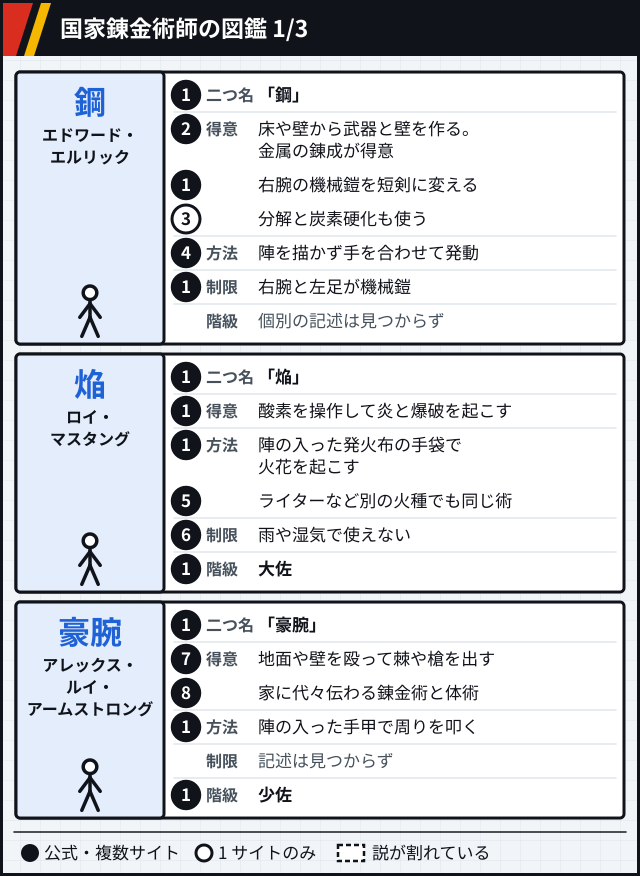

図 1-1 確かさ: ① `公式` [src-002]、② `複数サイト` [src-109] [src-103] [src-045]、③ `1 サイトのみ` [src-109]、④ `複数サイト` [src-002] [src-109] [src-102]、⑤ `複数サイト` [src-109] [src-104] [src-114]、⑥ `複数サイト` [src-109] [src-104] [src-045]、⑦ `複数サイト` [src-109] [src-045] [src-102]、⑧ `複数サイト` [src-045] [src-114] [src-105]

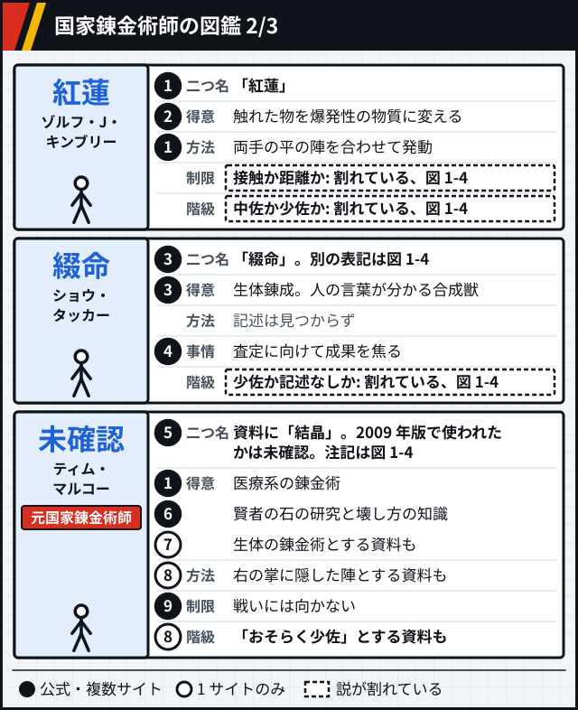

図 1-2 確かさ: ① `公式` [src-002]、② `複数サイト` [src-102] [src-109] [src-106]、③ `公式` [src-003]、④ `複数サイト` [src-003] [src-045] [src-128]、⑤ `複数サイト` [src-042] [src-116] [src-114]、⑥ `複数サイト` [src-042] [src-045] [src-114]、⑦ `1 サイトのみ` [src-114]、⑧ `1 サイトのみ` [src-121]、⑨ `複数サイト` [src-045] [src-114]

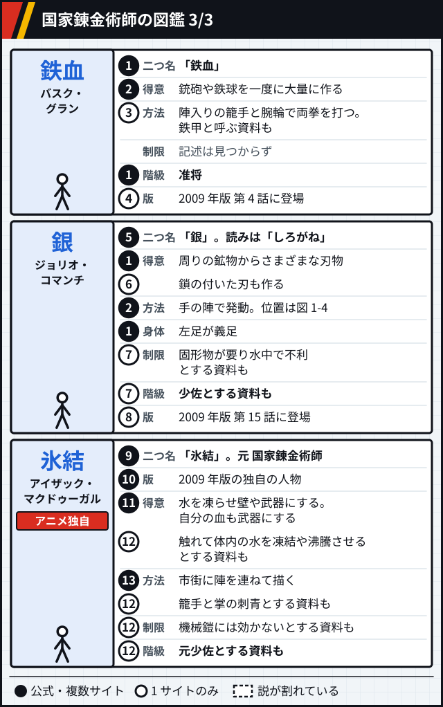

図 1-3 確かさ: ① `複数サイト` [src-101] [src-045] [src-109]、② `複数サイト` [src-101] [src-109] [src-114]、③ `1 サイトのみ` [src-109] [src-122]、④ `1 サイトのみ` [src-118]、⑤ `複数サイト` [src-101] [src-045] [src-114]、⑥ `1 サイトのみ` [src-114] [src-120]、⑦ `1 サイトのみ` [src-120]、⑧ `1 サイトのみ` [src-119]、⑨ `公式` [src-003]、⑩ `複数サイト` [src-042] [src-115] [src-113]、⑪ `複数サイト` [src-115] [src-113] [src-042]、⑫ `1 サイトのみ` [src-129]、⑬ `複数サイト` [src-115] [src-113]

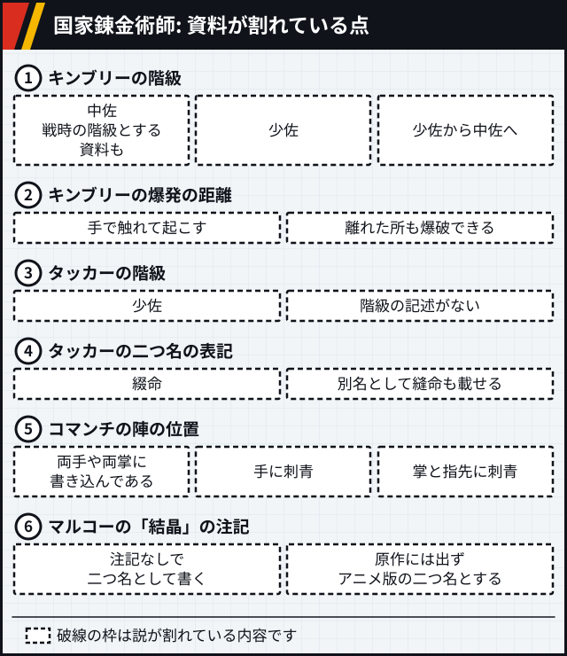

図 1-4 確かさ: ① `説が割れている` 左から [src-102]、[src-042]、[src-045] [ほか](references.md#能力-図-1-4)、② `説が割れている` 左から [src-102]、[src-114] [ほか](references.md#能力-図-1-4)、③ `説が割れている` 左から [src-042]、[src-101] [ほか](references.md#能力-図-1-4)、④ `説が割れている` 左から [src-003]、[src-128] [ほか](references.md#能力-図-1-4)、⑤ `説が割れている` 左から [src-101]、[src-114]、[src-120] [ほか](references.md#能力-図-1-4)、⑥ `説が割れている` 左から [src-042]、[src-045] [ほか](references.md#能力-図-1-4)

## 国家資格の記述がない使い手

国家資格の記述が、読んだ資料に見つからなかった人物です。資格を持たないと確かめたわけではありません。そう書く資料があるのはベルトルトだけです (図 2-3)。2009 年版に出るかを確かめられなかった人物は載せていません。

錬丹術は基礎の理論と等価交換の原則を錬金術と共有し、力の源が違います。`複数サイト` [src-040] [src-109] 大地の気の流れの入口と出口を使うので、遠隔の錬成ができると説明されます。`1 サイトのみ` [src-109] メイの術の幅としては、炭鉱一面に陣を描いて坑道を直す例や、石炭で煙幕を作る例が挙げられています。`1 サイトのみ` [src-109] `1 サイトのみ` [src-049]

アルの血印の場所は、鎧の胴の内側で、背中側の首に近い所と書かれています。`1 サイトのみ` [src-108] イズミが兄弟に教えた言葉は「一は全、全は一」です。`公式` [src-002]

スカーは一般の錬金術師を「創る者」、自分を「壊す者」と呼ぶ、と書く記事があります。`1 サイトのみ` [src-109] ホーエンハイムの力については、中の魂と対話を終えていて、魂が力を貸す形だと説明されます。`1 サイトのみ` [src-109] [src-130]

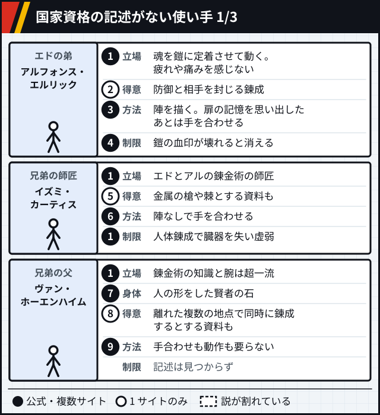

図 2-1 確かさ: ① `公式` [src-002]、② `1 サイトのみ` [src-109]、③ `複数サイト` [src-002] [src-109] [src-108]、④ `複数サイト` [src-109] [src-108] [src-071]、⑤ `1 サイトのみ` [src-125]、⑥ `複数サイト` [src-102] [src-109] [src-125]、⑦ `複数サイト` [src-048] [src-109]、⑧ `1 サイトのみ` [src-130]、⑨ `複数サイト` [src-102] [src-109] [src-130]

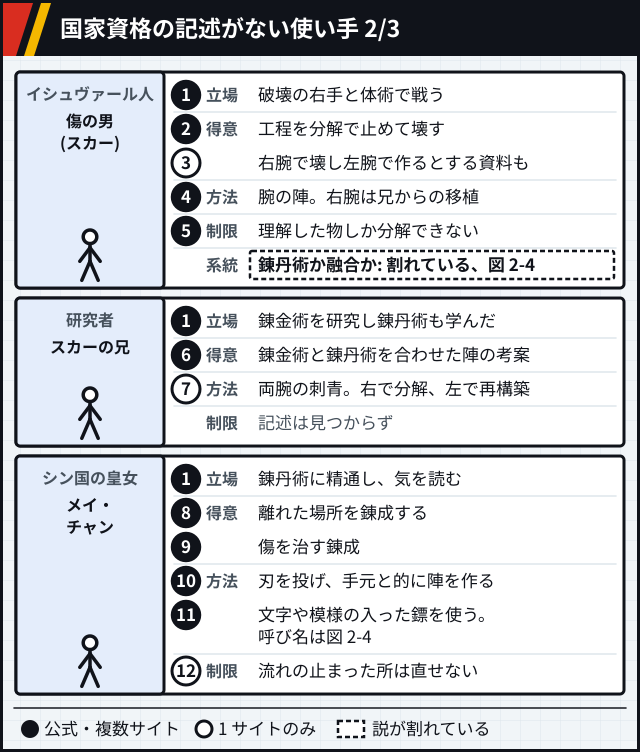

図 2-2 確かさ: ① `公式` [src-002]、② `複数サイト` [src-109] [src-102] [src-126]、③ `1 サイトのみ` [src-113] [src-126]、④ `複数サイト` [src-109] [src-042]、⑤ `複数サイト` [src-109] [src-102]、⑥ `複数サイト` [src-101] [src-113] [src-126]、⑦ `1 サイトのみ` [src-101]、⑧ `複数サイト` [src-102] [src-049] [src-042]、⑨ `複数サイト` [src-109] [src-113] [src-124]、⑩ `複数サイト` [src-042] [src-109]、⑪ `複数サイト` [src-002] [src-102]、⑫ `1 サイトのみ` [src-109]

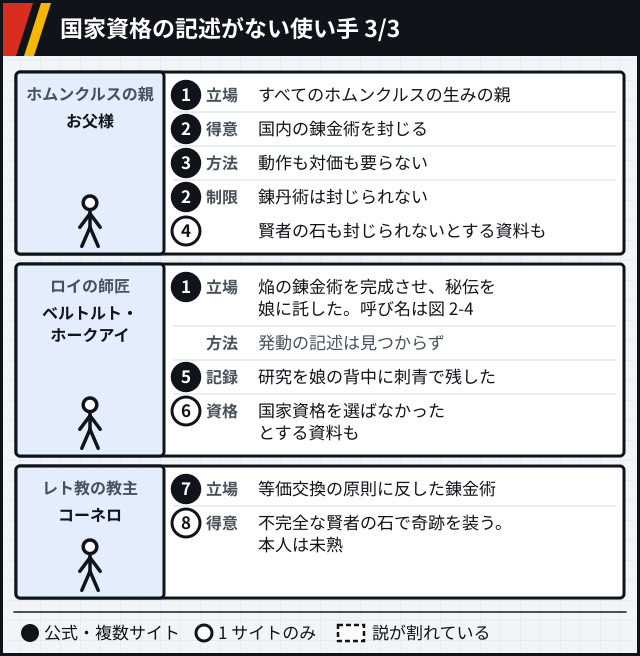

図 2-3 確かさ: ① `公式` [src-002]、② `複数サイト` [src-102] [src-113]、③ `複数サイト` [src-102] [src-109]、④ `1 サイトのみ` [src-102]、⑤ `複数サイト` [src-112] [src-111] [src-109]、⑥ `1 サイトのみ` [src-123]、⑦ `公式` [src-003]、⑧ `1 サイトのみ` [src-101]

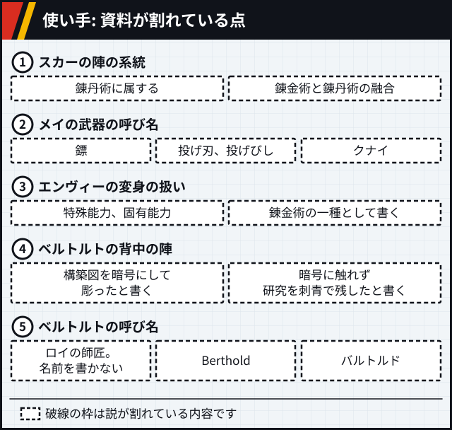

図 2-4 確かさ: ① `説が割れている` 左から [src-102]、[src-101] [ほか](references.md#能力-図-2-4)、② `説が割れている` 左から [src-002]、[src-042]、[src-124] [ほか](references.md#能力-図-2-4)、③ `説が割れている` 左から [src-002]、[src-113] [ほか](references.md#能力-図-2-4)、④ `説が割れている` 左から [src-110]、[src-112] [ほか](references.md#能力-図-2-4)、⑤ `説が割れている` 左から [src-002]、[src-071]、[src-123]

## 錬成の方法の比較

陣をどこに用意するかで 5 段階に分けました。段は固定ではなく、同じ人物が 2 つの段に載ることがあります。

手を合わせる錬成では、術者自身が構築式の役を兼ね、両手で円を作ると説明されます。`1 サイトのみ` [src-109] 真理の扉については[世界観のページ](world.md#真理の扉)にあります。

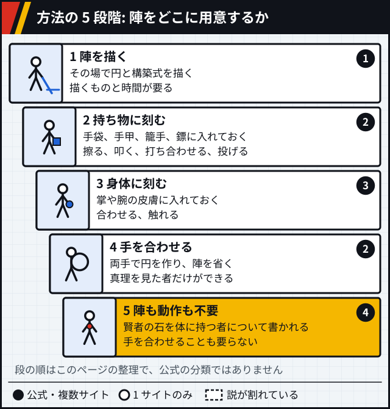

図 3-1 確かさ: ① `複数サイト` [src-040] [src-109] [src-108]、② `複数サイト` [src-002] [src-109] [src-102]、③ `複数サイト` [src-002] [src-109] [src-042]、④ `複数サイト` [src-102] [src-109] [src-130]

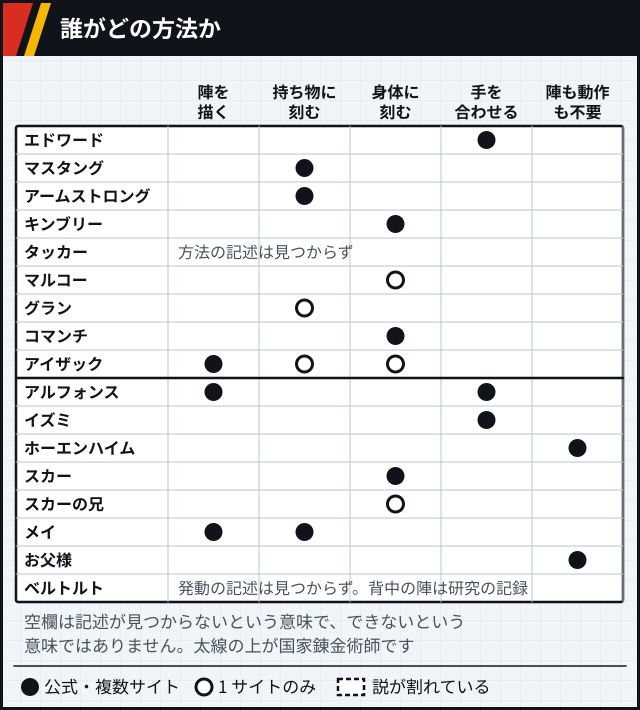

図 3-2 確かさ: 各セルの印と出典は図 1-1〜1-3 と図 2-1〜2-3のカードの「方法」と同じです。

## 錬成陣の種類

作中の図案は再現していません。形の特徴は言葉で書き、人の記号には陣の置き場所だけを示します。逆転の錬成陣は仕組みだけを書きます。国土錬成陣の形の説明が割れている点は、[世界観のページ](world.md#国土錬成陣) にあります。

陣は絵や文字を組み合わせ、同じ効果の術でも考案した術者によって形が違う、と説明されます。`1 サイトのみ` [src-109] 描く先は手袋、皮膚のほか血やチョークもあり、陣の大きさが違っても結果は似るが理由は説明されない、と書く記事があります。`1 サイトのみ` [src-117]

部品には意味を読む記事があります。マスタングの動物は、中世のヨーロッパで火と結び付けられた火蜥蜴と読まれます。`1 サイトのみ` [src-071] キンブリーの太陽と月は金と銀を表すと読まれ、作中のエドワードは陰と陽に基づく術と推測します。`1 サイトのみ` [src-071] [src-127] `複数サイト` [src-102] [src-109] 人体錬成の陣では、太陽を飲み込む獅子が賢者の石を、中央の竜が雌雄同体を表すと書かれています。`1 サイトのみ` [src-109]

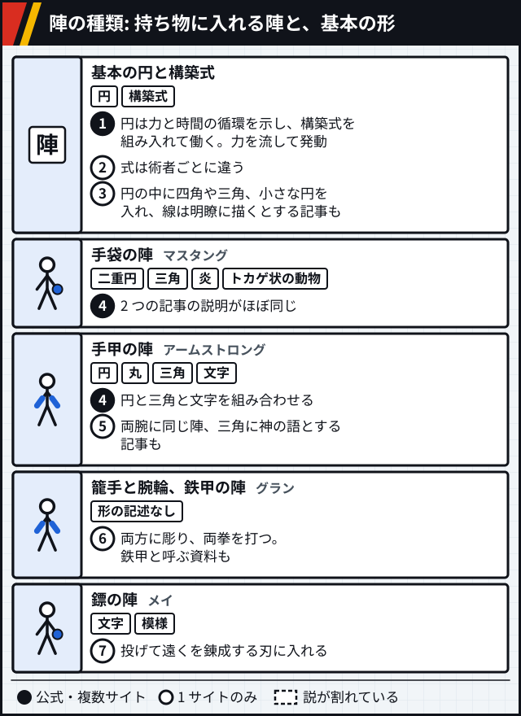

図 4-1 確かさ: ① `複数サイト` [src-040] [src-109]、② `1 サイトのみ` [src-109]、③ `1 サイトのみ` [src-117]、④ `複数サイト` [src-109] [src-071]、⑤ `1 サイトのみ` [src-071]、⑥ `1 サイトのみ` [src-109] [src-122]、⑦ `1 サイトのみ` [src-102]

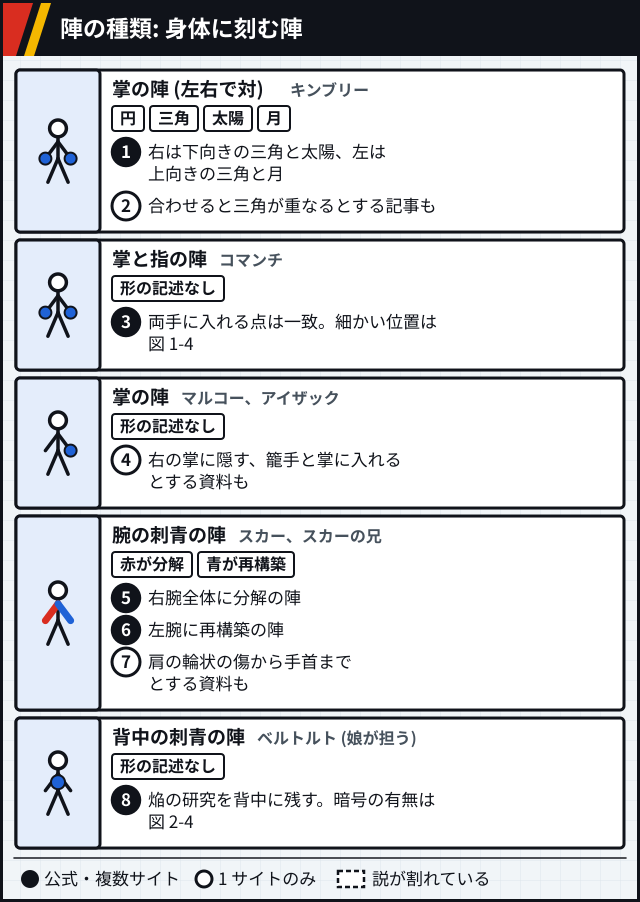

図 4-2 確かさ: ① `複数サイト` [src-102] [src-109]、② `1 サイトのみ` [src-071] [src-127]、③ `複数サイト` [src-101] [src-109] [src-114]、④ `1 サイトのみ` [src-121] [src-129]、⑤ `複数サイト` [src-109] [src-102] [src-101]、⑥ `複数サイト` [src-101] [src-113] [src-126]、⑦ `1 サイトのみ` [src-126]、⑧ `複数サイト` [src-112] [src-111] [src-109]

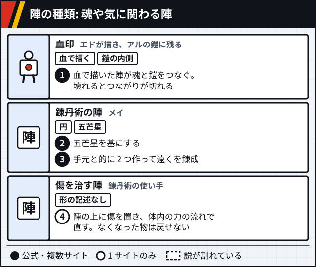

図 4-3 確かさ: ① `複数サイト` [src-109] [src-071] [src-108]、② `複数サイト` [src-109] [src-071]、③ `複数サイト` [src-042] [src-109]、④ `1 サイトのみ` [src-109]

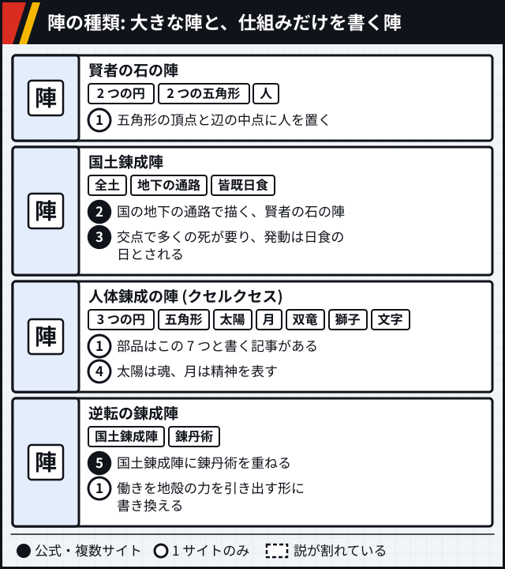

図 4-4 確かさ: ① `1 サイトのみ` [src-109]、② `複数サイト` [src-109] [src-056] [src-072]、③ `複数サイト` [src-109] [src-042]、④ `1 サイトのみ` [src-071]、⑤ `複数サイト` [src-109] [src-071]

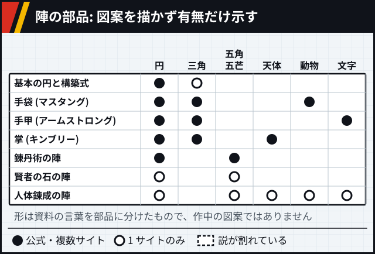

図 4-5 確かさ: 各セルの印と出典は図 4-1〜4-3 と図 4-4 の同じ陣と同じです。

## 術の分類

**この分類はこのページが作ったものです。** 物質別や手法別の公式の分類は見つかりませんでした。資料の呼び方もそろっていません。英語の記事は爆発の錬金術、戦闘の錬金術、生体の錬金術のような見出しを使います。`1 サイトのみ` [src-114]

エドワードの分解と炭素硬化は、相手の術を見て取り入れたものと書かれています。`1 サイトのみ` [src-109] グリードはホムンクルスで、錬金術師として載せたのではなく、炭素の列の比較のために入れました。全身を硬くする能力は「最強の盾」と呼ばれます。`公式` [src-002] 賢者の石そのものは列に入れていません。扱いは[世界観のページ](world.md#賢者の石)にあります。

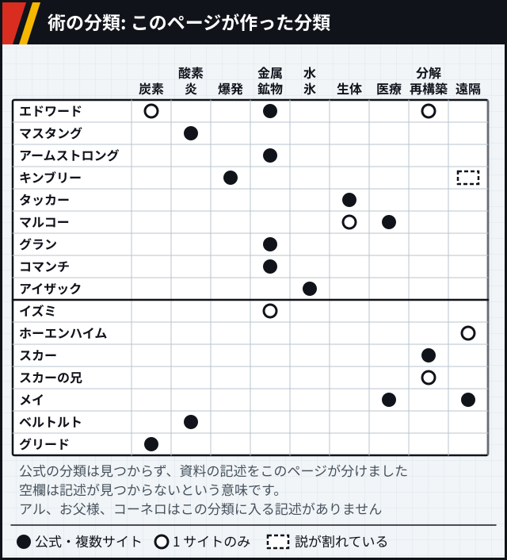

図 5-1 確かさ: ① グリードの炭素 `公式` [src-002]。ほかのセルの印と出典は図 1-1〜1-3 と図 2-1〜2-3のカードの「得意」「方法」「立場」と同じです。

## 印の数

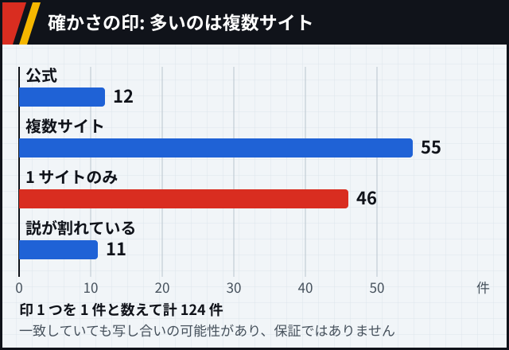

図 6-1: 印 1 つを 1 件と数えています。同じ番号で 1 つにまとめた記述は 1 件です。
