# 鋼の錬金術師のホムンクルスと七つの大罪

[← anime-guide のトップ](../../README.md) · [参照ページ](references.md)

> [!IMPORTANT]
> **このページは AI (Claude) がまとめました。** 資料集め、文章、図を AI が作り、人は公開前に全体を確認しました。記述を一つずつ原典と照らしたものではないので、誤りがあれば [Issue か Pull Request](../../README.md#誤りを指摘する) で教えてください。

> [!WARNING]
> **このページは設定のネタバレを含みます。** ホムンクルスの正体と能力を伏せずに書きます。あらすじ、物語の展開、結末は書きません。

2009 年版のホムンクルスは七つの大罪の名を持つ 7 人で、お父様が自分から切り離した存在とされます。七つの大罪は 4 世紀の八つの想念から形を変えてきた一覧で、ホムンクルスは錬金術の伝承に出てくる人造の小人です。別々の歴史を持つ 2 つが、この作品で 1 つになっています。`複数サイト` [src-102] [src-203] [src-213]

## このページの確かさ

> [!CAUTION]
> **原作は直接読んでおらず、解説サイトや論考を通して確かめました。複数のサイトが一致していても、写し合っている可能性があり、正しいという保証にはなりません。** 基準は 2009 年版です。

| 印 | 意味 |
| --- | --- |
| `公式` | 2009 年版の公式サイトで確かめた内容です。歴史の項では教会の文書を指します。 |
| `複数サイト` | 同じ内容を書いていた別のサイトが 2 つ以上あります。 |
| `1 サイトのみ` | 元が 1 つしか見つかっていません。特に確かめが要る内容です。 |
| `説が割れている` | 元によって内容が違います。違いをそのまま並べます。 |

図の下の行に載せる出典は 3 つまでで、残りは「ほか」とします。図ごとの出典の全件は [参照ページ](references.md) にあります。

## 七つの大罪の歴史

### 年表

聖書に七つの大罪の一覧はなく、4 世紀の修道士が数えた八つの想念が起源とされます。ただし、テルトゥリアヌスに遡るとし、エウァグリオスは九を八に減らしたとする事典もあります。`説が割れている` [src-203] [src-201]

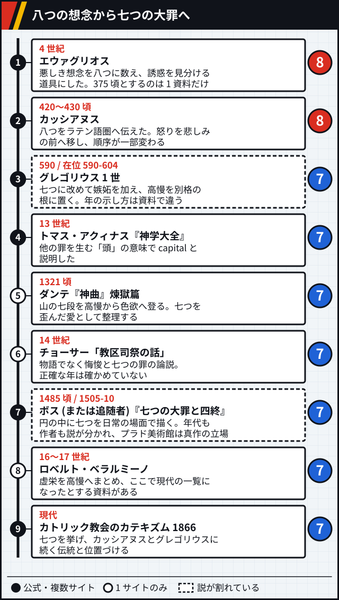

図 1-1 確かさ: ①②④ `複数サイト`、③⑦⑩ `説が割れている`、⑤⑥⑧ `1 サイトのみ`、⑨ `公式` (教会の文書)。[src-201] [src-203] [src-212] [ほか](references.md#七つの大罪-図-1-1)。右端の数字は一覧の数です。

グレゴリウスは高慢を罪の女王と呼び、そこから七つの主要な悪徳が生まれると書きました。トマスはこの見方を受け継ぎ、capital を頭 (caput) から来た語と説明します。トマスの説明では、capital は重い罪というより他の罪を生み出す源という意味です。`複数サイト` [src-206] [src-204] [src-207]

ダンテは七つを愛の乱れとして整理しました。高慢、嫉妬、憤怒は歪んだ愛、怠惰は足りない愛、強欲、暴食、色欲は度を越した愛です。`1 サイトのみ` [src-210]

### 名前の変遷

変わったのは数だけではありません。行列はグレゴリウスとトマスの本文の列挙に従い、事典の説明が本文とずれる箇所は破線の枠に並べました。

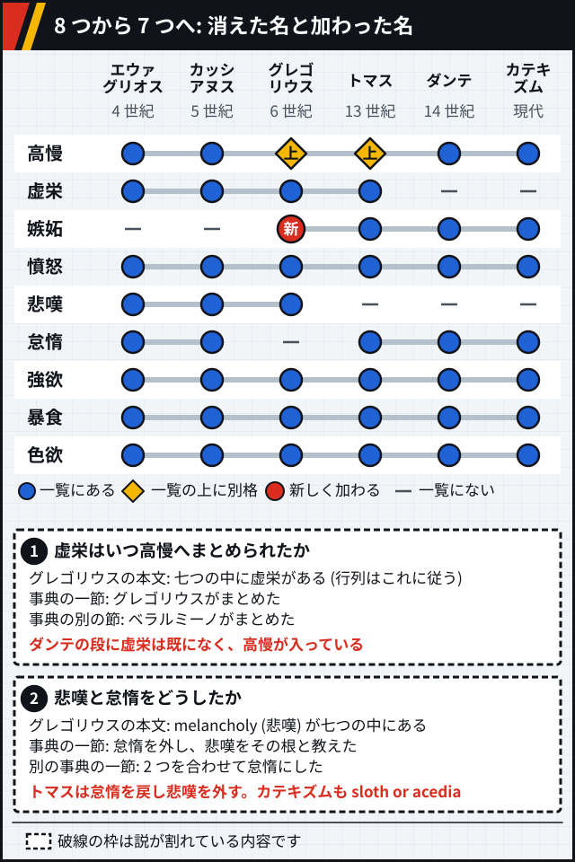

図 1-2 確かさ: ①② `説が割れている`。行列の元は本文の列挙です。[src-206] [src-204] [src-201] [ほか](references.md#七つの大罪-図-1-2)。

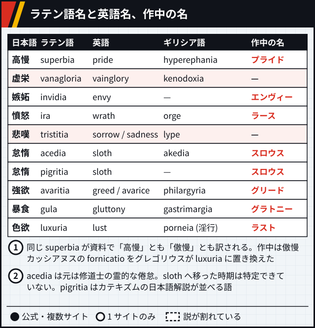

図 1-3 確かさ: 表は `複数サイト`、①② `1 サイトのみ`。[src-201] [src-203] [src-102] [ほか](references.md#七つの大罪-図-1-3)。

acedia は元は修道士の無関心や倦怠を指す語で、のちに sloth に畳み込まれました。怠惰という訳語から思い浮かぶ「なまける」とは、出発点が少し違います。`複数サイト` [src-209] [src-201]

【見立て】ダンテの段は既に現代の 7 つと同じ顔ぶれなので、ベラルミーノで現代の一覧になったとする説明とは時期が合いません。どちらが正しいかは確かめていません。`説が割れている` [src-210] [src-201]

## 作中の 7 人

### 罪と能力

公式サイトのキャラ紹介で罪の名が書かれているのは 6 人で、傲慢の項はありません。`公式` [src-002]

罪の名と性格を紹介文がはっきり結ぶのはグリードとスロウスで、どちらも「名前のとおり」と書かれています。グラトニーは食欲の描写で結ばれます。ラストは容姿の描写にとどまり、エンヴィーとラースには罪との結びつきの説明がありません。`公式` [src-002]

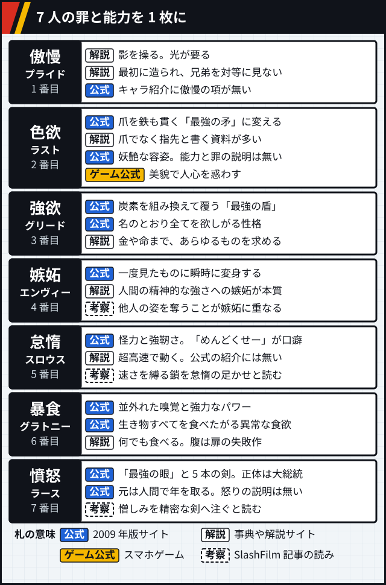

図 2-1 確かさ: 札の `公式` は 2009 年版のサイトです。解説は `複数サイト` と `1 サイトのみ` が混ざります。ゲーム公式は『鋼の錬金術師 MOBILE』の情報で、2009 年版の公式ではありません。[src-002] [src-102] [src-218] [ほか](references.md#七つの大罪-図-2-1)。

### お父様との関係

公式は生みの親とだけ書きます。何を切り離したかの言葉は資料で揺れます。`説が割れている` [src-002] [src-102] [src-078]

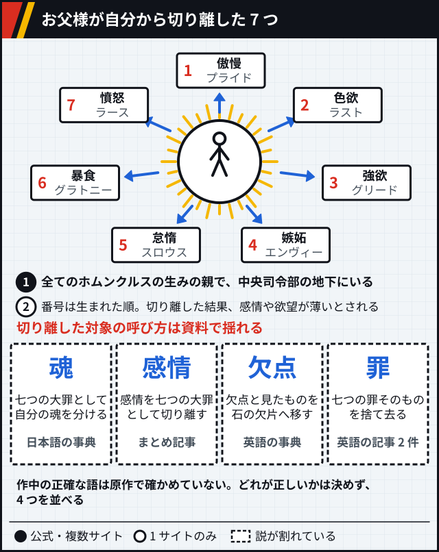

図 2-2 確かさ: ① `公式`、② `1 サイトのみ`、呼び方 `説が割れている` 左から [src-102]、[src-078]、[src-042] [ほか](references.md#七つの大罪-図-2-2)。

### こういう意見もある

- 【考察】SlashFilm の記事は、エンヴィーの変身を他人のものを奪う嫉妬の形と読みます。ラースは怒りを爆発させず、憎しみを戦いの精密さへ向けるとみます。[src-220]
- 【考察】同じ記事は、スロウスの手首の鎖が速さを縛ることを怠惰の足かせと読み、プライドの子供の姿に尊大さの幼さをみます。[src-220]
- 【考察】tatara-pt の記事は、スロウスを名前に反して最速と書きます。怠惰の名と最速の能力が逆になっている、という見方です。[src-219]
- 【考察】CBR の記事は、お父様が計画に集中するために自分の罪を捨てた、と説明します。[src-221]

## 現実のホムンクルス伝承

人造の小人の話は作品よりずっと古く、語が固まる前の例まで遡って語られます。語り方は資料で違います。

錬金術の中で人工生命を造る話があり、文学にも題材として入っていきました。ゲーテの小人は肉体を求めて瓶の中で光り、肉体を脱したい主人公と対になります。`複数サイト` [src-213] [src-216]

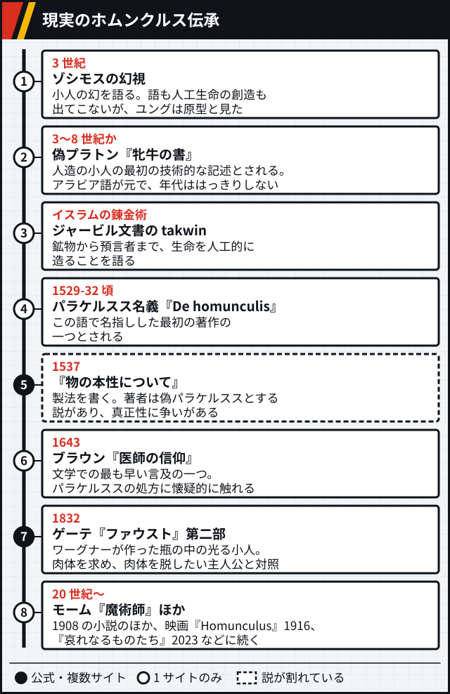

図 3-1 確かさ: ①②③④⑥⑧ `1 サイトのみ`、⑤ `説が割れている`、⑦ `複数サイト`。[src-213] [src-016] [src-216] [ほか](references.md#七つの大罪-図-3-1)。

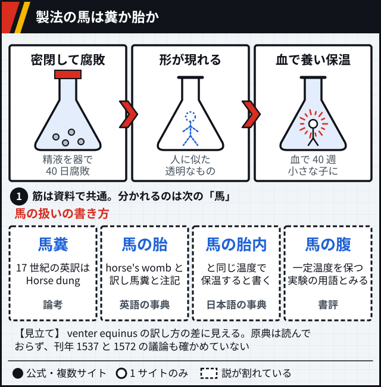

図 3-2 確かさ: ① `複数サイト`、馬の書き方 `説が割れている` 左から [src-016]、[src-213]、[src-214] [ほか](references.md#七つの大罪-図-3-2)。

お父様も「フラスコの中の小人」と呼ばれ、現実の錬金術のホムンクルスのように瓶の中でしか生きられなかったと説明されます。`1 サイトのみ` [src-102]

## 他の作品での七つの大罪

**ここに載せるのは資料で確認できた範囲です。公式に確かめたものではなく、網羅でもありません。** 読めたページで七つの大罪との関係を確かめられなかった作品は載せていません。

数えると、使い方では敵の組織・敵役が 14 件、キャラの称号・役割が 12 件で、この 2 つで半分を超えます。媒体ではゲームの 14 件、年代では 2010 年代の 19 件がいちばん多く、ただしこの数は資料の偏りを含みます。

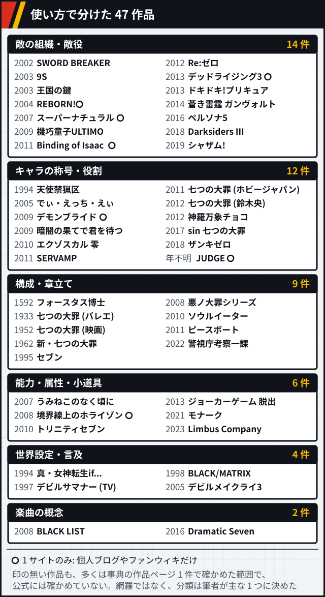

図 4-1 確かさ: 白丸は個人ブログやファンウィキだけが根拠の作品。印の無い作品も多くは事典の 1 ページで確かめた範囲です。[src-222] [src-226] [src-223] [ほか](references.md#七つの大罪-図-4-1)。分類は筆者によります。

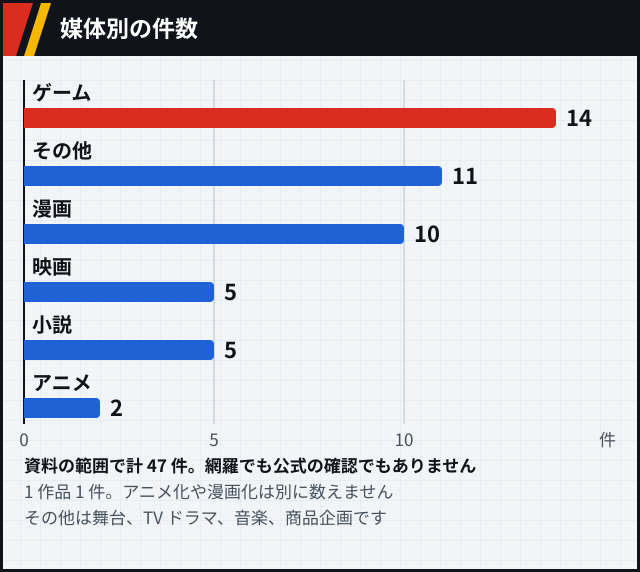

図 4-2: 図 4-1 と同じ資料から数えました。

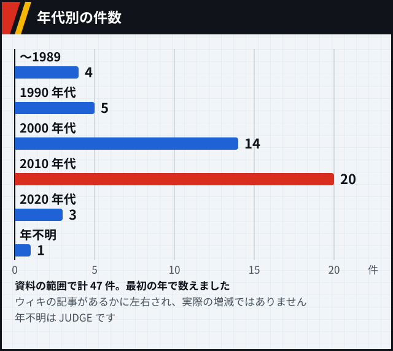

図 4-3: 図 4-1 と同じ資料から数えました。

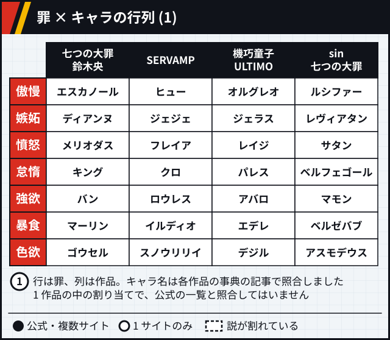

図 4-4 確かさ: ① 各作品 `1 サイトのみ`。[src-223] [src-233] [src-234] [ほか](references.md#七つの大罪-図-4-4)。

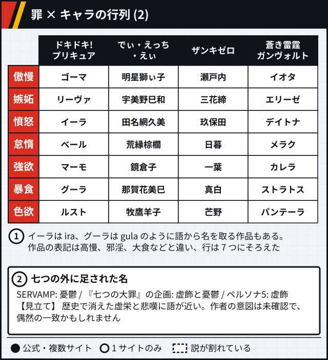

図 4-5 確かさ: ① 各作品 `1 サイトのみ`、② 各作品 `1 サイトのみ` と筆者の見立て。[src-255] [src-233] [src-225] [ほか](references.md#七つの大罪-図-4-5)。

七つをそのまま使わない作品もあります。『Re:ゼロ』の大罪司教は嫉妬を除く 6 つの名を持ち、『真・女神転生if...』の魔界には色欲界がありません。`1 サイトのみ` [src-228] [src-241] 『BLACK/MATRIX』は善悪が逆転した世界で、平等や自由などを七つの大罪と呼びます。`1 サイトのみ` [src-236]

## ホムンクルスと七つの大罪の組み合わせ

**「ホムンクルス × 七つの大罪」の組み合わせは、鋼の錬金術師以外で確認できませんでした。** ただし読めなかった資料があり、「他に無い」とは言えません。作者が七つの大罪を選んだ理由の発言も見つかっていません。

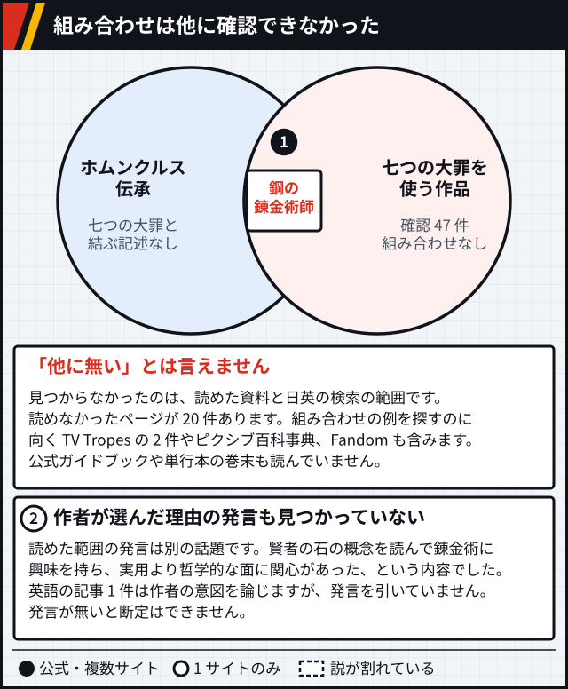

図 5-1 確かさ: ① 作中の罪の名は `公式`、② `1 サイトのみ`。「確認できない」は読めた範囲の話です。[src-213] [src-214] [src-009] [ほか](references.md#七つの大罪-図-5-1)。
