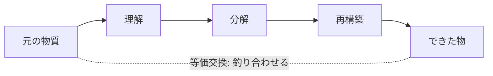
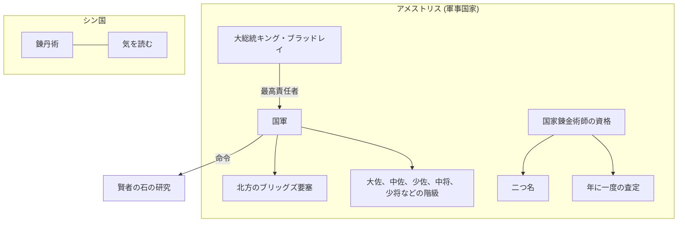
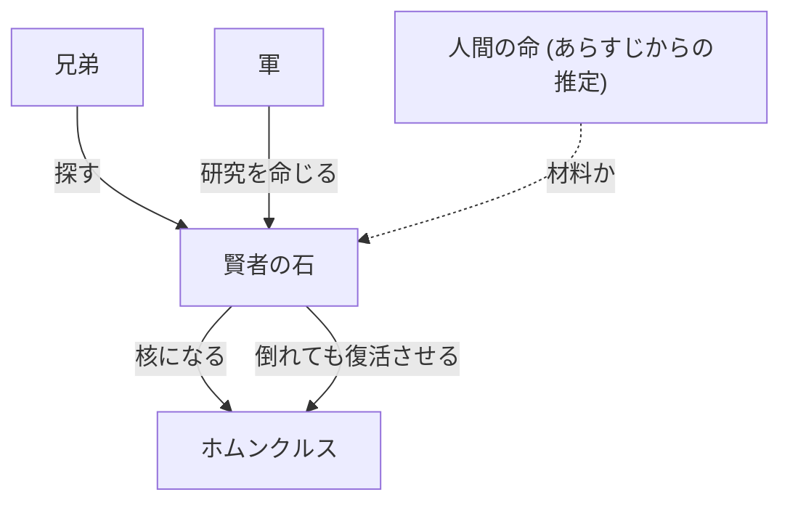
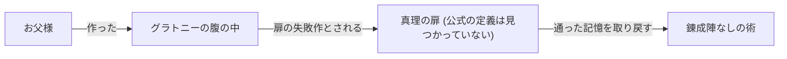

# 鋼の錬金術師 FULLMETAL ALCHEMIST の世界観

この世界では、物質を理解し、分解し、再構築する錬金術が、もっとも進んだ科学として扱われています。[src-001] 原則は等価交換で、最大の禁忌は人体錬成です。[src-001]

このページは設定のネタバレを含みます。世界の仕組みを説明するページなので、あらすじ、物語の展開、結末は書きません。

## このページの読み方

各項目の「区分」は、記述の確かさを示します。「公式の説明」は、公式サイトの文と、作者本人が語った記事で確かめた内容です。「通説」は、事典の説明です。推定には【推測】、筆者の解釈には【考察】の印を付け、「考察」の節に分けて書きます。

公式サイトで筆者が確かめたのは、作品紹介、キャラクター、話数あらすじの一部です。[src-001] [src-002] [src-003] [src-004] [src-005] [src-006] [src-007] 用語集や世界観の解説のページは見つけられませんでした。[src-001] [src-002] このページで「見つかっていない」と書くのは、確かめたこの範囲で見つかっていないという意味です。設定を原作の該当話と照合することは、していません。

## 事実: 世界の仕組み

### 対象の版

区分: 通説

対象は 2009 年版です。[src-009] 2009 年版は原作に沿った映像化で、2003 年版は大半が独自の物語だと説明されています。[src-009] 2 つの版の設定が混ざらないように、2003 年版の内容は書きません。

### 錬金術の原理

区分: 公式の説明

錬金術は、物質を理解し、分解し、再構築する技です。[src-001] 作中では、もっとも進んだ科学と位置づけられています。[src-001] 3 つの段階の順序は図 1 に示します。[src-001]

原則は等価交換で、差し出すものと得るものを釣り合わせるという考え方です。[src-001] 現実の法則や農業との関係については、[コラム](column.md)に分けて書きます。[src-001]

### 手を合わせる動作

区分: 公式の説明

作中には、手を合わせて行う錬成の動作があります。[src-029] 作者はこの動作について、円で循環させるという前提から一番自然な形として考えたと語っています。[src-029] 元は「いただきます」かもしれない、とも述べています。[src-029]

### 人体錬成の禁忌

区分: 公式の説明

人体錬成は、錬金術で最大の禁忌とされています。[src-001] [src-003] 主人公の兄弟は、亡くなった母を想ってこの禁忌を犯しました。[src-001] [src-003]

### 賢者の石

区分: 公式の説明

公式の文で確かめられる賢者の石の扱いは、次の 3 つです。[src-001] [src-002] [src-003] [src-004]

- 兄弟が、失ったものを取り戻すために探している対象です。[src-001] [src-002] [src-003] [src-004]
- 軍の命令で行われる研究の題材でもあります。[src-001] [src-002] [src-003] [src-004]
- ホムンクルスの核としても扱われ、石の力で、倒れたホムンクルスが復活します。[src-001] [src-002] [src-003] [src-004]

公式サイトの紹介文に、材料の直接の説明はありません。[src-001] [src-002] [src-003] [src-004] 材料を定義した公式の文も見つかっていません。[src-007] あらすじからの推定は「考察」の節に書きます。[src-007]

### 錬丹術

区分: 公式の説明

錬丹術はシン国の錬金術で、人物紹介ではメイが精通しているとされます。[src-002] [src-006] [src-008] シン国の人物は「気」を読めます。[src-002] [src-006] [src-008] 英語版の公式サイトでの呼び名は Alkahestry です。[src-008] 公式あらすじの第 31 話には、錬丹術が地上でも力を発揮できたという書き方があります。[src-006]

公式サイトで確かめられる違いはここまでです。[src-002] [src-006] [src-008] アメストリスの錬金術と原理がどう違うかの説明は見つかっていません。[src-002] [src-006] [src-008]

| 項目 | アメストリスの錬金術 | 錬丹術 |
| --- | --- | --- |
| 確かめられる位置づけ | もっとも進んだ科学 [src-001] | シン国の錬金術 [src-002] [src-006] [src-008] |
| 確かめられる特徴 | 理解、分解、再構築と等価交換 [src-001] | シン国の人物は「気」を読める [src-002] [src-006] [src-008] |
| 原理の差 | 見つかっていない [src-002] [src-006] [src-008] | 見つかっていない [src-002] [src-006] [src-008] |

### アメストリスの国家と軍

区分: 公式の説明

アメストリスは、公式の紹介文で軍事国家と書かれている国です。[src-001] [src-002] 国軍の最高責任者は大総統キング・ブラッドレイで、若いうちに政権を握った人物です。[src-001] [src-002] 公式の人物紹介には、大佐、中佐、少佐、中将、少将といった階級が出てきます。[src-001] [src-002] 北方にはブリッグズ要塞があり、少将オリヴィエが守っています。[src-001] [src-002]

### 国家錬金術師

区分: 公式の説明

国家錬金術師は国家資格で、年に一度の査定があります。[src-002] [src-003] 資格を持つ人物には、「鋼」「焔」「豪腕」「紅蓮」のような二つ名があります。[src-002] [src-003] エドワード・エルリックは、史上最年少の 12 歳で取得しました。[src-002] [src-003]

### 機械鎧

区分: 公式の説明

機械鎧は義肢で、エドワードの右腕と左足がこれにあたります。[src-002] [src-008] 整備するのはウィンリィで、その技術を教えたのが祖母のピナコです。[src-002] [src-008]

寒冷地向けに改造した戦闘用の機械鎧があり、公式の紹介ではバッカニアがその例です。[src-002] [src-008] エドワードの右腕も、戦闘で刃に変わります。[src-002] [src-008]

### 真理の扉

区分: 公式の説明

真理の扉には、公式の定義が見つかっていません。[src-002] [src-005] [src-007] 話の中で触れられるだけです。[src-002] [src-005] [src-007] 公式の文から分かるのは、次の 2 点です。[src-002] [src-005] [src-007]

- アルフォンスは扉を通った記憶を取り戻し、錬成陣なしで術を使えるようになります。[src-002] [src-005] [src-007]
- グラトニーの腹の中は、お父様が作った扉の失敗作とされています。[src-002] [src-005] [src-007]

### 公式の文で確かめられる範囲

区分: 公式の説明

次の表は、公式の文で確かめられることと、見つかっていないことを分けたものです。[src-001] [src-002] [src-005] [src-006] [src-007] [src-008] 人に説明するときは、見つかっていないことの列の内容を公式の設定として話さないでください。[src-001] [src-002] [src-005] [src-006] [src-007] [src-008]

| 仕組み | 公式の文で確かめられること | 公式の文で見つかっていないこと | 出典 |
| --- | --- | --- | --- |
| 賢者の石 | 探す対象、軍の研究の題材、ホムンクルスの核 | 材料の定義 | [src-001] [src-002] [src-007] |
| 錬丹術 | シン国の錬金術、「気」を読むこと | 錬金術との原理の差 | [src-002] [src-006] [src-008] |
| 真理の扉 | 話の中で触れられる個別の例 | 扉そのものの定義 | [src-002] [src-005] [src-007] |

## 用語

| 用語 | 意味 | 区分 | 出典 |
| --- | --- | --- | --- |
| 錬金術 | 物質を理解、分解、再構築する技 | 公式の説明 | [src-001] |
| 等価交換 | 錬金術の原則。差し出すものと得るものを釣り合わせる | 公式の説明 | [src-001] |
| 人体錬成 | 錬金術で最大の禁忌とされる術 | 公式の説明 | [src-001] [src-003] |
| 賢者の石 | 兄弟が探す対象で、ホムンクルスの核。材料の公式の定義は見つかっていない | 公式の説明 | [src-001] [src-002] [src-007] |
| 錬丹術 | シン国の錬金術 | 公式の説明 | [src-002] [src-006] [src-008] |
| 国家錬金術師 | 年に一度の査定がある国家資格 | 公式の説明 | [src-002] [src-003] |
| 機械鎧 | 義肢。戦闘用に改造したものもある | 公式の説明 | [src-002] [src-008] |
| 真理の扉 | 話の中で触れられるもの。公式の定義は見つかっていない | 公式の説明 | [src-002] [src-005] [src-007] |

## 図

### 錬金術の 3 段階と等価交換

図 1: 錬金術は物質を理解、分解、再構築する技で、差し出す側とできた側は等価交換の原則で結ばれます。[src-001]

### 国家と制度の関係

図 2: アメストリスの国軍と国家資格、シン国の錬丹術を並べた図です。[src-001] [src-002] [src-003] [src-004] [src-006] [src-008] 線で結んだのは公式の文で確かめられる関係だけです。[src-001] [src-002] [src-003] [src-004] [src-006] [src-008]

### 賢者の石の扱われ方

図 3: 実線は公式の文で確かめられる扱いです。[src-001] [src-002] [src-003] [src-004] 点線は、公式の定義が見つからず、あらすじから推定した材料です。[src-007]

### 真理の扉について公式の文から分かること

図 4: 公式の文に出てくる 2 つの例を並べた図です。[src-002] [src-005] [src-007] 扉の定義を示すものではありません。[src-002] [src-005] [src-007]

## 考察

【推測】賢者の石の材料は、人間の命だと推定できます。[src-007] 公式文での定義は見つかっておらず、公式あらすじ第 43 話に人を石に変えた旨の記述があることからの推定です。[src-007]

【考察】賢者の石は、兄弟の目標、軍の研究の題材、ホムンクルスの核という 3 つの扱いを受けています。[src-001] [src-002] [src-003] [src-004] 立場の違う者が同じものに関わるので、石はこの世界で利害の重なる対象だと読めます。[src-001] [src-002] [src-003] [src-004]

【考察】もっとも進んだ科学である錬金術が国家資格になり、賢者の石の研究を軍が命じています。[src-001] [src-002] [src-003] [src-004] このことから、国が錬金術に深く関わっていると読めます。[src-001] [src-002] [src-003] [src-004]

【考察】国家錬金術師には年に一度の査定があるので、資格は取って終わりにならず、続けて評価を受けるものだと考えられます。[src-002] [src-003]

【考察】錬丹術が地上でも力を発揮できたという書き方からは、術の働きが場所の条件に左右される場面があると読めます。[src-006] 公式の文に原理の説明は見つかっていないので、これは言葉からの読み取りです。[src-006]

【考察】機械鎧に寒冷地向けの改造があるので、義肢の技術は使う土地の環境に合わせて作り変えられるものだと読めます。[src-002] [src-008]

【考察】扉を通った記憶によって錬成陣が要らなくなる例があるので、真理の扉は術の手順に関わる知識と結びついていると読めます。[src-002] [src-005] [src-007] 公式の定義は見つかっていないので、この読みは 1 つの例からのものです。[src-002] [src-005] [src-007]
