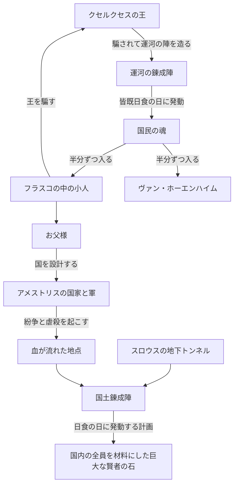
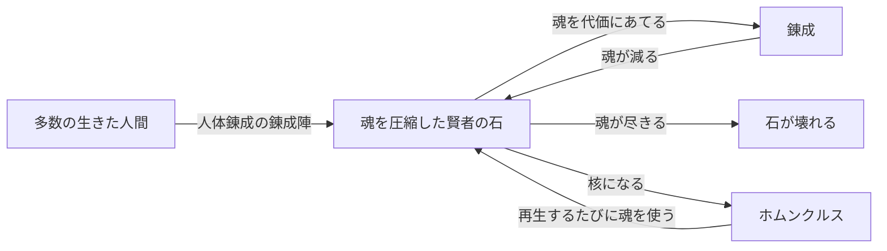

# 鋼の錬金術師 FULLMETAL ALCHEMIST の世界観

この世界の錬金術は、地殻変動のエネルギーを錬成陣で物質に流し、作り変える技術です。そのエネルギーと術者のあいだには、国の地下にある賢者の石が置かれ、アメストリスの紛争と領土拡大は、国土全体を使う錬成陣を完成させるために起こされてきました。`1 サイトのみ` [src-040]

**このページは設定のネタバレを含みます。** 賢者の石の材料、国の成り立ち、ホムンクルスの正体を伏せずに書きます。あらすじ、物語の展開、結末は書きません。

## このページの確かさ

**原作は直接読んでおらず、解説サイトや論考を通して確かめました。複数のサイトが一致していても、写し合っている可能性があり、正しいという保証にはなりません。** 対象は 2009 年版で、原作の情報は確認の補助に使います。2003 年版の設定は書きません。

記述のまとまりごとに、次の印を付けています。

| 印 | 意味 |
| --- | --- |
| `公式` | 公式サイトで確かめた内容です。 |
| `N サイトで一致` | 同じ内容を書いていた別のサイトの数です。同じドメインは 1 と数えます。 |
| `1 サイトのみ` | 元が 1 つしか見つかっていません。特に確かめが要る内容です。 |
| `説が割れている` | 元によって内容が違います。違いをそのまま並べます。 |

確かさの違う内容が 1 つの段落にあるときは、段落の下の「確かさ」に内容ごとの印と出典をまとめます。`N サイトで一致` に添えた話数は、その出典が挙げる 2009 年版の話数です。話数の無い記述は、2009 年版のどの話かを確かめられていません。定型的な解説サイトの 1 件だけが根拠の記述は「書く資料もある」と書き、断定しません。

賢者の石の材料の定義、真理の扉の定義、錬丹術と錬金術の原理の差は、公式サイトの文では確かめられませんでした。[src-001] [src-002]

## 錬金術の仕組み

丸数字は、図の下の行の印と出典に対応します。

図 1-1: この節の印の数です。

### 等価交換

錬金術は作中でもっとも進んだ科学とされ、原則は等価交換です。

図 1-2 確かさ: ① `公式` [src-001]、② `1 サイトのみ` [src-031]。床材の例は 2009 年版の「The First Day」「Rain of Sorrows」の場面。

図 1-3 確かさ: ① `2 サイトで一致` [src-044] [src-067] / 2009 年版 第 2 話: [src-067]、② `1 サイトのみ` [src-040]

賢者の石がこの原則の外にあるかは、書き方が分かれます。

図 1-4 確かさ: `説が割れている` 左から [src-077]、[src-078]、[src-040]

### 力の源

力の源は地殻変動のエネルギーです。地下の賢者の石があいだに入るので、お父様は国内の錬金術を封じられます。錬金術師は知らずに封じられた魂の力を使っている、と書く資料もあります。

図 1-5 確かさ: ① `3 サイトで一致` [src-040] [src-044] [src-058] / 2009 年版 第 35 話: [src-058]、② `2 サイトで一致` [src-040] [src-054]、③ 玉座から流す記述 `1 サイトのみ` [src-054]、④ [src-040] [src-049] [src-054]、⑤ `1 サイトのみ` [src-054]

図 1-6 確かさ: ① `3 サイトで一致` [src-040] [src-044] [src-072]、② `2 サイトで一致` [src-040] [src-075]、③ `1 サイトのみ` [src-029]、④ `1 サイトのみ` [src-041]

### 錬丹術との差

錬丹術はシン国の錬金術で、リンやメイなどシン国の人物は「気」を読めます。公式あらすじ第 31 話には、錬丹術が地上で力を発揮できたとあります。`公式` [src-002] [src-006] [src-008]

図 1-7 確かさ: ① `5 サイトで一致` [src-040] [src-044] [src-046] [src-049] [src-058] / 2009 年版 第 35 話: [src-058]、② `1 サイトのみ` [src-040]、③ `公式` [src-001]、④ `1 サイトのみ` [src-040]、⑤ `2 サイトで一致` [src-040] [src-049]、⑥ `1 サイトのみ` [src-040]

メイは中央の地下にうごめくようなエネルギーを感じ取ります。`1 サイトのみ` [src-056] / 2009 年版 第 35 話: [src-056]

### 真理の扉

人体錬成を行うと扉の前へ飛ばされ、通行料を奪われて知識を得ます。

図 1-8 確かさ: ① `4 サイトで一致` [src-040] [src-071] [src-074] [src-077] / 2009 年版 第 2 話: [src-071]、② `2 サイトで一致` [src-071] [src-072] / 2009 年版 第 2 話: [src-071]、③ `2 サイトで一致` [src-040] [src-074]、④ `1 サイトのみ` [src-040]、⑤ `1 サイトのみ` [src-040]、扉の場所 `説が割れている` 左から [src-040]、[src-044]

扉は石板の付いた両開きで、中に闇と手と目があると説明されます。`1 サイトのみ` [src-072] 現れる「真理」は白く顔のない姿です。`1 サイトのみ` [src-060] 原作を論じた論文では、真理は世界、宇宙、神、全、一、相手自身だと名乗り、扉の図は人物ごとに違い、エドワードの扉はセフィロトの図です。`1 サイトのみ` [src-068]

真理の扉を通った記憶があれば、人体錬成をした者は陣なしで術を使えます。グラトニーの腹の中は、お父様が作った扉の失敗作とされます。`公式` [src-002] [src-005] [src-007]

### こういう意見もある

- 【考察】地殻変動のエネルギーと龍脈はよく似た概念で、違うのは接続の仕方と仕組みだとする記事があります。メイの感じるうごめきは人の命を使う暗示とみますが、2003 年版への目配せかもしれないと筆者自身が留保しています。[src-058]
- 【考察】3 段階は少年向けの活劇に仕立てるための簡略化で、東西の差は錬金術史を物語の転換に使ったものだとする論文があります。[src-068]
- 【考察】保存則は共有された直観の科学的な形で、人の命はその外に置かれているとする論考があります。[src-031]
- 【考察】真理は皮肉を好む無関心な神に近いとする記事と、扉は各人の自己認識を映すとする記事があります。[src-060] [src-064]
- 【考察】扉の中の闇と手がお父様とプライドの原形に似ているとする記事があります。[src-072]

## 国家と歴史

### 国家錬金術師

アメストリスは軍事国家で、国軍の最高責任者は大総統キング・ブラッドレイです。国家錬金術師はこの国の国家資格で、年に一度の査定があり、「鋼」「焔」「豪腕」「紅蓮」のような二つ名を持ちます。エドワードは史上最年少の 12 歳で取得しました。`公式` [src-001] [src-002] [src-003]

資格者は軍の階級で少佐に相当します。合格者には銀時計が渡されます。

> 確かさ: 少佐相当 `2 サイトで一致` [src-040] [src-045]、銀時計 `2 サイトで一致` [src-045] [src-074]

試験の段階の数は元によって違います。`説が割れている`

- 筆記、精神鑑定、実技か研究の提出、面接の 4 段階とする。[src-045]
- 筆記、精神鑑定、実技の 3 つとする。[src-053]

次の細かい決まりは、すべて 1 つの wiki だけに書かれています。`1 サイトのみ` [src-045]

- 合格者は年に 1〜2 人です。
- 銀時計は身分証で、研究費を引き出すときなどに見せます。
- 年に数千万センズの研究費、特殊な文献の閲覧、施設の優先利用が認められます。
- 査定で成果が振るわなければ資格を失います。軍人として働く者は報告を免除され、軍務が査定の代わりになります。
- 三大制限と呼ばれる決まりは「人を作るな」「金を作るな」「軍に忠誠を誓え」です。
- 招集があれば人間兵器として戦地へ行く義務があり、そのため「軍の狗」と揶揄されます。

制度の裏の目的は、人柱の候補を確保することです。人柱とは人体錬成で扉に到達した者で、5 人が必要になります。

> 確かさ: 裏の目的 `2 サイトで一致` [src-045] [src-053]、人柱の数 `1 サイトのみ` [src-075]

### イシュヴァール

イシュヴァールはアメストリスに併合された地域で、併合の条件はイシュヴァラ教を認めることでした。イシュヴァール人の信仰は、錬金術を認めません。肌や赤い目の特徴でも区別されます。錬丹術も異端とする、と書く元もあります。

> 確かさ: 併合の条件 `1 サイトのみ` [src-040]、信仰 `2 サイトで一致` [src-042] [src-067] / 2009 年版 第 30 話: [src-067]、肌と目 `1 サイトのみ` [src-067] / 2009 年版 第 30 話: [src-067]、錬丹術の扱い `1 サイトのみ` [src-042]

内戦の発端は軍人が子どもを撃った事件で、撃ったのは軍人に化けたエンヴィーでした。この戦争も、国土錬成陣に要る血を流すためのものです。

> 確かさ: 発端 `2 サイトで一致` [src-050] [src-076]、戦争の目的 `2 サイトで一致` [src-040] [src-050]

7 年続いた内戦は、大総統の命令 3066 号を境に殲滅戦へ変わります。この命令で国家錬金術師が戦場に投入されました。生き残った人々は各地のゲットーや砂漠へ散りました。

> 確かさ: 殲滅戦への転換 `2 サイトで一致` [src-050] [src-067] / 2009 年版 第 30 話: [src-067]、国家錬金術師の投入 `2 サイトで一致` [src-050] [src-055] / 2009 年版 第 30 話: [src-055]、生存者の離散 `1 サイトのみ` [src-067] / 2009 年版 第 30 話: [src-067]

命令の呼び名はそろっていません。正式な名前は確かめられていません。`説が割れている`

- 同じ解説ページの中に「命令 3066 号」「3066 号特別厳命」「3066 号密令」が混ざっている。[src-050]
- 英語の話数解説は Executive Order 3066 と書く。[src-055]

### クセルクセス

クセルクセスは東の大砂漠にあった古代の王国で、ヴァン・ホーエンハイムの出身地です。アメストリスという国名は、この王国の王妃の名から来ています。`1 サイトのみ` [src-040]

滅びた時期は元によって違います。年表の具体的な年は 1 件だけの記載です。`説が割れている`

- 400 年前とする。[src-009] [src-068]
- 約 500 年前とする。[src-078]
- 1506 年とする。[src-073]

フラスコの中の小人は王を騙して、国の規模の錬成陣を造らせました。陣の正体は灌漑の運河で、皆既日食の日に発動しました。

> 確かさ: 王を騙したこと `1 サイトのみ` [src-042]、運河と日食 `1 サイトのみ` [src-057] / 2009 年版 第 40 話: [src-057]

その魂は小人とホーエンハイムの 2 人に半分ずつ入り、2 人は賢者の石になりました。ホーエンハイムの中の魂は 53 万 6329 人分で、年表の総人口 107 万 2658 人の半分にあたります。

> 確かさ: 半分ずつの魂 `2 サイトで一致` [src-057] [src-073] / 2009 年版 第 40 話: [src-057]、魂の数 `2 サイトで一致` [src-048] [src-073]

陣の要所で町ごとの虐殺を王が密かに命じたこと、小人が陣を歪めて自分とホーエンハイムを真の中心に置いたことを書く資料もあります。`1 サイトのみ` [src-051] / 2009 年版 第 40 話: [src-051]

小人、つまりお父様がいつ生まれたかも元によって違います。`説が割れている`

- 約 8 世紀前とする。[src-042]
- 1480 年とする。年表 1 件だけの記載です。[src-073]

### 国土錬成陣

アメストリスの国土はほぼ円形で、中央と東西南北の 5 地域に分かれます。`1 サイトのみ` [src-040]

建国の年は元によって違います。`説が割れている`

- 1558 年ごろとする。[src-040]
- 1550 年とする。[src-073]
- 別の資料は、1558 年をリヴィエールの事件の年としている。[src-052]

国土錬成陣は国の全土を使う錬成陣で、目的は国内の全員を犠牲にして巨大な賢者の石を作ることです。`4 サイトで一致` [src-043] [src-044] [src-056] [src-068] / 2009 年版 第 35 話: [src-056]

国内の虐殺の地点を結ぶと陣が浮かび上がり、紛争や領土拡大はそのために起こされました。スロウスがブリッグズの地下に掘った円形のトンネルも陣の一部です。国の外縁の 10 都市を軸に設計された、と書く記事もあります。

> 確かさ: 虐殺の地点 `3 サイトで一致` [src-040] [src-044] [src-052] / 2009 年版 第 35 話: [src-052]、地下トンネル `2 サイトで一致` [src-056] [src-072] / 2009 年版 第 35 話: [src-056]、10 都市 `1 サイトのみ` [src-072]

発動には日食が要り、その日が約束の日になります。`2 サイトで一致` [src-040] [src-068]

陣の形の説明はそろっていません。`説が割れている`

- 円とする解説ページがあり、同じページのよくある質問は五角形と書く。[src-052]
- 第五研究所の二重五角形に似るとする。[src-072]

図 2: クセルクセスの陣で力を得たお父様が、アメストリスの全土に次の陣を作る関係です。計画が実現するかどうかは示していません。[src-040] [src-042] [src-052] [src-056] [src-057]

### こういう意見もある

【考察】イタリアのサイト costituzionalismo.it に載った論考は、命令 3066 号以後の軍の行動がジェノサイド条約の要件を満たすとみています。作中の出来事を法の枠組みに当てはめたこの論考の見方で、このページの判断ではありません。[src-067]

【考察】BetaSeries の記事は、ヘレロ戦争やイラク戦争との並行を見ています。英語版 Wikipedia は他の評者の見方として、スカーの背景がアイヌの土地の歴史を参照しているという読みを引いています。どちらも、それぞれの筆者の比較です。[src-009] [src-069]

【考察】ブログ Mark Watches の筆者は、石が目的なら虐殺まで要らず拉致で足りるのではないか、と疑問を出しています。[src-059]

【考察】話数解説の AnimeOshi は国そのものを巨大な兵器として設計したものと見立て、note の感想記事は全方位の対立を大総統が権力を保つために作った火種と読みます。[src-056] [src-079]

【考察】ルーアン大学のサイトの論文は、日食との一致を錬金術の写本の図を字義どおりに使ったものとし、クセルクセスの名に古代ペルシアとゾシモスの時代の連想を見ています。[src-068]

## 人間と命

### 賢者の石

賢者の石の正体は、多数の生きた人間の魂を圧縮したエネルギーの塊です。公式の文に材料の定義はありませんが、2009 年版の公式あらすじ第 43 話には、人を石に変えた旨の記述があります。

> 確かさ: 魂という正体 `3 サイトで一致` [src-040] [src-044] [src-047]、あらすじの記述 `公式` [src-007]

作り方の例が第五研究所で、人体錬成の錬成陣を使って石を作りました。マルコーは、イシュヴァール人の捕虜数千人を犠牲に石を作っています。

> 確かさ: 第五研究所 `1 サイトのみ` [src-059] / 2009 年版 第 30 話: [src-059]、捕虜 `1 サイトのみ` [src-055] / 2009 年版 第 30 話: [src-055]

石を使えば代価を払わずに済むように見えますが、中の魂を減らして代価にあてているので、使い続ければ石は壊れます。`2 サイトで一致` [src-040] [src-065]

作中で石は、兄弟が失ったものを取り戻すために探す対象で、軍の命令で研究される題材でもあり、ホムンクルスの核でもあります。`公式` [src-001] [src-002] [src-003] [src-004]

図 3: 賢者の石の力は中の魂の量で決まり、錬成にもホムンクルスの再生にも魂を使います。[src-040] [src-059] [src-065] [src-078]

### 人体錬成

人体錬成は錬金術で最大の禁忌とされ、兄弟は亡くなった母を想ってこれを犯しました。死者の復活を目指す試みは必ず失敗します。

> 確かさ: 禁忌 `公式` [src-001] [src-003]、必ず失敗すること `3 サイトで一致` [src-040] [src-061] [src-077]

失敗の理由として挙げられるのは、存在しないものは錬成できないということです。材料の一覧が精確でも失敗します。兄弟の場合、魂の対価が何か分からないまま血を数滴入れただけだった、と原作を論じた論文は書きます。結果として生まれるのは半端な怪物です。

> 確かさ: 存在しないもの `1 サイトのみ` [src-040]、材料の一覧 `1 サイトのみ` [src-031]、血の数滴 `1 サイトのみ` [src-068]、怪物 `1 サイトのみ` [src-061]

失敗の代償は術者の身体に及びます。イズミは子の蘇生に失敗して内臓の一部を失いました。行った国家錬金術師は資格を奪われます。

> 確かさ: イズミ `1 サイトのみ` [src-046]、資格 `1 サイトのみ` [src-044]

### ホムンクルス

ホムンクルスは、お父様が自分から切り離した面を賢者の石の欠片に移した存在で、七つの大罪の名を持ちます。多くはお父様の肉の身体に入っていますが、ラースと 2 代目の強欲は人間の身体を使います。ラースは魂が 1 つで人間を土台にしているので、年を取ります。

> 確かさ: 生まれ方 `2 サイトで一致` [src-042] [src-078]、身体 `1 サイトのみ` [src-042]、ラース `1 サイトのみ` [src-078]

石の力で、倒れても復活します。復活は中の魂が尽きるまでで、尽きれば死にます。

> 確かさ: 復活 `公式` [src-001] [src-002] [src-003] [src-004]、魂が尽きるまで `2 サイトで一致` [src-065] [src-078]

ウロボロスの印を持つのはホムンクルスだけです。生まれた順はプライド、ラスト、グリード、エンヴィーと続きます。

> 確かさ: ウロボロス `1 サイトのみ` [src-071] / 2009 年版 第 1 話: [src-071]、生まれた順 `1 サイトのみ` [src-078]

自我をどう見るかは分かれます。`説が割れている`

- お父様に仕えながら、各自に強い自我があるとする。[src-077]
- 人の姿をしていても人間性は無く、自由意志も無いとする。[src-066]

### 機械鎧

機械鎧は義肢で、エドワードの右腕と左足がこれです。ウィンリィが整備し、その技術は祖母のピナコが教えました。神経と直接つないで動かします。金属製で丈夫です。

> 確かさ: 義肢とエドワード `公式` [src-002] [src-008]、神経 `1 サイトのみ` [src-040]、金属 `1 サイトのみ` [src-044]

装着には激痛を伴う手術と長い訓練が要り、維持にも費用がかかります。訓練は最低 3 年とされ、エドワードは 1 年で身につけました。身体の成長に合わせて作り直す必要もあります。幻肢痛があり、高温の土地では皮膚を火傷する恐れもあります。

> 確かさ: 手術と維持費 `2 サイトで一致` [src-040] [src-046]、訓練と新調 `1 サイトのみ` [src-046]、幻肢痛と火傷 `1 サイトのみ` [src-070]

武器にもなり、銃器を内蔵した戦闘用があります。寒冷地向けに改造した戦闘用の例がバッカニアで、エドワードの右腕も戦闘で刃に変わります。

> 確かさ: 戦闘用 `2 サイトで一致` [src-040] [src-044]、バッカニアと刃 `公式` [src-002] [src-008]

義肢の需要はイシュヴァールの戦争で急に高まりました。技師が集まり機械鎧を作る町がラッシュバレーです。

> 確かさ: 需要 `1 サイトのみ` [src-046]、ラッシュバレー `3 サイトで一致` [src-009] [src-044] [src-080] / 2009 年版 第 11 話: [src-080]

作者は、重い義肢なら相応の筋肉が要り、エドワードの年齢に合わないと気にしていました。`1 サイトのみ` [src-043]

### こういう意見もある

【考察】Galactica Media の論文は、石を権力の隠喩とみて、人を手段にするなというカント的な読みを示します。note の記事は、技術の全能感と倫理の境界を示す装置と位置づけます。[src-062] [src-063]

【考察】Substack の記事は、石は本物の魂に及ばず、代価と結果が釣り合っていないとみています。同じ記事は、兄弟の誤りを知識だけで足りると信じた点に置きます。[src-064]

【考察】The Fandomentals の論考は、魂に等価なものは無く人命に値は付かないから人体錬成は成り立たない、と読みます。同じ論考にとってホムンクルスは、創造できず破壊するだけの人間の暗い鏡です。[src-061]

【考察】ルーアン大学のサイトの論文は、血から生まれて奴隷に名を与えるお父様に、創造主と被造物の反転を見ています。[src-068]

【考察】ComicBook の記事は、機械鎧は失った手足を埋めず障害も消さないとみます。英語版 Wikipedia の Edward Elric の項は研究者の評として、エドワードを超人的な障害者の型でありながら心の傷も持つ人物と紹介します。[src-043] [src-070]
