# 鋼の錬金術師 FULLMETAL ALCHEMIST の世界観

この世界の錬金術は、地殻変動のエネルギーを錬成陣で物質に流し、作り変える技術です。そのエネルギーと術者のあいだには、国の地下にある賢者の石が置かれ、アメストリスの紛争と領土拡大は、国土全体を使う錬成陣を完成させるために起こされてきました。`1 サイトのみ` [src-040]

**このページは設定のネタバレを含みます。** 賢者の石の材料、国の成り立ち、ホムンクルスの正体を伏せずに書きます。あらすじ、物語の展開、結末は書きません。

## このページの確かさ

**原作は直接読んでおらず、解説サイトや論考を通して確かめました。複数のサイトが一致していても、写し合っている可能性があり、正しいという保証にはなりません。** 対象は 2009 年版で、原作の情報は確認の補助に使います。2003 年版の設定は書きません。

| 印 | 意味 |
| --- | --- |
| `公式` | 公式サイトで確かめた内容です。 |
| `複数サイト` | 同じ内容を別のサイトが書いていました。文の中では `N サイトで一致` と数を書きます。同じドメインは 1 と数えます。 |
| `1 サイトのみ` | 元が 1 つしか見つかっていません。特に確かめが要る内容です。 |
| `説が割れている` | 元によって内容が違います。違いをそのまま並べます。 |

図の黒丸は `公式` か `複数サイト`、白丸は `1 サイトのみ`、破線の枠は `説が割れている` です。図の下の行には、印とその件数 (×2 は 2 件) と主な出典を書きます。番号ごとの印、出典の全件、話数は [参照ページ](references.md) にあります。話数の無い記述は、2009 年版のどの話かを確かめられていません。定型的な解説サイトの 1 件だけが根拠の記述は「書く資料もある」と書き、断定しません。

賢者の石の材料の定義の文、真理の扉の定義、錬丹術と錬金術の原理の差は、公式サイトの文では確かめられませんでした。賢者の石については、定義の文は無いものの、公式あらすじ第 52 話に「石に閉じ込められた魂」という語があります。[src-001] [src-002] [src-081]

## 錬金術の仕組み

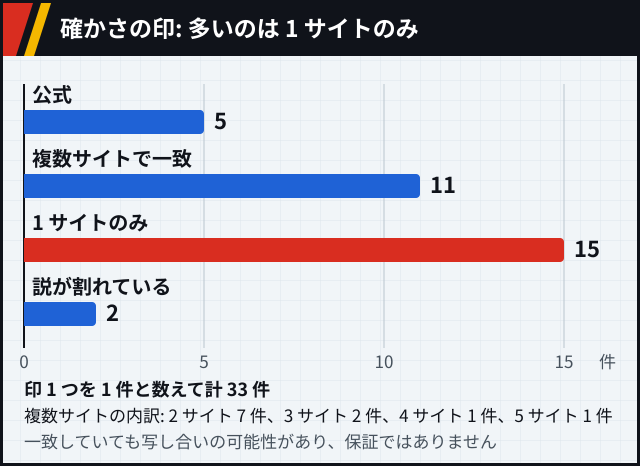

図 1-1: この節の印の数です。

### 等価交換

錬金術は作中でもっとも進んだ科学とされ、原則は等価交換です。

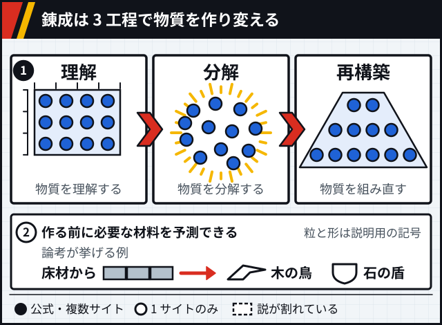

図 1-2: `公式` `1 サイトのみ` [src-001] [src-031]

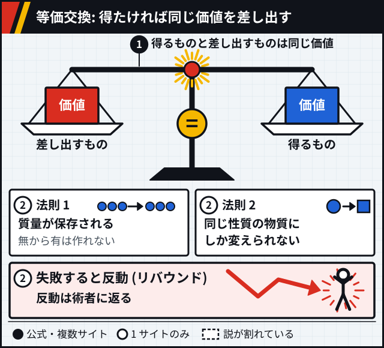

図 1-3: `複数サイト` `1 サイトのみ` [src-044] [src-067] [src-040]

賢者の石がこの原則の外にあるかは、書き方が分かれます。

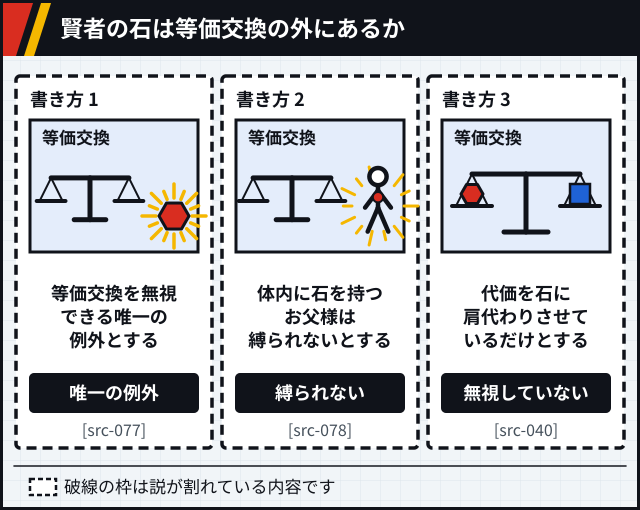

図 1-4: `説が割れている` [src-077] [src-078] [src-040]

### 力の源

力の源は地殻変動のエネルギーです。地下の賢者の石があいだに入るので、お父様は国内の錬金術を封じられます。錬金術師は知らずに封じられた魂の力を使っている、と書く資料もあります。

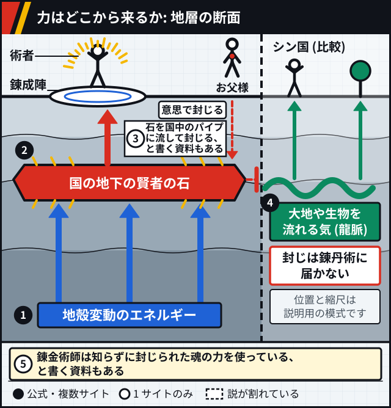

図 1-5: `複数サイト`×2 `1 サイトのみ`×2 [src-040] [src-044] [src-058] [ほか](references.md#世界観-図-1-5)

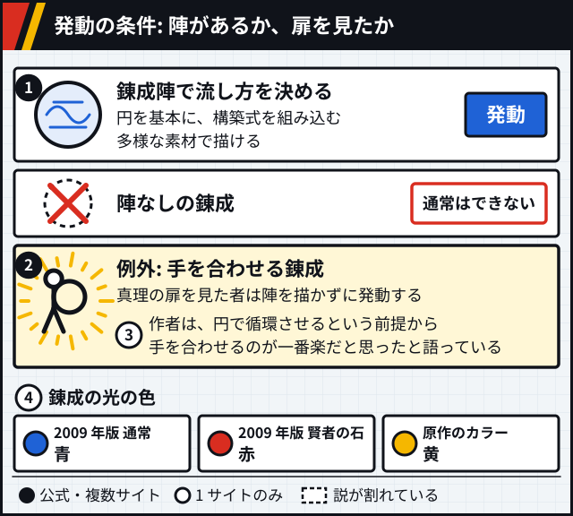

図 1-6: `複数サイト`×2 `1 サイトのみ`×2 [src-040] [src-044] [src-072] [ほか](references.md#世界観-図-1-6)

### 錬丹術との差

錬丹術はシン国の錬金術で、リンやメイなどシン国の人物は「気」を読めます。公式あらすじ第 31 話には、錬丹術が地上で力を発揮できたとあります。`公式` [src-002] [src-006] [src-008]

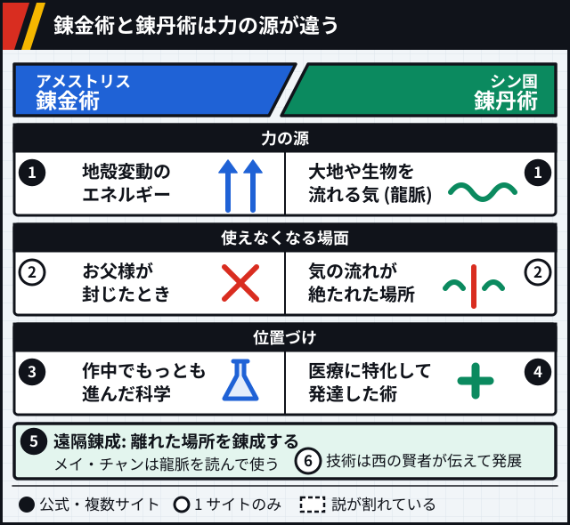

図 1-7: `公式` `複数サイト`×2 `1 サイトのみ`×3 [src-001] [src-040] [src-044] [ほか](references.md#世界観-図-1-7)

メイは中央の地下にうごめくようなエネルギーを感じ取ります。`1 サイトのみ` [src-056] / 2009 年版 第 35 話: [src-056]

### 真理の扉

人体錬成を行うと扉の前へ飛ばされ、通行料を奪われて知識を得ます。

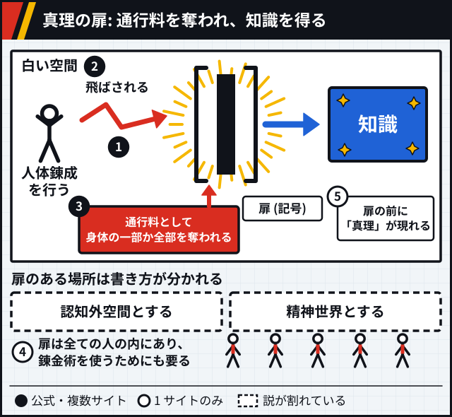

図 1-8: `複数サイト`×3 `1 サイトのみ`×2 `説が割れている` [src-040] [src-071] [src-074] [ほか](references.md#世界観-図-1-8)

扉は石板の付いた両開きで、中に闇と手と目があると説明されます。`1 サイトのみ` [src-072] 現れる「真理」は白く顔のない姿です。`1 サイトのみ` [src-060] 原作を論じた論文では、真理は世界、宇宙、神、全、一、相手自身だと名乗り、扉の図は人物ごとに違い、エドワードの扉はセフィロトの図です。`1 サイトのみ` [src-068]

真理の扉を通った記憶があれば、人体錬成をした者は陣なしで術を使えます。グラトニーの腹の中は、お父様が作った扉の失敗作とされます。`公式` [src-002] [src-005] [src-007]

### こういう意見もある

- 【考察】地殻変動のエネルギーと龍脈はよく似た概念で、違うのは接続の仕方と仕組みだとする記事があります。メイの感じるうごめきは人の命を使う暗示とみますが、2003 年版への目配せかもしれないと筆者自身が留保しています。[src-058]
- 【考察】3 段階は少年向けの活劇に仕立てるための簡略化で、東西の差は錬金術史を物語の転換に使ったものだとする論文があります。[src-068]
- 【考察】保存則は共有された直観の科学的な形で、人の命はその外に置かれているとする論考があります。[src-031]
- 【考察】真理は皮肉を好む無関心な神に近いとする記事と、扉は各人の自己認識を映すとする記事があります。[src-060] [src-064]
- 【考察】扉の中の闇と手がお父様とプライドの原形に似ているとする記事があります。[src-072]

## 国家と歴史

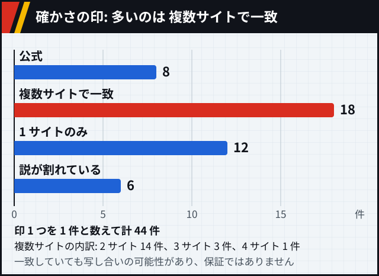

図 2-1: この節の印の数です。

### アメストリスと国家錬金術師

アメストリスは大総統を頂点とする軍事国家です。

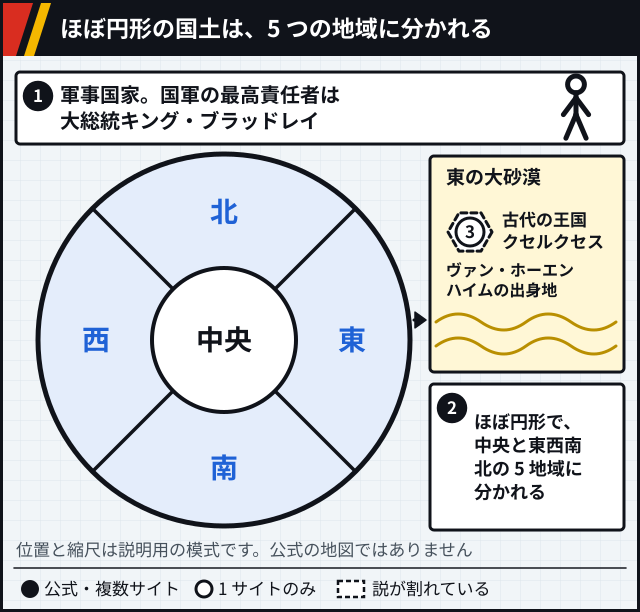

図 2-2: `公式` `1 サイトのみ`×2 [src-001] [src-002] [src-040]

国家錬金術師はこの国の国家資格です。細かい決まりは 1 つの wiki だけに書かれています。

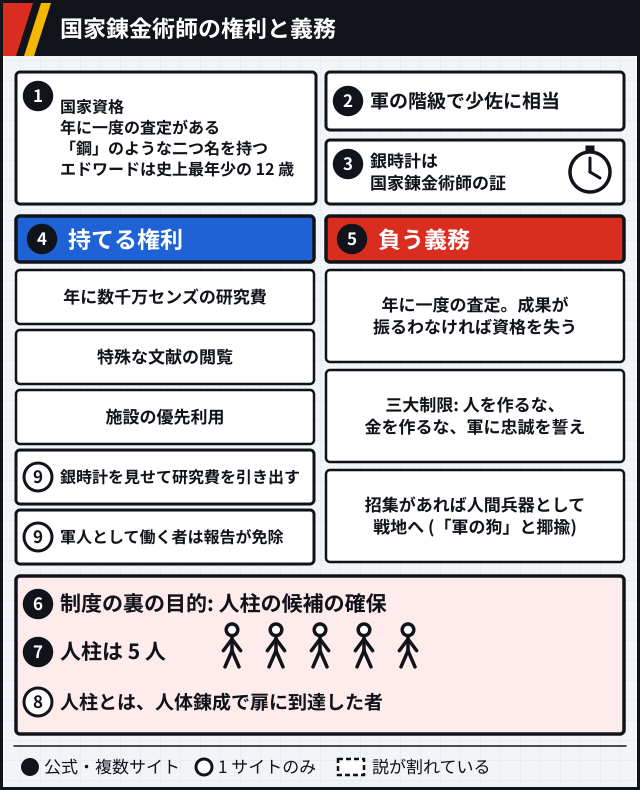

図 2-3: `公式`×3 `複数サイト`×2 `1 サイトのみ`×3 [src-001] [src-002] [src-003] [ほか](references.md#世界観-図-2-3)

試験の段階の数は元によって違います。

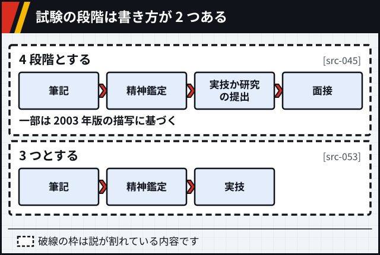

図 2-4: `説が割れている` [src-045] [src-053]

### イシュヴァール

イシュヴァールはアメストリスに併合された地域です。内戦は、命令 3066 号を境に殲滅戦へ変わります。

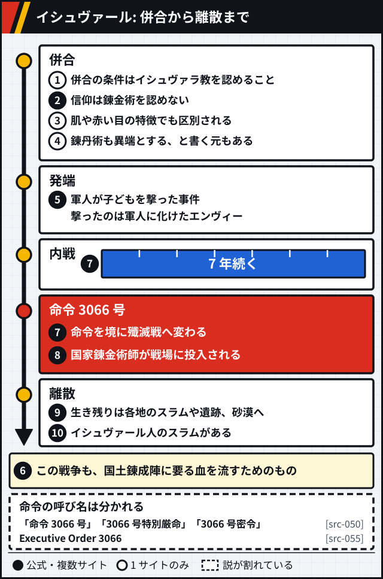

図 2-5: `公式` `複数サイト`×6 `1 サイトのみ`×3 `説が割れている` [src-007] [src-042] [src-067] [ほか](references.md#世界観-図-2-5)

### 国土錬成陣

国土錬成陣は国の全土を使う錬成陣です。

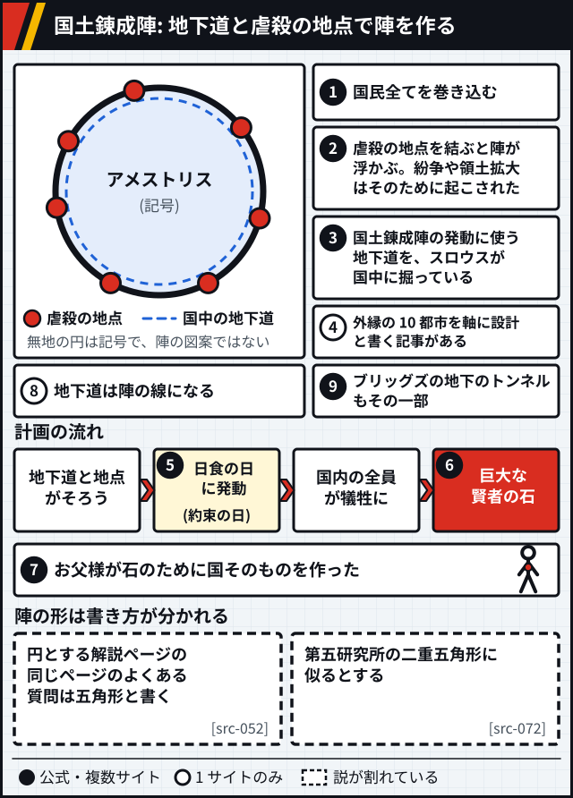

図 2-6: `公式`×2 `複数サイト`×3 `1 サイトのみ`×2 `説が割れている` [src-005] [src-002] [src-043] [ほか](references.md#世界観-図-2-6)

### クセルクセス

アメストリスという国名は、実在のペルシア王クセルクセス 1 世の后の名から取られています。`2 サイトで一致` [src-040] [src-068]

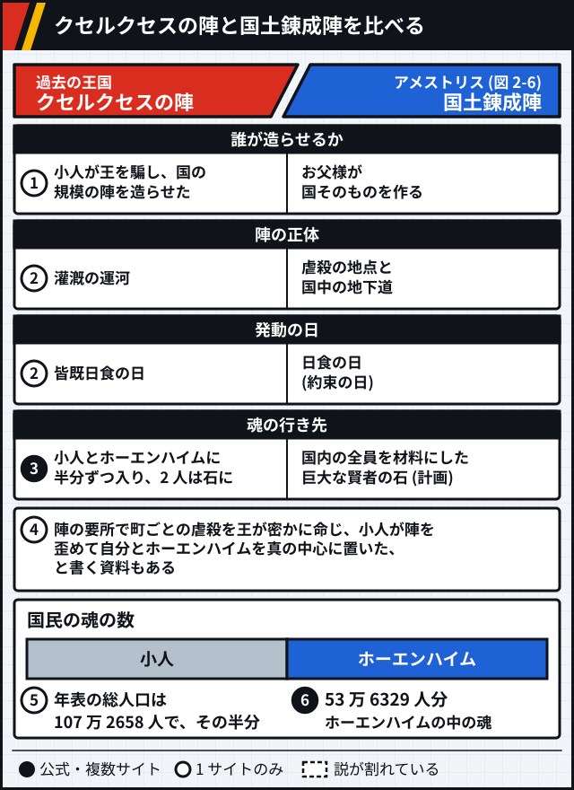

図 2-7: `公式` `複数サイト` `1 サイトのみ`×4 [src-081] [src-048] [src-073] [ほか](references.md#世界観-図-2-7)

年代の書き方は資料によって違います。

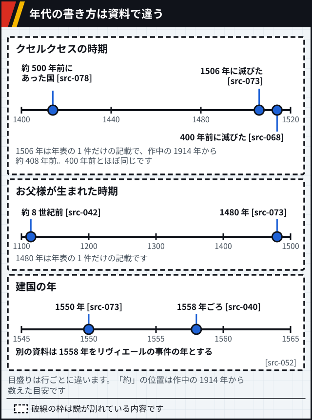

図 2-8: `説が割れている`×3 [src-068] [src-073] [src-078] [ほか](references.md#世界観-図-2-8)

### こういう意見もある

- 【考察】イタリアのサイト costituzionalismo.it に載った論考は、命令 3066 号以後の軍の行動がジェノサイド条約の要件を満たすとみています。作中の出来事を法の枠組みに当てはめたこの論考の見方で、このページの判断ではありません。[src-067]
- 【考察】BetaSeries の記事は、ヘレロ戦争やイラク戦争との並行を見ています。英語版 Wikipedia は他の評者の見方として、スカーの背景がアイヌの土地の歴史を参照しているという読みを引いています。どちらも、それぞれの筆者の比較です。[src-009] [src-069]
- 【考察】話数解説の AnimeOshi は、国そのものを巨大な兵器として設計したものと見立てます。[src-056]
- 【考察】ルーアン大学のサイトの論文は、日食との一致を錬金術の写本の図を字義どおりに使ったものとし、クセルクセスの名に古代ペルシアとゾシモスの時代の連想を見ています。[src-068]

## 人間と命

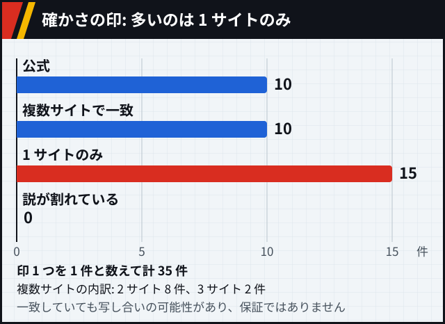

図 3-1: この節の印の数です。

### 賢者の石

賢者の石の材料は魂だとする資料があります。公式の文に定義はありませんが、公式あらすじ第 52 話に「石に閉じ込められた魂」という語があります。`公式` [src-081]

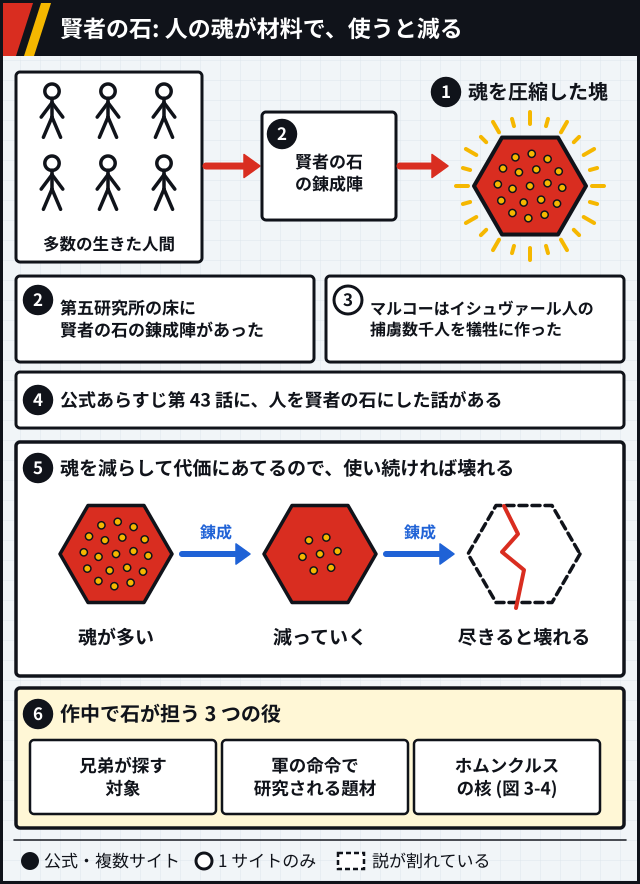

図 3-2: `公式`×3 `複数サイト`×2 `1 サイトのみ` [src-003] [src-007] [src-001] [ほか](references.md#世界観-図-3-2)

### 人体錬成

人体錬成は、死者の復活を目指す試みです。

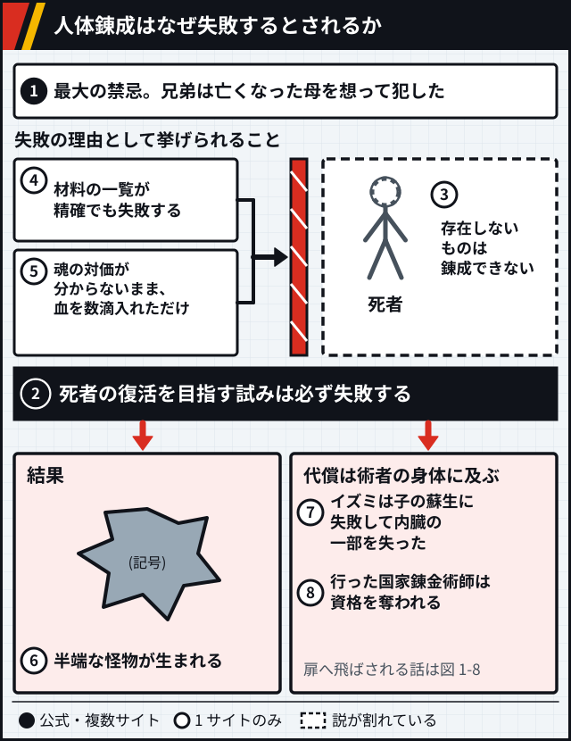

図 3-3: `公式` `複数サイト` `1 サイトのみ`×6 [src-001] [src-003] [src-040] [ほか](references.md#世界観-図-3-3)

### ホムンクルス

能力の詳しい話は [七つの大罪のページ](seven-sins.md) に任せ、ここでは成り立ちだけを描きます。

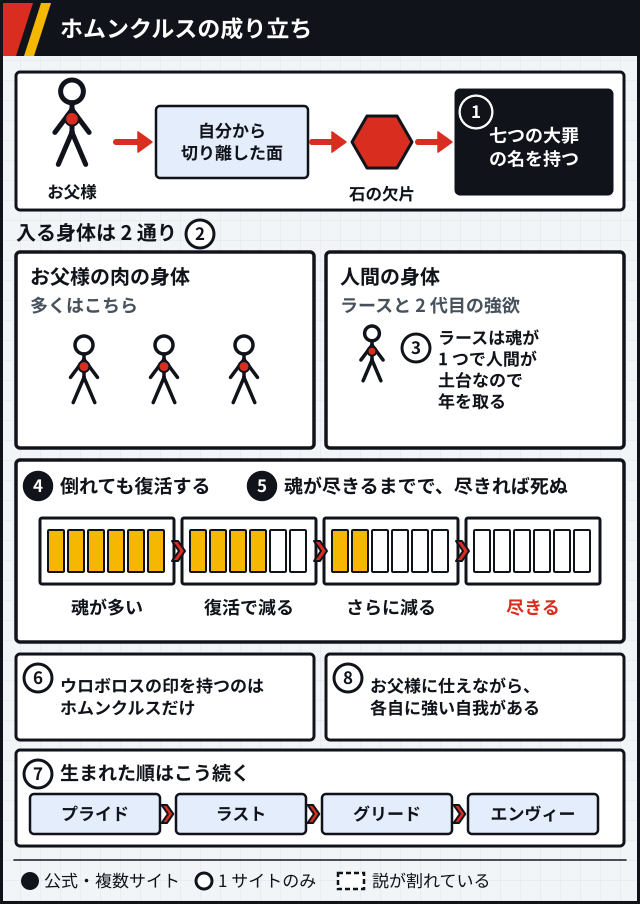

図 3-4: `公式` `複数サイト`×2 `1 サイトのみ`×5 [src-001] [src-002] [src-003] [ほか](references.md#世界観-図-3-4)

### 機械鎧

機械鎧は義肢です。技術と代償を左右に分けました。

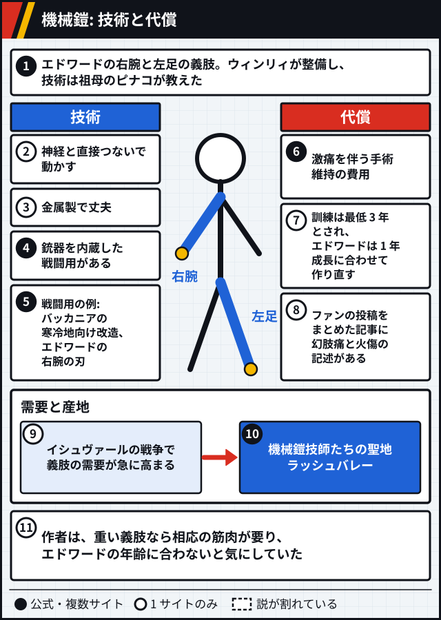

図 3-5: `公式`×3 `複数サイト`×2 `1 サイトのみ`×6 [src-002] [src-008] [src-004] [ほか](references.md#世界観-図-3-5)

### こういう意見もある

- 【考察】Galactica Media の論文は、石を権力の隠喩とみて、人を手段にするなというカント的な読みを示します。note の記事は、技術の全能感と倫理の境界を示す装置と位置づけます。[src-062] [src-063]
- 【考察】Substack の記事は、石は本物の魂に及ばず、代価と結果が釣り合っていないとみています。同じ記事は、兄弟の誤りを知識だけで足りると信じた点に置きます。[src-064]
- 【考察】The Fandomentals の論考は、魂に等価なものは無く人命に値は付かないから人体錬成は成り立たない、と読みます。同じ論考にとってホムンクルスは、創造できず破壊するだけの人間の暗い鏡です。[src-061]
- 【考察】Hypercritic の評論は、ホムンクルスは人の姿をしていても人間性は無く、自由意志も無いとみています。[src-066]
- 【考察】ルーアン大学のサイトの論文は、血から生まれて奴隷に名を与えるお父様に、創造主と被造物の反転を見ています。[src-068]
- 【考察】ComicBook の記事は Tumblr の投稿者の見方として、機械鎧は失った手足を埋めず障害も消さないと伝えます。英語版 Wikipedia の Edward Elric の項は研究者の評として、エドワードを超人的な障害者の型でありながら心の傷も持つ人物と紹介します。[src-043] [src-070]
