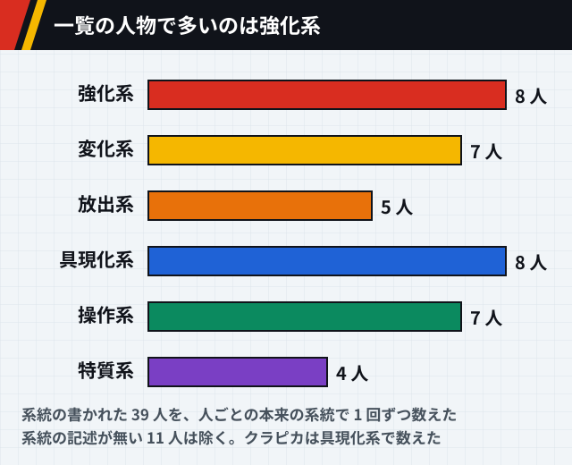

# HUNTER×HUNTER の能力の一覧

[← anime-guide のトップ](../../README.md) · [世界観](world.md) · [参照ページ](references.md)

> [!IMPORTANT]
> **このページは AI (Claude) がまとめました。** 資料集め、文章、図を AI が作り、人は公開前に全体を確認しました。記述を一つずつ原典と照らしたものではないので、誤りがあれば [Issue か Pull Request](../../README.md#誤りを指摘する) で教えてください。

> [!WARNING]
> [!NOTE]
> **このページは考察を含みます。** 考察は行頭に【考察】を付けて事実と分けます。他の人の考察は、元の文を写さず「という見方がある」と出典付きで短く紹介します。

> **このページは設定のネタバレを含みます。** 人物ごとの念能力の名前と仕組みを伏せずに書きます。2011 年版より後の原作 (暗黒大陸・王位継承編) の能力も、最後の表に分けて載せます。あらすじ、物語の展開、結末は書きません。

能力が確かめられた 71 人の、104 の能力を並べます。2011 年版の範囲のものと、原作の暗黒大陸・王位継承編のものを分けています。系統、能力の名前、仕組みは、[世界観](world.md#念能力の仕組み) の念の決まりに沿って読めます。

## このページの確かさ

> [!CAUTION]
> **公式の能力の一覧は見つからず、百科事典サイトや解説記事を通して確かめました。全員がそろった保証はありません。** 2011 年版の範囲の能力を所属ごとに並べ、原作の暗黒大陸・王位継承編で初めて出る能力は、最後の表に分けて載せます。 能力の名前の表記とルビは、資料によって揺れることがあります。

| 印 | 意味 |
| --- | --- |
| `複数サイト` | 能力の名前と仕組みを、別のサイト 2 つ以上が書いていました。同じドメインは 1 と数えます。 |
| `1 サイトのみ` | 元が 1 つしか見つかっていません。特に確かめが要る内容です。 |
| `説が割れている` | 元によって内容が違います。 |

能力の一覧の表の印の数は、`複数サイト` が 27 件、`1 サイトのみ` が 76 件、`説が割れている` が 1 件です。能力の名前は、ルビを上に振って書きます。

## 念の基本

念は、体からあふれる生命エネルギーのオーラを操る力です。基本の技は四大行と呼ばれ、念の基本となる修行でもあります。`複数サイト` [src-001] [src-003] [src-029] 図は [世界観](world.md#四大行と応用技) にあります。

| 技 | すること | 確かさ |
| --- | --- | --- |
| <ruby>纏<rt>テン</rt></ruby> | オーラを体の周りに留める。体が丈夫になる | `複数サイト` [src-001] [src-003] [src-029] |
| <ruby>絶<rt>ゼツ</rt></ruby> | 精孔を閉じてオーラを断つ。気配を消し、疲れを取るのに使う | `複数サイト` [src-001] [src-003] [src-029] |
| <ruby>練<rt>レン</rt></ruby> | 精孔を一気に開き、普段より多くのオーラを出す | `複数サイト` [src-001] [src-003] [src-029] |
| <ruby>発<rt>ハツ</rt></ruby> | オーラを自在に操り、その人だけの能力を出す。念の集大成 | `複数サイト` [src-001] [src-003] [src-029] |

応用技は四大行より疲れが激しい技です。`1 サイトのみ` [src-029] 堅を保てる時間を 10 分伸ばすだけで 1 か月かかると言われます。円は、オーラを半径 2 メートル以上に広げて 1 分以上保つ技で、達人では 50 メートルを超えます。`1 サイトのみ` [src-029]

## 念の種類 (系統)

念は、オーラの使い方で 6 つの系統に分かれます。系統は生まれつき決まり、自分の系統の能力をいちばん高くまで伸ばせます。相性の良い系統も高いところまで使えますが、遠い系統ほど苦手になります。`複数サイト` [src-001] [src-002] [src-029] 相性の図と水見式の図は [世界観](world.md#6-つの系統) にあります。

| 系統 | 得意なこと | ヒソカの性格診断 | この一覧の使い手 |
| --- | --- | --- | --- |
| 強化系 | 物の働きや力を高める。自分を強めると、攻めも守りも傷の治りも上がる | 単純で一途 | ゴン、ネテロ、パーム、カストロ、ノブナガ、フィンクス、ウボォーギン、モントゥトゥユピー |
| 放出系 | 体から離したオーラを保つ。念弾を撃つ、瞬間移動するなど | 短気で大雑把 | レオリオ、ノヴ、ナックル、リールベルト、フランクリン、リンチ |
| 変化系 | オーラの性質や形を変える。変える物への強いイメージが要る | 気まぐれで嘘つき | キルア、ビスケ、ゼノ、ヒソカ、ゲンスルー、フェイタン、マチ |
| 操作系 | 物や生き物を操る。道具は愛着や使い込みで精度が上がる | 理屈屋でマイペース | モラウ、シュート、イルミ、ヴェーゼ、シャルナーク、シャウアプフ、ザザン、シカク、ザクロ |
| 具現化系 | オーラを物にする。念を使う人にも見た目では本物と区別できない | 神経質 | クラピカ、カイト、梟、ケスー、シズク、ボノレノフ、コルトピ、フラッタ、リハン、ヒンリギ |
| 特質系 | ほかの 5 つに入らない能力。特質系の人にしか使えない | 個人主義でカリスマ性がある | ネオン、クロロ、パクノダ、ネフェルピトー、ツェリードニヒ |

得意なことと性格診断は `1 サイトのみ` [src-029] です。性格診断はヒソカの独断と偏見によるもので、系統は生まれつき決まるので、性格が系統を決めるわけではないと書かれています。[src-029] 使い手の列は、下の能力の一覧の系統の欄から数えています。

【考察】強化系のゴンと変化系のヒソカの関係は、性格診断の「単純で一途」と「気まぐれで嘘つき」の対比になぞらえて描かれている、という見方があります。[src-040]

図 1-1: 一覧のうち系統の分かる 45 人の内訳です。系統は表の出典によります。

## 修行

念は修行すれば誰でも身につけられますが、表向きには隠された技で、上達の速さは才能で大きく違います。ウイングは、ズシを 10 万人に 1 人、ゴンとキルアを 1000 万人に 1 人の才能と見ています。`1 サイトのみ` [src-029] [src-030]

1. **精孔を開く。** ゆっくり開く道と、他人のオーラで無理に開く道があります ([世界観](world.md#オーラと精孔))。念を知らない人が念の攻撃を受けて目覚めても、体を壊して後遺症が残ることが少なくありません。`1 サイトのみ` [src-029]
2. **四大行と応用技を身につける。** ハンター試験の合格者には、プロハンターが師匠として念を教えます。これが裏の試験で、ハンター十ヶ条の「最低限の武芸の会得」は念のことです。`1 サイトのみ` [src-029]
3. **系統を調べる。** 水見式で自分の系統を知り、系統に合った能力を作るのがよいとされます。相性の悪い系統を組み合わせた能力は身につけにくく、高いところまで仕上がりません。ただ、性格や好みが強く出るので、系統と違う能力ができてしまうこともあります。`1 サイトのみ` [src-029]
4. **自分の能力 (発) を作る。** 正しい手順で修行すれば、能力を自分で決められます。一度決まると取り消せず、他人の念の攻撃で目覚めた場合は、能力が勝手に決まってしまうこともあります。`1 サイトのみ` [src-029]

念を教えてはいけない相手には、念を隠して「燃」という心構えとして説明します。点で心を集めて目標を決め、舌で目標を言葉にし、錬で意志を高め、発で行動に移す、という教え方です。`複数サイト` [src-001] [src-029]

能力を入れておける容量 (メモリ) には限りがある、という見方もあります。強化系のカストロが、相性の悪い具現化と操作を合わせた分身を作ったことを、ヒソカは容量の無駄遣いと評し、ウイングも批判しました。`複数サイト` [src-030] [src-040]

## 制約と誓約

能力に自分で条件や制限を決めて守ると、能力が強くなります。仕組みは [世界観](world.md#制約と誓約) にあります。強い能力ほど発動の条件や手順が複雑になり、破ったときの危険が小さい能力は、そのぶん条件が格段に厳しいことが多いとされます。`1 サイトのみ` [src-029] 厳しい制約に加えて、自分に危険を課す覚悟が能力を伸ばすこともあります。`1 サイトのみ` [src-029]

一覧の能力から、条件や制限がはっきり書かれているものを並べます。

<table>
<thead><tr><th>人物</th><th>能力</th><th>条件や制限</th><th>得るもの</th><th>確かさ</th></tr></thead>
<tbody>
<tr><td rowspan="2">クラピカ</td><td><ruby>束縛する中指の鎖<rt>チェーンジェイル</rt></ruby></td><td>幻影旅団にしか使わない。破れば命を失う</td><td>縛った相手を絶にする強い拘束</td><td><code>複数サイト</code> [src-001] [src-003] [src-022]</td></tr>
<tr><td><ruby>絶対時間<rt>エンペラータイム</rt></ruby></td><td>緋の眼の間だけ。消耗が激しく長くは使えない</td><td>全系統の力を 100% 引き出す</td><td><code>複数サイト</code> [src-003] [src-022] [src-029]</td></tr>
<tr><td>ゲンスルー</td><td><ruby>命の音<rt>カウントダウン</rt></ruby></td><td>触れて唱える。能力を説明してから起動する。解除の方法もある</td><td>ほぼ必ず仕留める爆弾。条件の無い一握りの火薬は威力がほどほど</td><td><code>複数サイト</code> [src-024] [src-029]</td></tr>
<tr><td>ナックル</td><td><ruby>天上不知唯我独損<rt>ハコワレ</rt></ruby></td><td>オーラを貸す一撃では傷を与えない。利息込みで相手の残りを超えるまで待つ</td><td>30 日のあいだ相手を絶にする</td><td><code>1 サイトのみ</code> [src-029]</td></tr>
<tr><td>フランクリン</td><td><ruby>俺の両手は機関銃<rt>ダブルマシンガン</rt></ruby></td><td>指の先を切り落とす覚悟</td><td>念弾の威力が大きく上がる</td><td><code>1 サイトのみ</code> [src-029]</td></tr>
<tr><td>シュート</td><td><ruby>暗い宿<rt>ホテル・ラフレシア</rt></ruby></td><td>相手に傷を負わせることが発動の条件。傷つけてよい相手にだけ使う</td><td>傷つけた部分や全身を籠に閉じ込める</td><td><code>1 サイトのみ</code> [src-030]</td></tr>
<tr><td>パーム</td><td><ruby>淋しい深海魚<rt>ウィンクブルー</rt></ruby></td><td>右目だけで見て覚え、左目だけで見て発動する。両目では働かない</td><td>3 人までの今の様子を水晶に映す</td><td><code>1 サイトのみ</code> [src-030]</td></tr>
<tr><td>ウェルフィン</td><td><ruby>卵男<rt>ミサイルマン</rt></ruby></td><td>問いや命令に偽った者、逆らった者にだけ撃つ</td><td>命中率 100% のミサイル</td><td><code>1 サイトのみ</code> [src-034]</td></tr>
<tr><td>レオル</td><td><ruby>謝債発行機<rt>レンタルポッド</rt></ruby></td><td>恩を売った相手の能力だけ。1 回 1 時間</td><td>他人の発を借りて使う</td><td><code>1 サイトのみ</code> [src-034]</td></tr>
<tr><td>キルア</td><td><ruby>神速<rt>カンムル</rt></ruby> などの電気の能力</td><td>電気そのものを充電しておく必要がある</td><td>オーラを電気に変えて使う</td><td><code>1 サイトのみ</code> [src-021]</td></tr>
<tr><td>ネフェルピトー</td><td><ruby>玩具修理者<rt>ドクターブライス</rt></ruby></td><td>使っている間はほかの能力を使えない</td><td>傷を治す</td><td><code>1 サイトのみ</code> [src-017]</td></tr>
</tbody>
</table>

## 能力の一覧

### 主人公の 4 人

<table>
<thead><tr><th>人物</th><th>系統</th><th>能力の名前</th><th>仕組み</th><th>確かさ</th></tr></thead>
<tbody>
<tr><td rowspan="3">ゴン</td><td>強化系</td><td>ジャジャン拳 (グー)</td><td>オーラを込めた拳で殴る、近い間合いの一撃。</td><td><code>複数サイト</code> [src-003] [src-002] [src-027]</td></tr>
<tr><td>変化系</td><td>ジャジャン拳 (チー)</td><td>オーラを刃の形に変えて振るう、中ほどの間合いの技。</td><td><code>1 サイトのみ</code> [src-027]</td></tr>
<tr><td>放出系</td><td>ジャジャン拳 (パー)</td><td>手のひらからオーラの塊を撃ち出す、遠い間合いの技。</td><td><code>1 サイトのみ</code> [src-027]</td></tr>
<tr><td rowspan="5">キルア</td><td>変化系</td><td><ruby>神速<rt>カンムル</rt></ruby></td><td>オーラを電気に変えて神経に流し、頭で考えるより速く体を動かす。</td><td><code>複数サイト</code> [src-003] [src-002] [src-021]</td></tr>
<tr><td>変化系</td><td>疾風迅雷</td><td>神速の型の一つ。動きをあらかじめ組み込み、相手の動きに体が勝手に応じる。</td><td><code>1 サイトのみ</code> [src-021]</td></tr>
<tr><td>変化系</td><td>電光石火</td><td>神速の型の一つ。自分の意思で筋肉を直接動かす。</td><td><code>1 サイトのみ</code> [src-021]</td></tr>
<tr><td>変化系</td><td><ruby>雷掌<rt>イズツシ</rt></ruby></td><td>手のひらを当てて、相手の体に電流を流し込む。</td><td><code>1 サイトのみ</code> [src-021]</td></tr>
<tr><td>変化系</td><td><ruby>落雷<rt>ナルカミ</rt></ruby></td><td>高く跳び、指先から稲妻を落とす。</td><td><code>1 サイトのみ</code> [src-021]</td></tr>
<tr><td rowspan="5">クラピカ</td><td>具現化系</td><td><ruby>癒す親指の鎖<rt>ホーリーチェーン</rt></ruby></td><td>鎖の先の十字架を傷に当て、治る力を高める。</td><td><code>1 サイトのみ</code> [src-022]</td></tr>
<tr><td>具現化系</td><td><ruby>束縛する中指の鎖<rt>チェーンジェイル</rt></ruby></td><td>縛った相手を絶の状態にする。幻影旅団にしか使わないと誓い、破れば命を失う。</td><td><code>複数サイト</code> [src-003] [src-001] [src-022]</td></tr>
<tr><td>具現化系</td><td><ruby>導く薬指の鎖<rt>ダウジングチェーン</rt></ruby></td><td>地図の上に垂らして、探す相手の居場所を知る。</td><td><code>1 サイトのみ</code> [src-022]</td></tr>
<tr><td>具現化系</td><td><ruby>律する小指の鎖<rt>ジャッジメントチェーン</rt></ruby></td><td>刃を相手の心臓に刺し、決めた掟を破れば死に至らせる。</td><td><code>1 サイトのみ</code> [src-022]</td></tr>
<tr><td>特質系</td><td><ruby>絶対時間<rt>エンペラータイム</rt></ruby></td><td>緋の眼の間だけ系統が特質系に変わり、全系統の力を 100% 引き出す。体の負担が大きく長くは使えない。</td><td><code>複数サイト</code> [src-003] [src-002] [src-022]</td></tr>
<tr><td>レオリオ</td><td>放出系</td><td>名前の記述なし</td><td>近くの机を殴り、離れた相手にオーラの拳を届かせる。</td><td><code>複数サイト</code> [src-003] [src-026]</td></tr>
</tbody>
</table>

### 師匠とハンター

<table>
<thead><tr><th>人物</th><th>系統</th><th>能力の名前</th><th>仕組み</th><th>確かさ</th></tr></thead>
<tbody>
<tr><td>ビスケ</td><td>変化系</td><td><ruby>魔法美容師<rt>マジカルエステ</rt></ruby></td><td>美容師の姿の念を出し、マッサージで疲れや肌を整える。</td><td><code>1 サイトのみ</code> [src-023]</td></tr>
<tr><td rowspan="2">ネテロ</td><td>強化系</td><td>百式観音</td><td>背後に現れる百本の腕の観音が、本人の動きに合わせて打つ。発動には祈りの所作が要る。</td><td><code>複数サイト</code> [src-003] [src-020] [src-025]</td></tr>
<tr><td>強化系</td><td>百式観音の型 (掌)</td><td>一、九十九、零などの型の名がある。表記は「壱乃掌」と「一の掌」のように資料で揺れる。</td><td><code>複数サイト</code> [src-020] [src-025]</td></tr>
<tr><td rowspan="2">カイト</td><td>具現化系</td><td><ruby>気狂いピエロ<rt>クレイジースロット</rt></ruby></td><td>使う武器がくじのように決まる。</td><td><code>複数サイト</code> [src-003] [src-030]</td></tr>
<tr><td>具現化系</td><td><ruby>死神の円舞曲<rt>サイレントワルツ</rt></ruby></td><td>2 番の大鎌の技。鎌を構えて回り、周りの物を無差別に断つ。</td><td><code>1 サイトのみ</code> [src-030]</td></tr>
<tr><td rowspan="2">ノヴ</td><td>放出系</td><td><ruby>4次元マンション<rt>ハイドアンドシーク</rt></ruby></td><td>手をかざした所に穴を開け、全 21 室のマンションの形の念の空間へ人や物を送る。</td><td><code>複数サイト</code> [src-002] [src-030]</td></tr>
<tr><td>放出系</td><td><ruby>窓を開く者<rt>スクリーム</rt></ruby></td><td>両手のあいだに念の空間の入り口を作り、触れた相手の体の一部を空間へ送って切り離す。</td><td><code>1 サイトのみ</code> [src-030]</td></tr>
<tr><td rowspan="3">モラウ</td><td>操作系</td><td><ruby>紫煙拳<rt>ディープパープル</rt></ruby></td><td>キセルの煙を固めて形を変え、ロープや密室、偽物を作る。</td><td><code>複数サイト</code> [src-003] [src-030]</td></tr>
<tr><td>操作系</td><td><ruby>紫煙機兵隊<rt>ディープパープル</rt></ruby></td><td>自分で動く煙の人形を作る。最大 216 体で、数を増やすほど操る精度は落ちる。</td><td><code>1 サイトのみ</code> [src-030]</td></tr>
<tr><td>操作系</td><td><ruby>監獄ロック<rt>スモーキージェイル</rt></ruby></td><td>煙のドームで相手と自分を閉じ込める。</td><td><code>1 サイトのみ</code> [src-030]</td></tr>
<tr><td>ナックル</td><td>放出系</td><td><ruby>天上不知唯我独損<rt>ハコワレ</rt></ruby></td><td>殴って相手にオーラを貸し、利息込みで相手の残りを超えると、30 日のあいだ相手を絶の状態にする。</td><td><code>複数サイト</code> [src-002] [src-029]</td></tr>
<tr><td rowspan="2">シュート</td><td>操作系</td><td>浮遊する 3 つの手</td><td>名前だけが挙がり、仕組みの記述はない。</td><td><code>1 サイトのみ</code> [src-002]</td></tr>
<tr><td>操作系</td><td><ruby>暗い宿<rt>ホテル・ラフレシア</rt></ruby></td><td>傷を負わせた相手の体の一部や全身を、縮めて籠に閉じ込める。</td><td><code>1 サイトのみ</code> [src-030]</td></tr>
<tr><td rowspan="2">パーム</td><td>強化系</td><td><ruby>暗黒の鬼婦神<rt>ブラックウィドウ</rt></ruby></td><td>髪で全身を覆う鎧をまとい、守りを任せて拳で殴る。</td><td><code>1 サイトのみ</code> [src-030]</td></tr>
<tr><td>強化系</td><td><ruby>淋しい深海魚<rt>ウィンクブルー</rt></ruby></td><td>右目だけで見た人を水晶玉に覚え、左目だけで見ると今の様子が映る。3 人まで。</td><td><code>1 サイトのみ</code> [src-030]</td></tr>
<tr><td>ポックル</td><td>記述なし</td><td><ruby>七色弓箭<rt>レインボウ</rt></ruby></td><td>指のあいだにオーラの弦を張り、色ごとに力の違う 7 種の矢を放つ。</td><td><code>1 サイトのみ</code> [src-030]</td></tr>
</tbody>
</table>

### ゾルディック家とヒソカ

<table>
<thead><tr><th>人物</th><th>系統</th><th>能力の名前</th><th>仕組み</th><th>確かさ</th></tr></thead>
<tbody>
<tr><td>イルミ</td><td>操作系</td><td>名前の記述なし</td><td>自作の針を刺した相手を操る。自分に刺せば顔や姿を変えられる。</td><td><code>複数サイト</code> [src-003] [src-002] [src-028]</td></tr>
<tr><td>ゼノ</td><td>変化系</td><td><ruby>龍頭戯画<rt>ドラゴンヘッド</rt></ruby> ほか</td><td>牙突 (ドラゴンランス)、龍星群 (ドラゴンダイブ) と合わせて名前だけが挙がる。</td><td><code>1 サイトのみ</code> [src-002]</td></tr>
<tr><td rowspan="2">ヒソカ</td><td>変化系</td><td><ruby>伸縮自在の愛<rt>バンジーガム</rt></ruby></td><td>ゴムとガムの両方の性質を持つオーラを操る。</td><td><code>複数サイト</code> [src-003] [src-002] [src-020]</td></tr>
<tr><td>変化系</td><td><ruby>薄っぺらな嘘<rt>ドッキリテクスチャー</rt></ruby></td><td>オーラで物の表面の質感を写し取る。平面の物だけで、触れられると偽物と分かる。</td><td><code>1 サイトのみ</code> [src-030]</td></tr>
</tbody>
</table>

### 天空闘技場の闘士

<table>
<thead><tr><th>人物</th><th>系統</th><th>能力の名前</th><th>仕組み</th><th>確かさ</th></tr></thead>
<tbody>
<tr><td>カストロ</td><td>強化系</td><td><ruby>分身<rt>ダブル</rt></ruby></td><td>自分の分身を具現化して操る。具現化、放出、操作を合わせた複合の能力。</td><td><code>1 サイトのみ</code> [src-030]</td></tr>
<tr><td>ギド</td><td>記述なし</td><td><ruby>散弾独楽哀歌<rt>ショットガンブルース</rt></ruby></td><td>強めた独楽を何個も相手めがけて真っすぐ飛ばす。</td><td><code>1 サイトのみ</code> [src-030]</td></tr>
<tr><td>リールベルト</td><td>放出系</td><td><ruby>爆発的推進力<rt>オーラバースト</rt></ruby></td><td>溜めたオーラを噴き出し、その勢いで車椅子を走らせる。使っている間は攻撃できない。</td><td><code>1 サイトのみ</code> [src-030]</td></tr>
</tbody>
</table>

### ヨークシンの使い手

<table>
<thead><tr><th>人物</th><th>系統</th><th>能力の名前</th><th>仕組み</th><th>確かさ</th></tr></thead>
<tbody>
<tr><td>ネオン</td><td>特質系</td><td><ruby>天使の自動筆記<rt>ラブリーゴーストライター</rt></ruby></td><td>相手の名前や生年月日を書いてもらい、その月の週ごとの出来事を詩の形で占う。本人は念と気づいていない。</td><td><code>1 サイトのみ</code> [src-030]</td></tr>
<tr><td>梟</td><td>具現化系</td><td><ruby>不思議で便利な大風呂敷<rt>ファンファンクロス</rt></ruby></td><td>念の風呂敷で包んだ物を、ポケットに入る大きさに縮めて閉じ込める。</td><td><code>1 サイトのみ</code> [src-030]</td></tr>
<tr><td>ヴェーゼ</td><td>操作系</td><td><ruby>180分の恋奴隷<rt>インスタントラヴァー</rt></ruby></td><td>唇を奪った相手を 180 分のあいだ、言いなりにする。</td><td><code>1 サイトのみ</code> [src-030]</td></tr>
</tbody>
</table>

### グリードアイランドで出会う使い手

<table>
<thead><tr><th>人物</th><th>系統</th><th>能力の名前</th><th>仕組み</th><th>確かさ</th></tr></thead>
<tbody>
<tr><td rowspan="2">ゲンスルー</td><td>変化系</td><td><ruby>一握りの火薬<rt>リトルフラワー</rt></ruby></td><td>つかんだ物を爆発させる。手を厚いオーラで守るので自分は傷つかない。</td><td><code>1 サイトのみ</code> [src-024]</td></tr>
<tr><td>記述なし</td><td><ruby>命の音<rt>カウントダウン</rt></ruby></td><td>触れて唱えると相手の体に時限爆弾を付け、心拍に合わせて数が進む。</td><td><code>複数サイト</code> [src-024] [src-029]</td></tr>
<tr><td rowspan="2">ゴレイヌ</td><td>記述なし</td><td><ruby>白の賢人<rt>ホワイトゴレイヌ</rt></ruby></td><td>念のゴリラを出し、自分と位置を入れ替える。</td><td><code>1 サイトのみ</code> [src-030]</td></tr>
<tr><td>記述なし</td><td><ruby>黒い賢人<rt>ブラックゴレイヌ</rt></ruby></td><td>念のゴリラを出し、ほかの人と位置を入れ替える。</td><td><code>1 サイトのみ</code> [src-030]</td></tr>
<tr><td>ケスー</td><td>具現化系</td><td><ruby>蝿の仕事<rt>サイレントワーカー</rt></ruby></td><td>レーダーを具現化し、使う蝿に追わせた相手の居場所を知る。</td><td><code>1 サイトのみ</code> [src-030]</td></tr>
<tr><td>ビノールト</td><td>記述なし</td><td><ruby>切り裂き美容師<rt>シザーハンズ</rt></ruby></td><td>切った髪を食べ、相手の体の質や病気、強さを知る。</td><td><code>1 サイトのみ</code> [src-030]</td></tr>
</tbody>
</table>

### 幻影旅団

<table>
<thead><tr><th>人物</th><th>系統</th><th>能力の名前</th><th>仕組み</th><th>確かさ</th></tr></thead>
<tbody>
<tr><td>クロロ</td><td>特質系</td><td><ruby>盗賊の極意<rt>スキルハンター</rt></ruby></td><td>他人の念能力を奪い、具現化した本に収めて、条件を満たせば使う。</td><td><code>複数サイト</code> [src-013] [src-014] [src-015]</td></tr>
<tr><td>ノブナガ</td><td>強化系</td><td>名前の記述なし</td><td>半径 4 メートルの円に入った敵を斬る、と書く資料と、能力は不明とする資料がある。</td><td><code>説が割れている</code> [src-013] [src-015] [src-014]</td></tr>
<tr><td rowspan="2">フェイタン</td><td>変化系</td><td><ruby>許されざる者<rt>ペインパッカー</rt></ruby></td><td>受けた痛みをオーラに変えて相手に返す。</td><td><code>複数サイト</code> [src-013] [src-014] [src-016]</td></tr>
<tr><td>変化系</td><td><ruby>太陽に灼かれて<rt>ライジングサン</rt></ruby></td><td>自分は衣で身を包み、オーラを灼熱の玉に変えて周りを焼く。</td><td><code>複数サイト</code> [src-013] [src-014] [src-016]</td></tr>
<tr><td>マチ</td><td>変化系</td><td><ruby>念糸<rt>ネンシ</rt></ruby></td><td>オーラを糸にして縛る、追う、傷を縫い合わせるのに使う。</td><td><code>複数サイト</code> [src-013] [src-014] [src-016]</td></tr>
<tr><td>フランクリン</td><td>放出系</td><td><ruby>俺の両手は機関銃<rt>ダブルマシンガン</rt></ruby></td><td>指先から念弾を続けて撃ち出す。</td><td><code>複数サイト</code> [src-013] [src-014] [src-015]</td></tr>
<tr><td>シズク</td><td>具現化系</td><td>デメちゃん</td><td>掃除機の形の念を出し、生き物でないと見なした物を吸い込む。何を吸えるかの書き方は資料で揺れる。</td><td><code>複数サイト</code> [src-013] [src-014] [src-015]</td></tr>
<tr><td>パクノダ</td><td>特質系</td><td><ruby>記憶弾<rt>メモリーボム</rt></ruby></td><td>人や物から読み取った記憶を弾に込め、撃った相手に伝える。</td><td><code>複数サイト</code> [src-014] [src-015]</td></tr>
<tr><td>シャルナーク</td><td>操作系</td><td><ruby>携帯する他人の運命<rt>ブラックボイス</rt></ruby></td><td>アンテナを刺した相手を携帯電話で操る。自分に刺すと意識を失う代わりに力が増す。</td><td><code>複数サイト</code> [src-014] [src-015]</td></tr>
<tr><td>フィンクス</td><td>強化系</td><td><ruby>廻天<rt>リッパー・サイクロトロン</rt></ruby></td><td>腕を回した回数だけ拳の威力が上がる。</td><td><code>複数サイト</code> [src-013] [src-014] [src-016]</td></tr>
<tr><td>ボノレノフ</td><td>具現化系</td><td><ruby>戦闘円舞曲<rt>バト=レ・カンタービレ</rt></ruby></td><td>体の穴で音を奏で、曲に応じた力で戦う。</td><td><code>複数サイト</code> [src-013] [src-014] [src-015]</td></tr>
<tr><td>ウボォーギン</td><td>強化系</td><td><ruby>超破壊拳<rt>ビッグバンインパクト</rt></ruby></td><td>オーラを込めた、小型ミサイルほどの威力の拳。</td><td><code>1 サイトのみ</code> [src-014]</td></tr>
<tr><td>コルトピ</td><td>具現化系</td><td><ruby>神の左手悪魔の右手<rt>ギャラリーフェイク</rt></ruby></td><td>左手で触れた物の複製を右手から出す。</td><td><code>複数サイト</code> [src-014] [src-015]</td></tr>
</tbody>
</table>

### キメラ=アント

<table>
<thead><tr><th>人物</th><th>系統</th><th>能力の名前</th><th>仕組み</th><th>確かさ</th></tr></thead>
<tbody>
<tr><td>メルエム</td><td>記述なし</td><td>名前の記述なし</td><td>食べた相手のオーラを自分のものにする。</td><td><code>1 サイトのみ</code> [src-016]</td></tr>
<tr><td rowspan="2">ネフェルピトー</td><td>特質系</td><td><ruby>玩具修理者<rt>ドクターブライス</rt></ruby></td><td>ナース姿の念人形を出して傷を治す。使っている間は他の能力を使えない。表記は資料で揺れる。</td><td><code>1 サイトのみ</code> [src-017] [src-016]</td></tr>
<tr><td>特質系</td><td><ruby>黒子舞想<rt>テレプシコーラ</rt></ruby></td><td>念人形に自分の体を操らせて強くなる。表記は資料で揺れる。</td><td><code>1 サイトのみ</code> [src-017] [src-016]</td></tr>
<tr><td rowspan="2">シャウアプフ</td><td>操作系</td><td><ruby>麟粉乃愛泉<rt>スピリチュアルメッセージ</rt></ruby></td><td>鱗粉で相手のオーラの流れを読み、気持ちを探る。蝿の王と同時には使えない。</td><td><code>1 サイトのみ</code> [src-018] [src-016]</td></tr>
<tr><td>操作系</td><td><ruby>蝿の王<rt>ベルゼブブ</rt></ruby></td><td>体を分けて分身を作る。増やすほど一体ずつの力は落ちる。</td><td><code>1 サイトのみ</code> [src-018] [src-016]</td></tr>
<tr><td>モントゥトゥユピー</td><td>強化系</td><td>名前の記述なし</td><td>体の形を変え、羽や腕を増やす。怒りをオーラに変えて力を上げる。</td><td><code>1 サイトのみ</code> [src-019] [src-016]</td></tr>
<tr><td>メレオロン</td><td>記述なし</td><td><ruby>神の不在証明<rt>パーフェクトプラン</rt></ruby></td><td>息を止めているあいだ、自分の気配も音も匂いも気づかれない。手で触れている者にも効く。</td><td><code>複数サイト</code> [src-019] [src-034]</td></tr>
<tr><td>ザザン</td><td>操作系</td><td><ruby>審美的転生注射<rt>クィーンショット</rt></ruby></td><td>尻尾の針で注射した相手を異形の姿に変え、部下にする。</td><td><code>1 サイトのみ</code> [src-034]</td></tr>
<tr><td>レオル</td><td>記述なし</td><td><ruby>謝債発行機<rt>レンタルポッド</rt></ruby></td><td>恩を売った相手の発を、券を発行して 1 回 1 時間だけ借りる。</td><td><code>1 サイトのみ</code> [src-034]</td></tr>
<tr><td>ウェルフィン</td><td>記述なし</td><td><ruby>卵男<rt>ミサイルマン</rt></ruby></td><td>問いや命令に偽った者、逆らった者にミサイルを撃つ。当たった所に植えた念の虫が、逆らう心を糧に育つ。</td><td><code>1 サイトのみ</code> [src-034]</td></tr>
<tr><td rowspan="2">フラッタ</td><td>具現化系</td><td><ruby>衛星蜻蛉<rt>サテライトンボ</rt></ruby></td><td>念のトンボを多数作り、トンボの目を通して見る。</td><td><code>1 サイトのみ</code> [src-034]</td></tr>
<tr><td>具現化系</td><td><ruby>超複眼<rt>スーパーアイ</rt></ruby></td><td>複眼で多数のトンボの視界を同時に見て、広く偵察する。</td><td><code>1 サイトのみ</code> [src-034]</td></tr>
<tr><td rowspan="2">イカルゴ</td><td>記述なし</td><td><ruby>蚤弾<rt>フリーダム</rt></ruby></td><td>空気銃で特製の蚤を撃つ。噛まれた傷は血が止まらなくなる。</td><td><code>1 サイトのみ</code> [src-034]</td></tr>
<tr><td>記述なし</td><td><ruby>死体と遊ぶな子供達<rt>リビングデッドドールズ</rt></ruby></td><td>遺体に寄生して動かし、その体の力や念能力も使う。腐るまでの間だけ。</td><td><code>1 サイトのみ</code> [src-034]</td></tr>
<tr><td>パイク</td><td>記述なし</td><td><ruby>愛の放射線<rt>ラブシャワー</rt></ruby></td><td>粘る糸を広く撃ち出して相手を捕らえる。</td><td><code>1 サイトのみ</code> [src-034]</td></tr>
<tr><td>コウモリ</td><td>記述なし</td><td><ruby>超不協輪怨<rt>シークレットノイズ</rt></ruby></td><td>人を殺すほどの超音波を放つ。</td><td><code>1 サイトのみ</code> [src-034]</td></tr>
</tbody>
</table>

### 暗黒大陸・王位継承編 (原作のみ)

<table>
<thead><tr><th>人物</th><th>系統</th><th>能力の名前</th><th>仕組み</th><th>確かさ</th></tr></thead>
<tbody>
<tr><td rowspan="2">クラピカ</td><td>具現化系</td><td><ruby>奪う人差し指の鎖<rt>スチールチェーン</rt></ruby></td><td>刺した相手のオーラを吸い、その念能力を預かる。吸い続けると相手を絶の状態にできる。</td><td><code>1 サイトのみ</code> [src-030]</td></tr>
<tr><td>特質系</td><td><ruby>人差し指の絶対時間<rt>ステルスドルフィン</rt></ruby></td><td>絶対時間の間、預かった能力を喋るイルカの念獣が調べ、1 度だけ使えるようにする。</td><td><code>1 サイトのみ</code> [src-030]</td></tr>
<tr><td rowspan="4">クロロ</td><td>特質系</td><td><ruby>栞のテーマ<rt>ダブルフェイス</rt></ruby></td><td>盗賊の極意の本に栞を挟み、本を閉じても栞のページの能力を使える。両手が空く。</td><td><code>複数サイト</code> [src-016] [src-035]</td></tr>
<tr><td>特質系</td><td><ruby>番いの破壊者<rt>サンアンドムーン</rt></ruby></td><td>盗んだ能力。両手で太陽と月の印を付け、2 つの印が触れると爆発する。</td><td><code>1 サイトのみ</code> [src-035]</td></tr>
<tr><td>特質系</td><td><ruby>人間の証明<rt>オーダースタンプ</rt></ruby></td><td>盗んだ能力。スタンプを押した人形を操る。生き物は操れず、首を切られると止まる。</td><td><code>1 サイトのみ</code> [src-035]</td></tr>
<tr><td>特質系</td><td><ruby>転校生<rt>コンバートハンズ</rt></ruby></td><td>盗んだ能力。右手で触れた相手を自分の姿に、左手で触れると自分を相手の姿にする。</td><td><code>1 サイトのみ</code> [src-035]</td></tr>
<tr><td>ボノレノフ</td><td>具現化系</td><td><ruby>変容<rt>メタモルフォーゼン</rt></ruby></td><td>戦闘円舞曲の曲の一つ。話したことのある人に化ける。化けていられるのは会っていた時間ほど。</td><td><code>1 サイトのみ</code> [src-035]</td></tr>
<tr><td>ミザイストム</td><td>記述なし</td><td><ruby>密室裁判<rt>クロスゲーム</rt></ruby></td><td>三色のカードで相手の行動を縛る。青は入廷、黄は拘束、赤は退席。</td><td><code>1 サイトのみ</code> [src-030]</td></tr>
<tr><td>サイユウ</td><td>記述なし</td><td>名前の記述なし</td><td>見ざる・聞かざる・言わざるの猿の念獣 3 匹を出し、当てた相手の視覚、聴覚、言葉を奪う。</td><td><code>1 サイトのみ</code> [src-030]</td></tr>
<tr><td rowspan="2">ツェリードニヒ</td><td>特質系</td><td>予知夢 (仮称)</td><td>目を閉じて絶をすると、10 秒先までの未来の映像が見える。</td><td><code>1 サイトのみ</code> [src-030]</td></tr>
<tr><td>記述なし</td><td>守護霊獣</td><td>王子に付く念獣。嘘をついた相手に段階を踏んで傷を付ける。</td><td><code>1 サイトのみ</code> [src-030]</td></tr>
<tr><td>ベンジャミン</td><td>記述なし</td><td><ruby>星を継ぐもの<rt>ベンジャミンバトン</rt></ruby></td><td>忠誠を誓った私設兵が死ぬと、その念能力を受け継ぐ。受け継ぐと指に星の印が出る。</td><td><code>1 サイトのみ</code> [src-030]</td></tr>
<tr><td>カミーラ</td><td>記述なし</td><td><ruby>百万回生きた猫<rt>ネコノナマエ</rt></ruby></td><td>自分が死ぬと黒猫の念獣が現れ、殺した相手の命でカミーラを生き返らせる。</td><td><code>1 サイトのみ</code> [src-030]</td></tr>
<tr><td>ハルケンブルグ</td><td>記述なし</td><td><ruby>少年は残酷な弓を射る<rt>グリマル・レ・ディソナンス</rt></ruby></td><td>臣下のオーラで鎧と矢、自分のオーラで弩を作り、臣下の魂を込めた矢で撃った相手を乗っ取る。</td><td><code>1 サイトのみ</code> [src-030]</td></tr>
<tr><td>カチョウ</td><td>記述なし</td><td><ruby>2人セゾン<rt>キミガイナイ</rt></ruby></td><td>守護霊獣の能力。カチョウとフウゲツのどちらかが死ぬと、念獣がその人に化け、残った方を守る。</td><td><code>1 サイトのみ</code> [src-030]</td></tr>
<tr><td>フウゲツ</td><td>記述なし</td><td><ruby>秘密の扉<rt>マジカルワーム</rt></ruby></td><td>守護霊獣の能力。行きの扉はフウゲツ、帰りの扉はカチョウが作る瞬間移動。1 日 1 回。</td><td><code>1 サイトのみ</code> [src-030]</td></tr>
<tr><td>チョウライ</td><td>記述なし</td><td>守護霊獣</td><td>1 日に 1 枚、数字の付いたコインを吐く。ほかの人が持ったときだけ効く。具現化系の複合型。</td><td><code>1 サイトのみ</code> [src-030]</td></tr>
<tr><td>タイソン</td><td>記述なし</td><td>守護霊獣</td><td>教典を受け取った人に子の念獣を憑かせ、オーラを集めて読み込み具合に応じた幸せを授ける。放出系。</td><td><code>1 サイトのみ</code> [src-030]</td></tr>
<tr><td>サレサレ</td><td>記述なし</td><td>守護霊獣</td><td>口からガスを吐き、一定量吸った人を信奉者にする。操作系。</td><td><code>1 サイトのみ</code> [src-030]</td></tr>
<tr><td>モモゼ</td><td>記述なし</td><td>守護霊獣</td><td>条件を満たした相手に小さな念獣を寄生させ、話しかけ続ける。</td><td><code>1 サイトのみ</code> [src-030]</td></tr>
<tr><td>ビル</td><td>記述なし</td><td><ruby>球根<rt>ハルジオン</rt></ruby></td><td>発を当てた物の成長を促す補助の能力。</td><td><code>1 サイトのみ</code> [src-030]</td></tr>
<tr><td>サイールド</td><td>記述なし</td><td><ruby>裏窓<rt>リトルアイ</rt></ruby></td><td>念弾で小動物を捕らえて遠隔で操り、目を借りて偵察する。</td><td><code>1 サイトのみ</code> [src-030]</td></tr>
<tr><td>リハン</td><td>具現化系</td><td><ruby>異邦人<rt>プレデター</rt></ruby></td><td>狙った相手の能力の天敵になる念獣を体内で育て、その能力を食べる。</td><td><code>1 サイトのみ</code> [src-030]</td></tr>
<tr><td>ムッセ</td><td>記述なし</td><td><ruby>裏窓の鳥<rt>シークレットウィンドウ</rt></ruby></td><td>諜報用の鳥の念獣。ミミズクは触れた相手の言動を術者に伝える。</td><td><code>1 サイトのみ</code> [src-030]</td></tr>
<tr><td>シカク</td><td>操作系</td><td><ruby>遊戯王<rt>カルドセプト</rt></ruby></td><td>前にカードの形の盾を張る。相手の念能力をカードにするらしい。</td><td><code>1 サイトのみ</code> [src-030]</td></tr>
<tr><td>ヒンリギ</td><td>具現化系</td><td><ruby>手のひらを太陽に<rt>バイオハザード</rt></ruby></td><td>触れた機械や武具を生き物に変えて操る。</td><td><code>1 サイトのみ</code> [src-030]</td></tr>
<tr><td>ザクロ</td><td>操作系</td><td><ruby>血いさな世界<rt>ブラッディメアリー</rt></ruby></td><td>自分の血を体の外で自在に操る。</td><td><code>1 サイトのみ</code> [src-030]</td></tr>
<tr><td>リンチ</td><td>放出系</td><td><ruby>体は全部知っている<rt>ボディアンドソウル</rt></ruby></td><td>質問してから殴ると、その人の心の声が聞こえる。</td><td><code>1 サイトのみ</code> [src-030]</td></tr>
<tr><td>モレナ</td><td>記述なし</td><td><ruby>恋のエチュード<rt>サイキンオセン</rt></ruby></td><td>唾液を介して相手を発症者に変え、念能力を身につけさせる。自分を入れて 23 人まで。</td><td><code>1 サイトのみ</code> [src-030]</td></tr>
</tbody>
</table>

## こういう意見もある

【考察】伸縮自在の愛は、オーラをゴムとガムに変えるだけの単純な能力に見えて応用の幅が広く、使い手の頭の良さで差が出る能力だ、という見方があります。[src-039]

【考察】薄っぺらな嘘は、触られれば偽物と分かる弱さがあるぶん、見た目で相手の心を揺さぶる駆け引きに向いた能力だ、という見方があります。[src-039]

【考察】暗黒大陸編では、相互協力型や寄生型のように一人では使えない能力が増え、個人の力より能力の相性や組み合わせが勝負を分ける作りになっている、という見方があります。[src-042]

## 能力を確かめられなかった人物

2011 年版に出てくる使い手のうち、次の人は能力を表に載せていません。

- シルバ、カルト、ツェズゲラ: 人物の記事を読めず、読めた資料にも能力の記述がありませんでした。
- ウイング: 強化系の使い手として名前だけが挙がり、能力の記述がありませんでした。 [src-002]
- センリツ: 読めた資料に能力の記述がありませんでした。
- ジン、パリストン: 能力の詳細は明らかになっていない、と書かれています。 [src-002]
