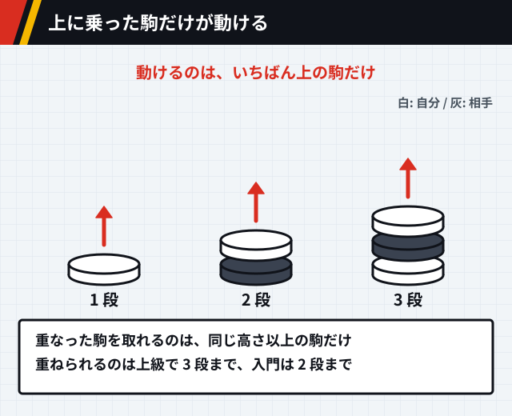
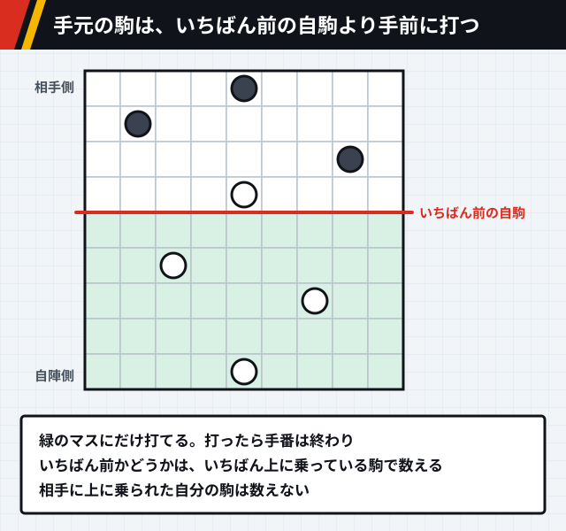
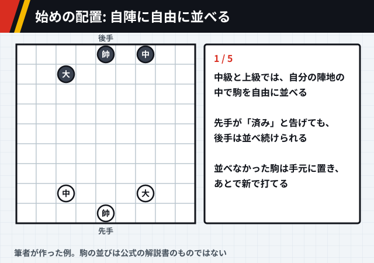
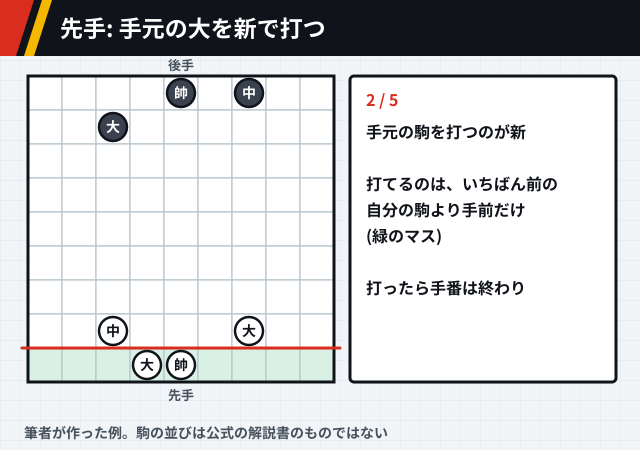
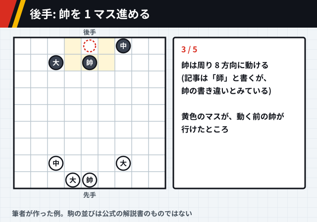
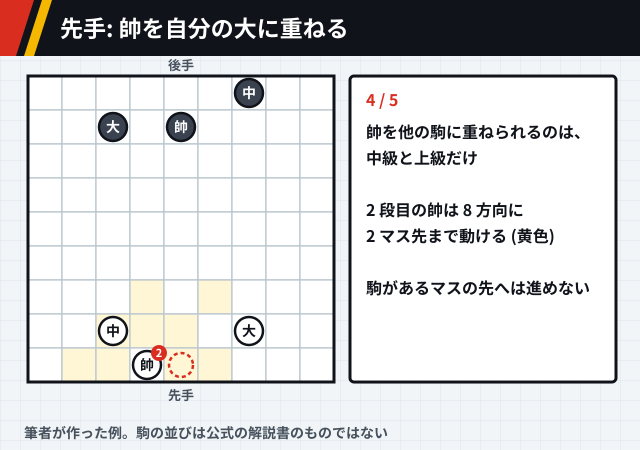
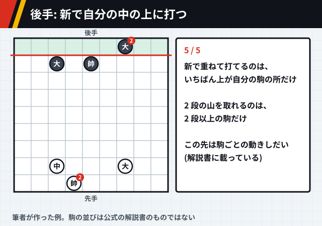

# HUNTER×HUNTER の軍儀

[← anime-guide のトップ](../../README.md) · [世界観](world.md) · [能力の一覧](abilities.md) · [参照ページ](references.md)

> [!IMPORTANT]
> **このページは AI (Claude) がまとめました。** 資料集め、文章、図を AI が作り、人は公開前に全体を確認しました。記述を一つずつ原典と照らしたものではないので、誤りがあれば [Issue か Pull Request](../../README.md#誤りを指摘する) で教えてください。

> [!WARNING]
> **このページは設定のネタバレを含みます。** あらすじはまとめませんが、軍儀の説明に要る範囲で、キメラ=アント編の対局に触れます。

軍儀は、作中の東ゴルトー共和国で生まれた盤上の競技です。作中では全部の決まりが示されておらず、2022 年に商品になったときに、作中の描写をもとに遊べるルールが作られました。このページでは、作中の設定と、商品のルールを分けて書きます。`複数サイト` [src-029] [src-012] [src-046]

## このページの確かさ

> [!CAUTION]
> **商品の解説書はネットで読めず、公式の特設サイトの解説と Q&A、発売時の記事から確かめました。駒ごとの動きの全部は分かっていません。** 解説書の文章と駒の図柄は使わず、図は自作しています。

| 印 | 意味 |
| --- | --- |
| `公式` | 公式サイトで確かめた内容です。このページの「公式」は、商品の特設サイト (ユニバーサル ミュージック) を指します。 |
| `複数サイト` | 同じ内容を別のサイトが書いていました。同じドメインは 1 と数えます。 |
| `1 サイトのみ` | 元が 1 つしか見つかっていません。 |
| `説が割れている` | 元によって内容が違います。 |

## 作中の軍儀

軍儀は東ゴルトー共和国で生まれた盤上の競技です。`複数サイト` [src-029] [src-012] 決着は王を追い詰めることでつき、始めの並びは自陣の範囲で各自が決め、駒は 3 枚まで積めます。`1 サイトのみ` [src-029]

世界王者は目の見えない少女コムギで、5 回続けて勝っています。国際大会は 15 年ほど前に始まり、優勝はいつも東ゴルトーの代表です。本国では棋士がプロとして成り立っているものの、稼ぎは少ないとされます。`1 サイトのみ` [src-029] [src-030]

### 作中での役割

> [!WARNING]
> **この小節は、キメラ=アント編の王とコムギの対局に触れます。**

キメラ=アントの王が初めて負けた相手が、軍儀の王者コムギでした。それまで盤上の勝負で負け知らずだった王は、コムギと打ち続けるうちに、軍儀の駆け引きの奥行きにのめり込んでいきます。`1 サイトのみ` [src-029] [src-034]

## 商品のルール (2022 年)

2022 年 2 月、ユニバーサル ミュージックが「HUNTER×HUNTER 軍儀」の受注を始めました。受注だけで作る品で、木の駒が白と黒 25 個ずつ、計 50 個入っています。`複数サイト` [src-047] [src-051] 2 人で遊び、時間の決まりはありません。`公式` [src-045]

### 盤と駒と勝ち負け

盤は縦横 9 マスです。`1 サイトのみ` [src-046] 王にあたる駒は帥 (スイ) で、相手の帥を詰めることを目指します。`複数サイト` [src-047] [src-051] 相手の帥を取るか、帥の逃げ場を無くして詰ませた側の勝ちで、投了を告げた側は負けです。`公式` [src-045] 取った駒は盤から外れ、将棋のように自分の駒として使い直すことはできません。`複数サイト` [src-044] [src-046]

駒の種類の数は、10 種と書く記事と、14 種と書く公式の解説とで食い違います。`説が割れている` [src-050] [src-044] 分かっている駒の例は次のとおりです。全部の駒の動きは、付属の解説書と動きの早見表に載っています。`複数サイト` [src-045] [src-048]

| 駒 | 分かっていること | 確かさ |
| --- | --- | --- |
| 帥 (スイ) | 王にあたる。取られるか詰むと負け | `複数サイト` [src-045] [src-047] |
| 帥 (スイ) の動き | 周り 8 方向に動き、2 段目にいるとさらに 1 マス先まで動ける、と紹介する記事がある。記事は「師」と書くが、公式の解説は同じ場面の駒を帥と書いているので、筆者は帥の書き違いと見ている | `1 サイトのみ` [src-049] [src-044] [src-050] |
| 大、中 | 将棋の飛車と角にあたる。重ねると動ける距離が伸びる | `1 サイトのみ` [src-049] |
| 砲、筒、弓 | 通り道に駒があっても飛び越えて動ける | `公式` [src-045] |
| 謀 | 相手の駒に重ねたとき、手元に同じ種類の駒があれば入れ替えて寝返らせられる | `公式` [src-045] |

### ツケ (駒を重ねる)

駒は、自分の駒の上にも、相手の駒の上にも、取らずに重ねられます。`複数サイト` [src-044] [src-046] 重ねると動ける範囲が広がります。`複数サイト` [src-044] [src-049]

図 1-1: `公式`×2 `1 サイトのみ` [src-044] [src-045] [src-046]

山のうち動かせるのは、いつもいちばん上の 1 枚です。相手の山の上にいた駒が降りると、その下の相手の駒はまた動けるようになります。`公式` [src-044] [src-045] 重なった駒を取れるのは、同じ高さ以上の駒だけです。`公式` [src-044] 積めるのは上級で 3 段まで、入門で 2 段までです。`複数サイト` [src-046] [src-047] [src-051] 帥を他の駒の上に重ねられるのは、中級と上級だけです。`公式` [src-045]

### 新 (あらた: 手元の駒を打つ)

始めの配置で使わなかった駒は手元に置いておき、あとで盤に打てます。これを新と呼びます。`複数サイト` [src-044] [src-046] [src-050] 打てるのは、盤の上でいちばん前にいる自分の駒より手前のマスだけで、打ったら手番は終わりです。`複数サイト` [src-044] [src-050]

図 1-2: `複数サイト` `公式`×2 [src-044] [src-045] [src-050]

いちばん前かどうかは、いちばん上に乗っている駒で数え、相手に上に乗られた自分の駒は数えません。重ねて打てるのは、いちばん上が自分の駒のところだけです。`公式` [src-045]

### 始めの配置と 4 つの段階

ルールは入門、初級、中級、上級の 4 段階です。`複数サイト` [src-047] [src-050] [src-051]

| 段階 | 始めの配置 | ほかの決まり | 確かさ |
| --- | --- | --- | --- |
| 入門 | 解説書の決まった並べ方 | 使わない駒がある。重ねは 2 段まで。親子で遊ぶ想定 | `複数サイト` [src-045] [src-046] [src-047] [src-051] |
| 初級 | 解説書の決まった並べ方 | 作中に無い決まりも足してある | `公式` [src-045] |
| 中級 | 自分の陣地の中で自由 | 帥を他の駒に重ねられる | `公式` [src-045] |
| 上級 | 自分の陣地の中で自由 | 作中のメルエムとコムギの対局に合わせた決まり。重ねは 3 段まで | `複数サイト` [src-045] [src-046] [src-047] [src-051] |

受注が始まってすぐ、そのとき公開されていたルールでは先手が必ず勝てる手順がある、という指摘が出ました。先手が好きなときに配置を終えられることが原因とされました。`複数サイト` [src-044] [src-050] その後、先手が配置を終えると告げても、後手は配置を続けられる、という決まりが足されています。`公式` [src-044]

## 序盤の流れの例

> [!NOTE]
> **この節は筆者が作った例です。** 駒ごとの動きの全部は分かっていないので、帥 (動きは前の表のとおり記事の紹介による) と、ツケ、新、取れる高さの決まりだけを使い、大と中は動かしていません。並び方は公式の解説書の例ではありません。陣地の広さも確かめられていないので、図では手前の 3 段に並べています。図の下の行の印は、例で使った決まりの確かさです。

中級か上級のルールで、配置から 4 手目までを追います。上が後手、下が先手で、白が先手、灰色が後手の駒です。赤い数字は山の段の数です。

図 2-1: `公式`×2 `複数サイト` [src-044] [src-045] [src-046]

図 2-2: `複数サイト` `公式` [src-044] [src-050]

図 2-3: `1 サイトのみ` [src-049]

図 2-4: `公式`×2 `1 サイトのみ` [src-045] [src-049]

図 2-5: `公式`×2 `複数サイト` [src-044] [src-045] [src-050]

この先は、帥を詰めるまで続きます。駒ごとの動きは付属の解説書に載っています。[src-048]

## 作中の戦法は再現できるか

作中には、孤孤狸固 (ココリコ) や中中将 (ナカチュウジョウ) といった戦法が出てきます。発売時の記事は、これらが商品のルールで再現できるかに関心を示していますが、試した結果は書いていません。`複数サイト` [src-046] [src-049] 公式は、作中でコムギとメルエムが使った技は商品でも使えるが、使えば勝てるとは限らない、としています。ただし技の名前は挙げていません。`公式` [src-045]

戦法の駒の形や手順を説明した資料は、見つかりませんでした。[src-029] [src-046] [src-049]

【考察】商品の上級には、作中と同じく 3 段までの重ね、自由な配置、手元の駒を打つ新があるので、作中の形を盤の上に作ること自体はできると考えられます。作中と同じ働きをするかは、駒ごとの動きしだいです。[src-044] [src-045] [src-046]

## そのほか

オンライン版やアプリ版は無く、ルールの提案は受け付けていません。`公式` [src-045] 2 回目の受注 (2022 年 3〜6 月) からは、駒の動きの早見表が付きました。`1 サイトのみ` [src-047] [src-048]
