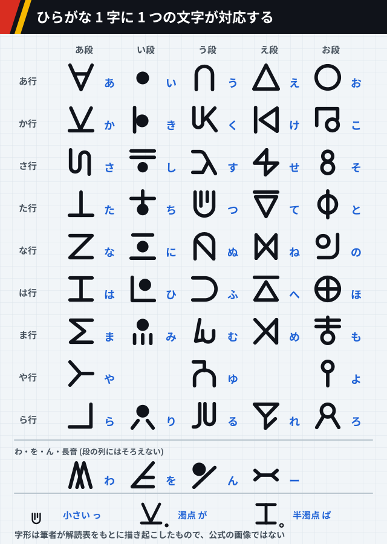
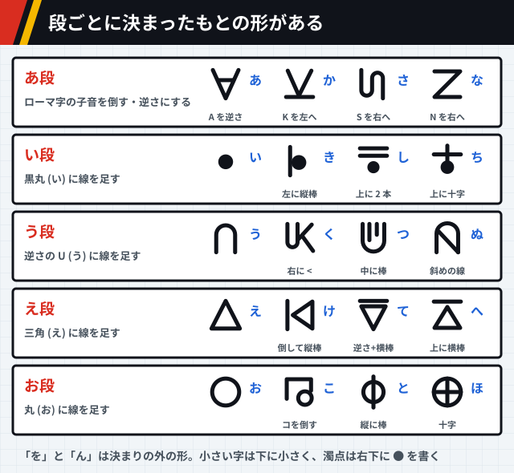
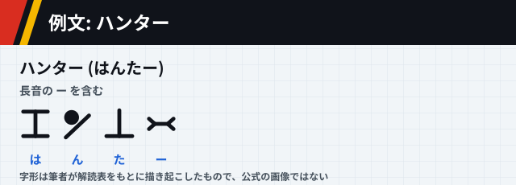
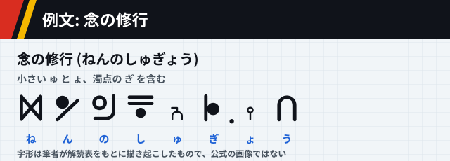
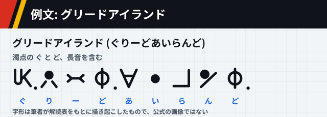
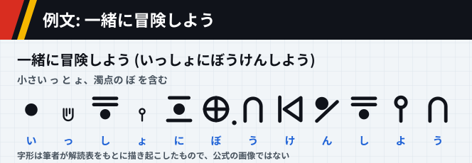

# HUNTER×HUNTER のハンター文字

[← anime-guide のトップ](../../README.md) · [世界観](world.md) · [能力の一覧](abilities.md) · [参照ページ](references.md)

> [!IMPORTANT]
> **このページは AI (Claude) がまとめました。** 資料集め、文章、図を AI が作り、人は公開前に全体を確認しました。記述を一つずつ原典と照らしたものではないので、誤りがあれば [Issue か Pull Request](../../README.md#誤りを指摘する) で教えてください。

> [!NOTE]
> **このページの文字の形は、筆者が解読表をもとに描き起こしたものです。** 公式の画像や、ほかの人が作った字の画像・フォントは載せていません。字形の細部は、作中の書き方と違うことがあります。

作中の世界では、看板やパソコンの画面、紙の文書に、独自の文字が書かれています。ファンのあいだでは「ハンター文字」と呼ばれ、背景の文字にも意味のある言葉が書かれているため、読み解いて楽しむ人がいます。`1 サイトのみ` [src-052]

## このページの確かさ

> [!CAUTION]
> **文字の対応と形は、解説記事に載っている 2 つの表で確かめました。** 1 つは記事の本文にある、日本テレビのサイトを出典とする公式の解読表で、もう 1 つは記事の見出しにある、ほかの人のアプリの早見表です。2 つの表で字の形は同じでした。図には、どちらの画像も載せていません。

| 印 | 意味 |
| --- | --- |
| `複数サイト` | 同じ内容を別のサイトが書いていました。同じドメインは 1 と数えます。 |
| `1 サイトのみ` | 元が 1 つしか見つかっていません。 |

## 文字のしくみ

ハンター文字は日本語の五十音に対応していて、ひらがな 1 字に 1 つの字があてられています。つまり、文の中身は日本語で、書き表す字だけが違います。`1 サイトのみ` [src-052] 数字は、現実と同じアラビア数字が使われます。`1 サイトのみ` [src-053]

作中ではこの文字が広く使われ、世界で共通の文字として扱われているようだ、と書く記事があります。ハンターが使うサイト「電脳ページ」でも、この文字と各国の言葉が並んでいます。ほかにひらがな、漢字、英語の表記も見られます。`1 サイトのみ` [src-053]

図 1-1: `1 サイトのみ` [src-052] [src-053]

## 字の作り

字の形には段ごとの決まりがあります。い段からお段までは、段ごとのもとの形に線を足して作られ、あ段だけは、ローマ字の子音の向きを変えた形です。`1 サイトのみ` [src-052]

- **あ段**: 「あ」は A を逆さにした形です。ほかは、ローマ字にしたときの子音の大文字を、横に倒すか逆さにした形です。「か」は K、「さ」は S、「な」は N がもとになっています。
- **い段**: 「い」は黒い丸です。ほかの字は、この丸に線を足した形です。
- **う段**: 「う」は U を逆さにした形で、ほかの字はそれに線を足します。
- **え段**: 「え」は三角で、ほかの字はそれに線を足します。
- **お段**: 「お」は丸で、ほかの字はそれに線を足します。

「を」と「ん」は、この決まりに当てはまらない形です。「ん」は、黒丸と斜めの線を組み合わせた字です。`1 サイトのみ` [src-052]

図 1-2: `1 サイトのみ` [src-052]

小さい「ゃ」「ゅ」「ょ」「っ」は、ひらがなと同じように、字を小さくして下に寄せて書きます。`1 サイトのみ` [src-052] 濁点は字の右下に黒い丸を、半濁点は白い丸を付けます。「が」なら「か」の右下に黒丸、「ぱ」なら「は」の右下に白丸です。`1 サイトのみ` [src-053] 長音の「ー」は、横線の両端が二股に分かれた形の字です。`1 サイトのみ` [src-052]

## 例文

ひらがなを 1 字ずつ置き換えると、ハンター文字の文になります。字の下に、対応するひらがなを添えています。例文は筆者が選びました。[src-052]

図 2-1: `1 サイトのみ` [src-052]

図 2-2: `1 サイトのみ` [src-052] [src-053]

図 2-3: `1 サイトのみ` [src-052] [src-053]

図 2-4: `1 サイトのみ` [src-052] [src-053]

## 読み解きの楽しみ

ファンのあいだでは、ひらがなを打ち込むとハンター文字に置き換えてくれるサイトや、表示されるページの文字を置き換える拡張機能が作られています。`1 サイトのみ` [src-053]

【考察】文字のしくみが五十音の置き換えなので、作中の看板や文書は、表さえあれば誰でも読めます。背景の小さな文字まで意味を持たせてあることが、読み解く楽しみを生んでいる、という見方ができます。[src-052]
