# HUNTER×HUNTER の世界観

[← anime-guide のトップ](../../README.md) · [能力の一覧](abilities.md) · [参照ページ](references.md)

> [!IMPORTANT]
> **このページは AI (Claude) がまとめました。** 資料集め、文章、図を AI が作り、人は公開前に全体を確認しました。記述を一つずつ原典と照らしたものではないので、誤りがあれば [Issue か Pull Request](../../README.md#誤りを指摘する) で教えてください。

> [!WARNING]
> **このページは設定のネタバレを含みます。** 念能力の仕組み、組織の決まり、場所の設定を伏せずに書きます。あらすじはまとめませんが、世界観の説明に要る展開には触れます。展開に触れる小節には、その頭に注意書きを付けます。

> [!NOTE]
> **このページは考察を含みます。** 考察は行頭に【考察】を付けて事実と分けます。他の人の考察は、元の文を写さず「という見方がある」と出典付きで短く紹介します。

この世界では、生命エネルギーのオーラを操る「念」が、強さと仕事の土台にあります。念はハンターになるための裏の試験でもあり、天空闘技場の 200 階より上やグリードアイランドのように、念を使える者だけの場所があります。`複数サイト` [src-001] [src-005] [src-029]

## このページの確かさ

> [!CAUTION]
> **2011 年版の公式サイトは見つからず、百科事典サイトや解説記事を通して確かめました。複数のサイトが一致していても、写し合っている可能性があり、正しいという保証にはなりません。** 対象は 2011 年版の全 148 話の範囲で、原作の情報は確認の補助に使います。1999 年版の設定は書きません。2011 年版より後の原作の話は、幻影旅団の結成のいきさつのように、注意書きを付けた小節に分けて書きます。

| 印 | 意味 |
| --- | --- |
| `公式` | 公式サイトで確かめた内容です。このページにはありません。 |
| `複数サイト` | 同じ内容を別のサイトが書いていました。同じドメインは 1 と数えます。 |
| `1 サイトのみ` | 元が 1 つしか見つかっていません。特に確かめが要る内容です。 |
| `説が割れている` | 元によって内容が違います。違いをそのまま並べます。 |

`1 サイトのみ` の文は、その資料がそう書いているという意味で、断定ではありません。図の下の行には、図に入れた項目の印とその件数 (×2 は 2 件) と主な出典を書きます。項目ごとの印は図の中の注記に書きます。出典の全件は [参照ページ](references.md) にあります。

## 念能力の仕組み

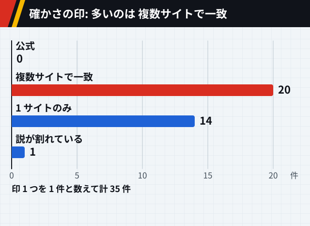

図 1-1: この節の印の数です。

### オーラと精孔

念は、体から流れ出る生命エネルギーのオーラを操る力です。`複数サイト` [src-001] [src-002] [src-003] [src-004] オーラは人間に限らず、動物や虫まであらゆる生き物が持つとされます。`複数サイト` [src-001] [src-004] 念の存在は、一般の人にはほとんど知られていません。`複数サイト` [src-001] [src-002] [src-003] [src-004]

念を使うには、全身にあるオーラの出口の精孔を開きます。開き方は 2 通りあると書く資料があります。`1 サイトのみ` [src-001] そのうち、他人のオーラで無理に開く方法は 2 つの資料が書いています。`複数サイト` [src-001] [src-004]

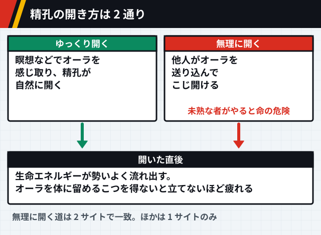

図 1-2: `複数サイト` `1 サイトのみ`×2 [src-001] [src-004]

### 四大行と応用技

基本の技は纏・絶・練・発の 4 つで、四大行と呼ばれます。すべての念能力の土台で、応用技はこの 4 つを工夫して組み合わせたものです。`複数サイト` [src-001] [src-003]

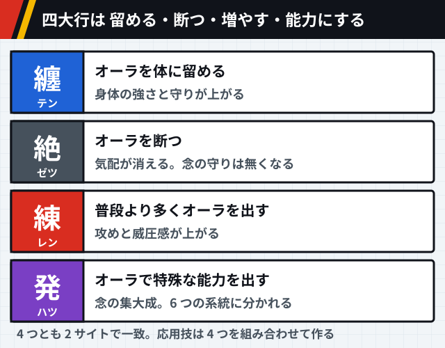

図 1-3: `複数サイト`×4 [src-001] [src-003]

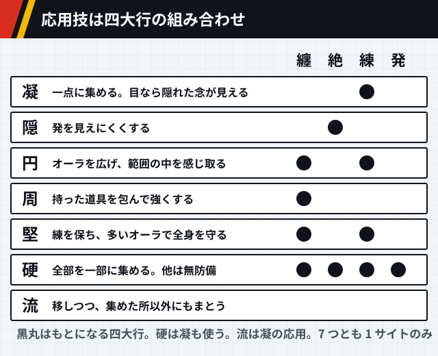

図 1-4: `1 サイトのみ`×7 [src-001]

### 6 つの系統

発は、強化系・変化系・放出系・具現化系・操作系・特質系の 6 つの系統に分かれます。`複数サイト` [src-001] [src-002] [src-003] 系統は生まれつきの資質で決まり、自分と違う系統の能力も訓練で使えますが、本来の力までは出せません。`複数サイト` [src-001] [src-002]

系統どうしには相性があります。`複数サイト` [src-001] [src-002] 良い組と悪い組を並べると、良い組は六角形の隣どうし、悪い組は向かい合う位置に収まります。`1 サイトのみ` [src-001]

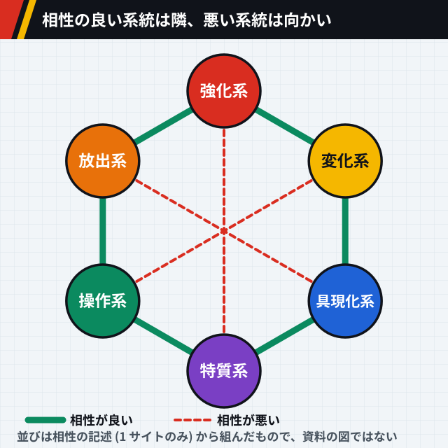

図 1-5: `複数サイト` `1 サイトのみ` [src-001] [src-002]

身につけられる割合の例として、具現化系の人なら、具現化系を 10 割、変化系を 8 割、強化系と操作系を 6 割、放出系を 4 割まで使えるとされます。`1 サイトのみ` [src-001]

特質系の身につき方は、資料で書き方が分かれます。修行では身につかず、生まれつき具現化系の才能があるか後から系統が変わった人だけが使える、と書く資料と、後から身につけられる唯一の系統と書く資料があります。`説が割れている` [src-001] [src-002] 他の系統の人が特質系の能力を使えない点は、2 つの資料で一致します。`複数サイト` [src-001] [src-002]

### 水見式

自分の系統は、水を満たしたグラスに葉を浮かべ、両手をかざしてオーラを込める水見式で調べます。`複数サイト` [src-001] [src-002]

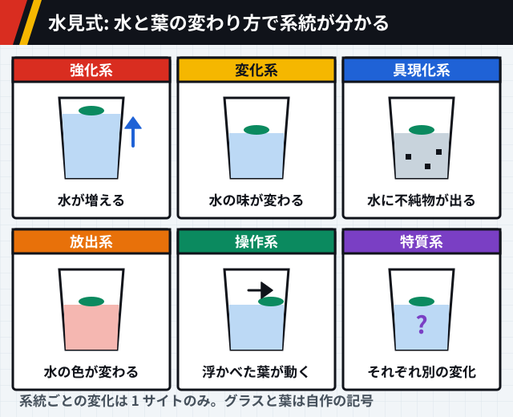

図 1-6: `複数サイト` `1 サイトのみ` [src-002] [src-001]

### 制約と誓約

能力に自分で条件や制限を決めて誓うと、その分だけ能力が強くなります。制約が厳しいほど強くなり、誓約を破ったときの代償も重くなります。代償は能力を失うことや、命を失うことです。`複数サイト` [src-001] [src-002] [src-003]

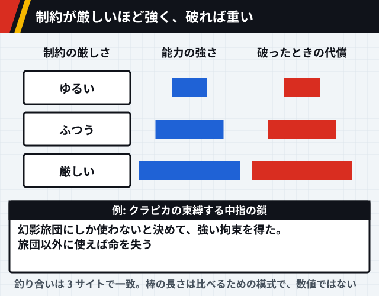

図 1-7: `複数サイト`×2 [src-001] [src-002] [src-003]

### こういう意見もある

【考察】念の戦いは、オーラの大きい方が必ず勝つ仕組みではなく、能力の相性と戦術しだいで弱い側が強い側を倒せるように作られている、という見方があります。[src-041]

【考察】図 1-5 の六角形で数えると、具現化系の人の身につけられる割合は、隣の系統で 8 割、2 つ離れた系統で 6 割、向かいの系統で 4 割と、離れるほど下がっています。ただし、資料が挙げる例は具現化系の 1 つだけです。[src-001]

## ハンターと協会

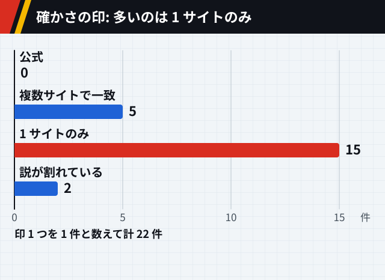

図 2-1: この節の印の数です。

### ハンター試験

プロのハンターになるための資格試験は毎年 1 回開かれ、合格率は数百万分の一と言われます。`1 サイトのみ` [src-005] 資格を得た人は、ほとんどの国で自由に出入りできるなど、最上級の優遇を受けます。`1 サイトのみ` [src-005]

試験は会場に着く前から始まっています。第 287 期では、会場への到着から最終の逆トーナメントまで、6 つの関門がありました。`1 サイトのみ` [src-005] 合格しても、念を身につけるまではハンターとして扱われません。この念の習得は裏の試験と呼ばれます。`複数サイト` [src-001] [src-002] [src-004] [src-005]

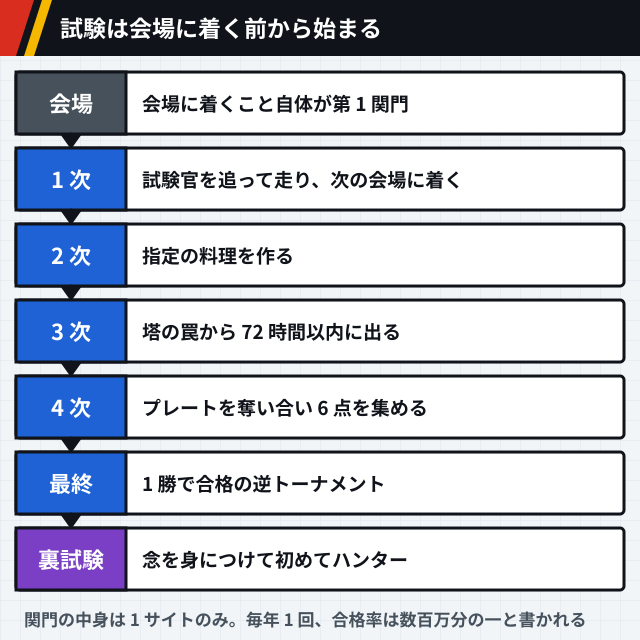

図 2-2: `1 サイトのみ`×6 `複数サイト` [src-005] [src-001] [src-002] [ほか](references.md#世界観-図-2-2)

試験官にも、追う対象を表す肩書きがあります。1 次は遺跡ハンター、2 次は美食ハンター、3 次と 4 次はブラックリストハンターが受け持ちました。`1 サイトのみ` [src-005] こうした肩書きは、本人が主にどんな仕事をするかによる俗称で、資格に種類があるわけではありません。`1 サイトのみ` [src-029]

### 協会と十二支ん

ハンター協会はすべてのハンターが属する組織で、試験の運営とハンターの支えを受け持ち、政府の機関とも結びついています。`1 サイトのみ` [src-007]

協会の最高幹部は十二支んと呼ばれる 12 人で、干支をコードネームにしています。有事には協会を回し、会長の暇つぶしの相手もします。`複数サイト` [src-006] [src-007] 多くは割り当てられた干支の動物に合わせて名前や外見を変えていますが、子と亥の 2 人は変えていません。`複数サイト` [src-006] [src-007] [src-008]

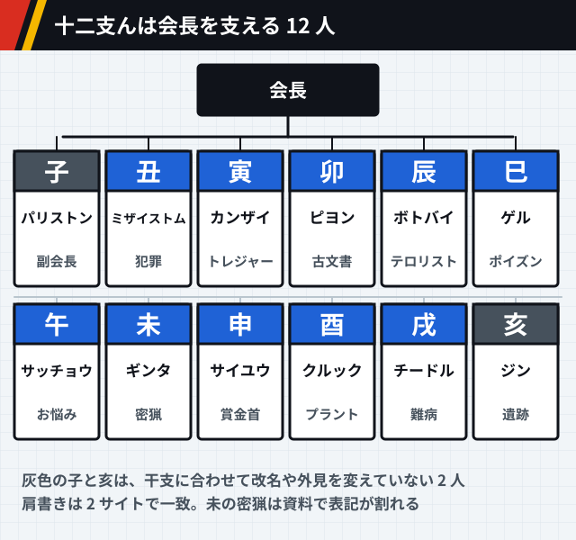

図 2-3: `複数サイト` `説が割れている` [src-006] [src-007] [src-008]

未の肩書きは、「密猟ハンター」と書く資料と「密漁ハンター」と書く資料に分かれます。`説が割れている` [src-006] [src-007]

ハンターには一ツ星から三ツ星までの星の格付けがあり、十二支んでは三ツ星が 3 人、二ツ星が 3 人と書かれています。`1 サイトのみ` [src-007] [src-008] 星がどういう条件で付くかは、読めた資料には書かれていませんでした。[src-007] [src-008]

十二支んには派閥があり、バランス重視の穏健保守派と、改革推進のタカ派に分かれています。どちらにも属さない人もいます。`複数サイト` [src-006] [src-036] 協会には、政府や企業から協会に来た依頼を専門に請け負う協専ハンターもいます。`1 サイトのみ` [src-029]

### 会長選挙の決まり

協会はハンター十ヶ条という規約を持ち、プロハンターの選び方、プロの行動指針、会長や参謀の選び方などを定めています。`1 サイトのみ` [src-029] 2011 年版の最後の編の会長選挙には、記名投票の決まりが盛り込まれました。`1 サイトのみ` [src-030] 投票率が 95% に届かなければ再選挙になる、という決まりがあったと書く資料もあります。`1 サイトのみ` [src-037] 誰が投票できるか、当選に何票要るかは、読めた資料の原文では確かめられませんでした。[src-029] [src-030]

### こういう意見もある

【考察】十二支んの「ん」には、仏教の 12 の武神である十二神 (じゅうにしん) を重ねた掛け言葉だ、という見方があります。[src-038]

【考察】穏健保守派は、ネテロが作った協会の体制を守ろうとする立場だ、という見方があります。[src-036]

【考察】副会長の立場は、協専ハンターへの仕事の振り分けと独自の派閥を通じて、私的な利益や会長への妨害に使える作りになっていた、という見方があります。[src-037]

【考察】試験に受かっても念を身につけるまでハンターと扱わない仕組みは、ハンターを名乗れる人を、念という一般に知られていない力を持つ人に絞る働きをしていると考えられます。[src-001] [src-005]

## 世界の場所と勢力

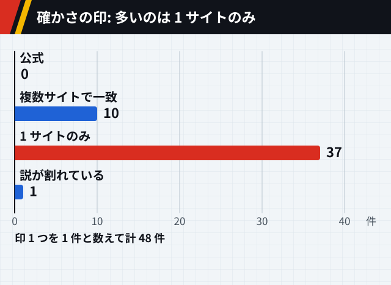

図 3-1: この節の印の数です。

### 2011 年版の範囲

2011 年版は 2011 年 10 月 2 日から 2014 年 9 月 24 日まで、日本テレビ系で放送されました。全 148 話で、第 13 話と第 26 話は総集編です。`1 サイトのみ` [src-009] キメラ=アント編から会長選挙・アルカ編までは、このときが初めてのアニメ化でした。`複数サイト` [src-009] [src-012]

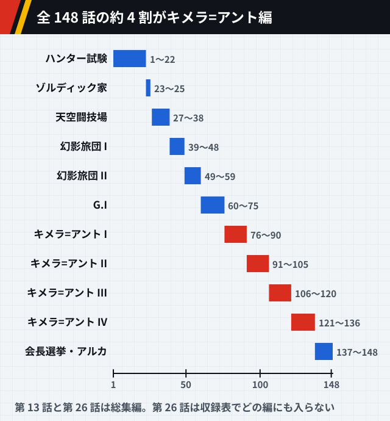

図 3-2: `1 サイトのみ` [src-009]

### ゾルディック家

ゾルディック家は、パドキア共和国デントラ地区にある標高 3722 メートルの死火山、ククルーマウンテンに屋敷を構えています。山と周りの樹海は一家の土地で、観光名所にもなっています。`1 サイトのみ` [src-010]

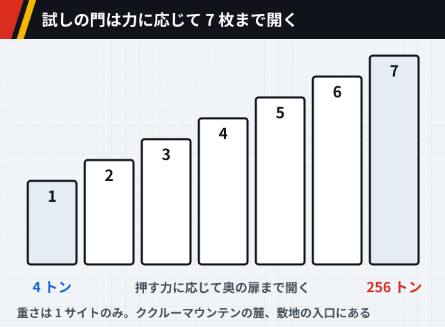

図 3-3: `1 サイトのみ` [src-010]

敷地の入口の門は、正しく開けないと番犬に襲われる仕掛けになっています。家族のあいだには、家族内での取引や家族内の指令、家族どうしで殺し合わないといった掟があります。`1 サイトのみ` [src-010]

### 天空闘技場

天空闘技場は 251 階、高さ 991 メートルの格闘の塔で、小遣い稼ぎに多くのハンターが使います。`1 サイトのみ` [src-029]

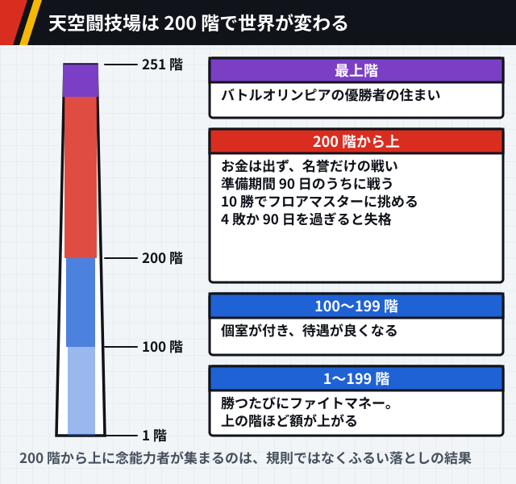

図 3-4: `1 サイトのみ`×5 [src-029]

200 階より上が念能力者だけの場所になっているのは、決まりではありません。念を知らずに戦った者が、念の攻撃で目覚めるか再起不能になって、ふるい落とされた結果です。係員や解説者は念を知りません。`1 サイトのみ` [src-029]

### ヨークシンと裏社会

ヨークシンシティでは、毎年 9 月 1 日から 10 日まで大規模なオークションが開かれます。`1 サイトのみ` [src-029] 裏社会のマフィアンコミュニティーは十老頭を頭とし、十老頭は 6 大陸 10 地区を縄張りにする大組織の長たちです。`1 サイトのみ` [src-030]

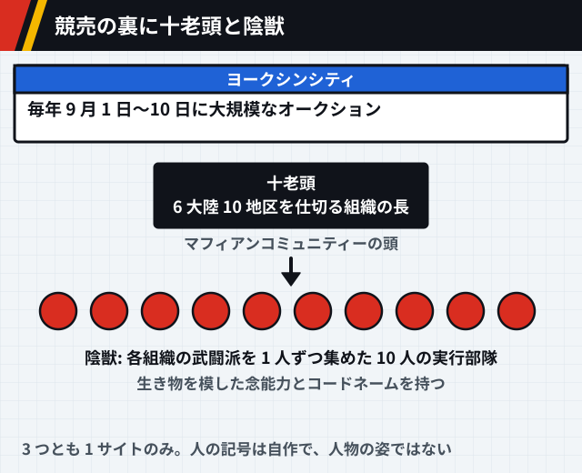

図 3-5: `1 サイトのみ`×3 [src-029] [src-030]

### 幻影旅団と流星街

幻影旅団は、団長を蜘蛛の頭、団員を 12 本の脚に見立てた 13 人の盗賊の集団で、全員が念能力者です。団員は番号入りの蜘蛛の刺青を体のどこかに入れ、旅団は「クモ」とも呼ばれます。`複数サイト` [src-011] [src-035] 入るには在団員を倒すことが条件の一つです。それ以外の欠員の埋め方は、団長が補うと書く資料と、団員の推薦が要ると書く資料に分かれます。`説が割れている` [src-011] [src-035]

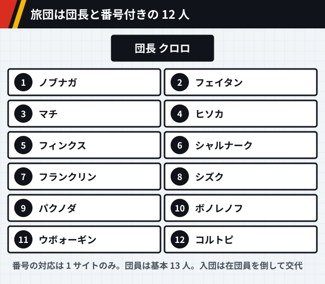

図 3-6: `1 サイトのみ` [src-011]

流星街は、外の世界から要らなくなった物も人も流れ込んでくる土地です。`1 サイトのみ` [src-035] 旅団の拠点で、団員の多くが育った場所でもあります。`複数サイト` [src-011] [src-012] [src-035] 住民は互いを固くかばい合い、仲間が外で殺されると街ぐるみで仕返しをします。弱い立場の住民にとって、旅団は外の権力に逆らう頼もしい存在です。`1 サイトのみ` [src-035]

旅団でいちばん大事にされるのは団という組織そのもので、団長の命もその下に置かれます。仲間どうしで殺し合うことは禁じられ、意見が割れたらコインを投げて決めます。ふだんは各自で過ごし、団長が声をかけたときに集まります。`1 サイトのみ` [src-035]

#### 結成のいきさつ (原作の過去編)

> [!WARNING]
> **この小節は、2011 年版より後に原作で描かれた過去編に触れます。** 結成に関わる事実だけを書き、場面の流れは書きません。

結成のときの団員は、クロロ、マチ、パクノダ、ノブナガ、ウボォーギン、フェイタン、フィンクス、シャルナーク、フランクリンの 9 人で、全員が流星街の出身です。いつ結成したかは分かっていません。`1 サイトのみ` [src-035] 旅団を作ったのは団長のクロロです。`複数サイト` [src-011] [src-035] クロロは作ったときから、自分が倒れても代わりの者が団を率いればよいと考え、団が続くことを自分の命より上に置いていました。`1 サイトのみ` [src-035]

結成の顔ぶれの幼なじみには、サラサとシーラという少女がいました。マチとパクノダに念の手ほどきをしたのは、流星街に住むエンバーマーのレンコです。流星街の長老の 1 人は、街のおきてと仕返しをやり遂げることを何より重んじる人物でした。`1 サイトのみ` [src-030]

### グリードアイランド

グリードアイランドは、ジンと仲間たちが作ったハンター向けのゲームです。`複数サイト` [src-029] [src-030] [src-032] [src-033] 念で作られています。`1 サイトのみ` [src-029] 念を込めると起動します。`1 サイトのみ` [src-032]

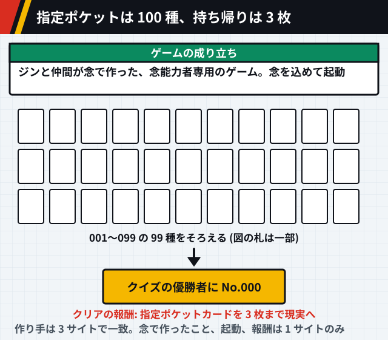

図 3-7: `複数サイト`×3 `1 サイトのみ`×3 [src-029] [src-031] [src-032] [ほか](references.md#世界観-図-3-7)

指定ポケットカードは No.000 から No.099 までの 100 種です。`複数サイト` [src-031] [src-032] 001 から 099 をそろえるとクイズが出され、優勝者に No.000 の「支配者の祝福」が与えられます。賞品は城と城下町です。`複数サイト` [src-031] [src-032] クリアすると、指定ポケットカードを 3 枚まで現実に持ち帰れます。`1 サイトのみ` [src-032] ゲームの舞台が現実のどこにあるかは、読めた資料には書かれていませんでした。[src-029] [src-031] [src-032] [src-033]

### キメラ=アントと NGL

キメラ=アントは、第一級の隔離指定種に定められた昆虫です。女王は他の生き物を食べ、その外見や習性、時には前世の記憶まで子に伝えて産みます。この生態は摂取交配と呼ばれます。`1 サイトのみ` [src-012]

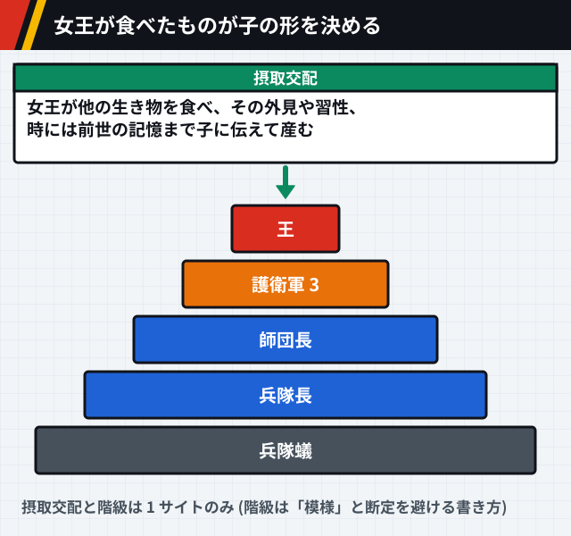

図 3-8: `1 サイトのみ`×2 [src-012]

NGL 自治国は、ミテネ連邦を作る 4 国のうちただ一つの自治国です。自然に帰る暮らしを掲げ、機械文明の産物を持ち込むことを法で禁じています。`1 サイトのみ` [src-029] 東ゴルトー共和国は、共和制とは名ばかりの独裁国家です。`1 サイトのみ` [src-029]

### こういう意見もある

【考察】天空闘技場の 200 階より上、グリードアイランド、ハンターの裏の試験のように、この世界では念を使える者だけが入れる場が、決まりではなく仕組みや選別の結果として作られています。念が一般に知られていないことと合わせると、表の社会の上に、念を知る者だけの層が重なっていると読めます。[src-001] [src-029]
