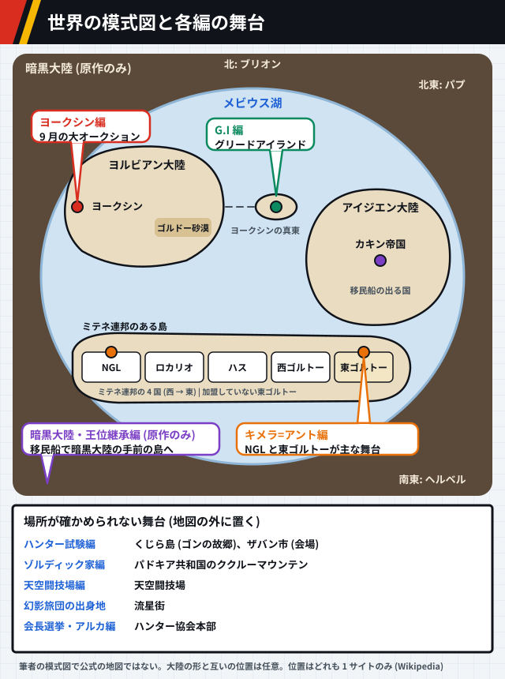

# HUNTER×HUNTER の世界観

[← anime-guide のトップ](../../README.md) · [能力の一覧](abilities.md) · [参照ページ](references.md)

> [!IMPORTANT]
> **このページは AI (Claude) がまとめました。** 資料集め、文章、図を AI が作り、人は公開前に全体を確認しました。記述を一つずつ原典と照らしたものではないので、誤りがあれば [Issue か Pull Request](../../README.md#誤りを指摘する) で教えてください。

> [!WARNING]
> **このページは設定のネタバレを含みます。** 念能力の仕組み、組織の決まり、場所の設定を伏せずに書きます。あらすじはまとめませんが、世界観の説明に要る展開には触れます。展開に触れる小節には、その頭に注意書きを付けます。

> [!NOTE]
> **このページは考察を含みます。** 考察は行頭に【考察】を付けて事実と分けます。他の人の考察は、元の文を写さず「という見方がある」と出典付きで短く紹介します。

この世界では、生命エネルギーのオーラを操る「念」が、強さと仕事の土台にあります。念はハンターになるための裏の試験でもあり、天空闘技場の 200 階より上やグリードアイランドのように、念を使える者だけの場所があります。`複数サイト` [src-001] [src-005] [src-029]

## このページの確かさ

> [!CAUTION]
> **2011 年版の公式サイトは見つからず、百科事典サイトや解説記事を通して確かめました。複数のサイトが一致していても、写し合っている可能性があり、正しいという保証にはなりません。** 対象は 2011 年版の全 148 話の範囲で、原作の情報は確認の補助に使います。1999 年版の設定は書きません。2011 年版より後の原作の話は、幻影旅団の結成のいきさつのように、注意書きを付けた小節に分けて書きます。

| 印 | 意味 |
| --- | --- |
| `公式` | 公式サイトで確かめた内容です。このページにはありません。 |
| `複数サイト` | 同じ内容を別のサイトが書いていました。同じドメインは 1 と数えます。 |
| `1 サイトのみ` | 元が 1 つしか見つかっていません。特に確かめが要る内容です。 |
| `説が割れている` | 元によって内容が違います。違いをそのまま並べます。 |

`1 サイトのみ` の文は、その資料がそう書いているという意味で、断定ではありません。図の下の行には、図に入れた項目の印とその件数 (×2 は 2 件) と主な出典を書きます。項目ごとの印は図の中の注記に書きます。出典の全件は [参照ページ](references.md) にあります。

## 念能力の仕組み

図 1-1: この節の印の数です。

### オーラと精孔

念は、体から流れ出る生命エネルギーのオーラを操る力です。`複数サイト` [src-001] [src-002] [src-003] [src-004] オーラは人間に限らず、動物や虫まであらゆる生き物が持つとされます。`複数サイト` [src-001] [src-004] 念の存在は、一般の人にはほとんど知られていません。`複数サイト` [src-001] [src-002] [src-003] [src-004]

念を使うには、全身にあるオーラの出口の精孔を開きます。開き方は 2 通りあると書く資料があります。`1 サイトのみ` [src-001] そのうち、他人のオーラで無理に開く方法は 2 つの資料が書いています。`複数サイト` [src-001] [src-004]

図 1-2: `複数サイト` `1 サイトのみ`×2 [src-001] [src-004]

### 四大行と応用技

基本の技は纏・絶・練・発の 4 つで、四大行と呼ばれます。すべての念能力の土台で、応用技はこの 4 つを工夫して組み合わせたものです。`複数サイト` [src-001] [src-003]

図 1-3: `複数サイト`×4 [src-001] [src-003]

図 1-4: `1 サイトのみ`×7 [src-001]

### 6 つの系統

発は、強化系・変化系・放出系・具現化系・操作系・特質系の 6 つの系統に分かれます。`複数サイト` [src-001] [src-002] [src-003] 系統は生まれつきの資質で決まり、自分と違う系統の能力も訓練で使えますが、本来の力までは出せません。`複数サイト` [src-001] [src-002]

系統どうしには相性があります。`複数サイト` [src-001] [src-002] 良い組と悪い組を並べると、良い組は六角形の隣どうし、悪い組は向かい合う位置に収まります。`1 サイトのみ` [src-001]

図 1-5: `複数サイト` `1 サイトのみ` [src-001] [src-002]

身につけられる割合の例として、具現化系の人なら、具現化系を 10 割、変化系を 8 割、強化系と操作系を 6 割、放出系を 4 割まで使えるとされます。`1 サイトのみ` [src-001]

特質系の身につき方は、資料で書き方が分かれます。修行では身につかず、生まれつき具現化系の才能があるか後から系統が変わった人だけが使える、と書く資料と、後から身につけられる唯一の系統と書く資料があります。`説が割れている` [src-001] [src-002] 他の系統の人が特質系の能力を使えない点は、2 つの資料で一致します。`複数サイト` [src-001] [src-002]

### 水見式

自分の系統は、水を満たしたグラスに葉を浮かべ、両手をかざしてオーラを込める水見式で調べます。`複数サイト` [src-001] [src-002]

図 1-6: `複数サイト` `1 サイトのみ` [src-002] [src-001]

### 制約と誓約

能力に自分で条件や制限を決めて誓うと、その分だけ能力が強くなります。制約が厳しいほど強くなり、誓約を破ったときの代償も重くなります。代償は能力を失うことや、命を失うことです。`複数サイト` [src-001] [src-002] [src-003]

図 1-7: `複数サイト`×2 [src-001] [src-002] [src-003]

### こういう意見もある

【考察】念の戦いは、オーラの大きい方が必ず勝つ仕組みではなく、能力の相性と戦術しだいで弱い側が強い側を倒せるように作られている、という見方があります。[src-041]

【考察】図 1-5 の六角形で数えると、具現化系の人の身につけられる割合は、隣の系統で 8 割、2 つ離れた系統で 6 割、向かいの系統で 4 割と、離れるほど下がっています。ただし、資料が挙げる例は具現化系の 1 つだけです。[src-001]

## ハンターと協会

図 2-1: この節の印の数です。

### ハンター試験

プロのハンターになるための資格試験は毎年 1 回開かれ、合格率は数百万分の一と言われます。`1 サイトのみ` [src-005] 資格を得た人は、ほとんどの国で自由に出入りできるなど、最上級の優遇を受けます。`1 サイトのみ` [src-005]

試験は会場に着く前から始まっています。第 287 期では、会場への到着から最終の逆トーナメントまで、6 つの関門がありました。`1 サイトのみ` [src-005] 合格しても、念を身につけるまではハンターとして扱われません。この念の習得は裏の試験と呼ばれます。`複数サイト` [src-001] [src-002] [src-004] [src-005]

図 2-2: `1 サイトのみ`×6 `複数サイト` [src-005] [src-001] [src-002] [ほか](references.md#世界観-図-2-2)

試験官にも、追う対象を表す肩書きがあります。1 次は遺跡ハンター、2 次は美食ハンター、3 次と 4 次はブラックリストハンターが受け持ちました。`1 サイトのみ` [src-005] こうした肩書きは、本人が主にどんな仕事をするかによる俗称で、資格に種類があるわけではありません。`1 サイトのみ` [src-029]

### 協会と十二支ん

ハンター協会はすべてのハンターが属する組織で、試験の運営とハンターの支えを受け持ち、政府の機関とも結びついています。`1 サイトのみ` [src-007]

協会の最高幹部は十二支んと呼ばれる 12 人で、干支をコードネームにしています。有事には協会を回し、会長の暇つぶしの相手もします。`複数サイト` [src-006] [src-007] 多くは割り当てられた干支の動物に合わせて名前や外見を変えていますが、子と亥の 2 人は変えていません。`複数サイト` [src-006] [src-007] [src-008]

図 2-3: `複数サイト` `説が割れている` [src-006] [src-007] [src-008]

未の肩書きは、「密猟ハンター」と書く資料と「密漁ハンター」と書く資料に分かれます。`説が割れている` [src-006] [src-007]

ハンターには一ツ星から三ツ星までの星の格付けがあり、十二支んでは三ツ星が 3 人、二ツ星が 3 人と書かれています。`1 サイトのみ` [src-007] [src-008] 星がどういう条件で付くかは、読めた資料には書かれていませんでした。[src-007] [src-008]

十二支んには派閥があり、バランス重視の穏健保守派と、改革推進のタカ派に分かれています。どちらにも属さない人もいます。`複数サイト` [src-006] [src-036] 協会には、政府や企業から協会に来た依頼を専門に請け負う協専ハンターもいます。`1 サイトのみ` [src-029]

### 会長選挙の決まり

協会はハンター十ヶ条という規約を持ち、プロハンターの選び方、プロの行動指針、会長や参謀の選び方などを定めています。`1 サイトのみ` [src-029] 2011 年版の最後の編の会長選挙には、記名投票の決まりが盛り込まれました。`1 サイトのみ` [src-030] 投票率が 95% に届かなければ再選挙になる、という決まりがあったと書く資料もあります。`1 サイトのみ` [src-037] 誰が投票できるか、当選に何票要るかは、読めた資料の原文では確かめられませんでした。[src-029] [src-030]

### こういう意見もある

【考察】十二支んの「ん」には、仏教の 12 の武神である十二神 (じゅうにしん) を重ねた掛け言葉だ、という見方があります。[src-038]

【考察】穏健保守派は、ネテロが作った協会の体制を守ろうとする立場だ、という見方があります。[src-036]

【考察】副会長の立場は、協専ハンターへの仕事の振り分けと独自の派閥を通じて、私的な利益や会長への妨害に使える作りになっていた、という見方があります。[src-037]

【考察】試験に受かっても念を身につけるまでハンターと扱わない仕組みは、ハンターを名乗れる人を、念という一般に知られていない力を持つ人に絞る働きをしていると考えられます。[src-001] [src-005]

## 世界の場所と勢力

図 3-1: この節の印の数です。

### 世界の模式図

> [!WARNING]
> **この小節は、2011 年版より後の原作 (暗黒大陸・王位継承編) で分かった世界の外側と、キメラ=アント編の舞台に触れます。**

暗黒大陸は、人の知る世界をさらに外から取り巻く大地です。そのただ中にメビウス湖という大きな湖があり、人の知る世界はこの湖の真ん中に収まっています。`1 サイトのみ` [src-029] ヨークシンシティはヨルビアン大陸の西の端にあり、グリードアイランドはヨークシンシティの真東の海に浮かぶ、北海道ほどの島です。`1 サイトのみ` [src-029] [src-043] ヨークシンシティの東には、ゴルドー砂漠という荒野が広がります。カキン帝国はアイジエン大陸の中央にあります。ミテネ連邦のある島には、西から NGL 自治国、ロカリオ共和国、ハス共和国、西ゴルトー共和国の 4 国が並び、その東に、連邦に入っていない東ゴルトー共和国があります。`1 サイトのみ` [src-029]

図 3-2: `1 サイトのみ`×7 [src-029] [src-043]

アイジエン大陸は、形がアジア大陸に当たるという出典の記述に従い、現実のアジアの形で描きました。`1 サイトのみ` [src-029] 形は、自由に使える地図データから取っています。[src-054] ほかの大陸の形と、大陸どうしの位置は筆者が決めたもので、公式の地図ではありません。くじら島、ザバン市、パドキア共和国、天空闘技場、流星街、ハンター協会本部は、どの大陸のどのあたりにあるかを読めた資料で確かめられなかったので、図の下の枠に並べています。[src-029] [src-030] 暗黒大陸の方角は、人の住む世界から見た向きで、ブリオンは北、パプは北東の沿岸の山地、ヘルベルは南東にいるとされます。`1 サイトのみ` [src-029]

### 2011 年版の範囲

2011 年版は 2011 年 10 月 2 日から 2014 年 9 月 24 日まで、日本テレビ系で放送されました。全 148 話で、第 13 話と第 26 話は総集編です。`1 サイトのみ` [src-009] キメラ=アント編から会長選挙・アルカ編までは、このときが初めてのアニメ化でした。`複数サイト` [src-009] [src-012]

図 3-3: `1 サイトのみ` [src-009]

### ゾルディック家

ゾルディック家は、パドキア共和国デントラ地区にある標高 3722 メートルの死火山、ククルーマウンテンに屋敷を構えています。山と周りの樹海は一家の土地で、観光名所にもなっています。`1 サイトのみ` [src-010]

図 3-4: `1 サイトのみ` [src-010]

敷地の入口の門は、正しく開けないと番犬に襲われる仕掛けになっています。家族のあいだには、家族内での取引や家族内の指令、家族どうしで殺し合わないといった掟があります。`1 サイトのみ` [src-010]

### 天空闘技場

天空闘技場は 251 階、高さ 991 メートルの格闘の塔で、小遣い稼ぎに多くのハンターが使います。`1 サイトのみ` [src-029]

図 3-5: `1 サイトのみ`×5 [src-029]

200 階より上が念能力者だけの場所になっているのは、決まりではありません。念を知らずに戦った者が、念の攻撃で目覚めるか再起不能になって、ふるい落とされた結果です。係員や解説者は念を知りません。`1 サイトのみ` [src-029]

### ヨークシンと裏社会

ヨークシンシティでは、毎年 9 月 1 日から 10 日まで大規模なオークションが開かれます。`1 サイトのみ` [src-029] 裏社会のマフィアンコミュニティーは十老頭を頭とし、十老頭は 6 大陸 10 地区を縄張りにする大組織の長たちです。`1 サイトのみ` [src-030]

図 3-6: `1 サイトのみ`×3 [src-029] [src-030]

### 幻影旅団と流星街

幻影旅団は、団長を蜘蛛の頭、団員を 12 本の脚に見立てた 13 人の盗賊の集団で、全員が念能力者です。団員は番号入りの蜘蛛の刺青を体のどこかに入れ、旅団は「クモ」とも呼ばれます。`複数サイト` [src-011] [src-035] 入るには在団員を倒すことが条件の一つです。それ以外の欠員の埋め方は、団長が補うと書く資料と、団員の推薦が要ると書く資料に分かれます。`説が割れている` [src-011] [src-035]

図 3-7: `1 サイトのみ` [src-011]

流星街は、外の世界から要らなくなった物も人も流れ込んでくる土地です。`1 サイトのみ` [src-035] 旅団の拠点で、団員の多くが育った場所でもあります。`複数サイト` [src-011] [src-012] [src-035] 住民は互いを固くかばい合い、仲間が外で殺されると街ぐるみで仕返しをします。弱い立場の住民にとって、旅団は外の権力に逆らう頼もしい存在です。`1 サイトのみ` [src-035]

旅団でいちばん大事にされるのは団という組織そのもので、団長の命もその下に置かれます。仲間どうしで殺し合うことは禁じられ、意見が割れたらコインを投げて決めます。ふだんは各自で過ごし、団長が声をかけたときに集まります。`1 サイトのみ` [src-035]

#### 結成のいきさつ (原作の過去編)

> [!WARNING]
> **この小節は、2011 年版より後に原作で描かれた過去編に触れます。** 結成に関わる事実だけを書き、場面の流れは書きません。

結成のときの団員は、クロロ、マチ、パクノダ、ノブナガ、ウボォーギン、フェイタン、フィンクス、シャルナーク、フランクリンの 9 人で、全員が流星街の出身です。いつ結成したかは分かっていません。`1 サイトのみ` [src-035] 旅団を作ったのは団長のクロロです。`複数サイト` [src-011] [src-035] クロロは作ったときから、自分が倒れても代わりの者が団を率いればよいと考え、団が続くことを自分の命より上に置いていました。`1 サイトのみ` [src-035]

結成の顔ぶれの幼なじみには、サラサとシーラという少女がいました。マチとパクノダに念の手ほどきをしたのは、流星街に住むエンバーマーのレンコです。流星街の長老の 1 人は、街のおきてと仕返しをやり遂げることを何より重んじる人物でした。`1 サイトのみ` [src-030]

### グリードアイランド

グリードアイランドは、ジンと仲間たちが作ったハンター向けのゲームです。`複数サイト` [src-029] [src-030] [src-032] [src-033] 念で作られています。`1 サイトのみ` [src-029] 念を込めると起動します。`1 サイトのみ` [src-032]

図 3-8: `複数サイト`×3 `1 サイトのみ`×3 [src-029] [src-031] [src-032] [ほか](references.md#世界観-図-3-8)

指定ポケットカードは No.000 から No.099 までの 100 種です。`複数サイト` [src-031] [src-032] 001 から 099 をそろえるとクイズが出され、優勝者に No.000 の「支配者の祝福」が与えられます。賞品は城と城下町です。`複数サイト` [src-031] [src-032] クリアすると、指定ポケットカードを 3 枚まで現実に持ち帰れます。`1 サイトのみ` [src-032] 島は現実の世界にあり、ヨークシンシティの真東に浮かんでいます (図 3-2)。`1 サイトのみ` [src-043]

#### カードのランクと限度枚数

ランクは入手の難しさを表し、いちばん難しい SS から S、A と続いて H までの段階があります。島の中でカードの形でいられる枚数にも、カードごとに上限 (限度枚数) が決まっていて、難しいカードほど上限が低い傾向です。上限に達しているカードは、持ち主がアイテムに戻すか、持ち主のデータがゲームから消えるまで、ほかの人の手では新たにカードになりません。`1 サイトのみ` [src-043]

#### 指定ポケットカード (No.000〜099)

100 枚のうち、ランクが B より下なのは No.084 の聖騎士の首飾り (D) だけです。効果の欄は、カードの説明を筆者の言葉で短くまとめたものです。番号、名前、ランク、限度枚数は `1 サイトのみ` [src-043] です。

| 番号 | 名前 | ランク | 限度枚数 | 効果 (要約) | 出典 |
| --- | --- | --- | --- | --- | --- |
| No.000 | 支配者の祝福 | SS | 1 | クイズの優勝者に城と、住人が持ち主の決まりに従う 1 万人の城下町が付く | [src-043] |
| No.001 | 一坪の密林 | SS | 3 | 固有の動物ばかりが住む大きな森への入り口。動物は人によくなつく | [src-043] |
| No.002 | 一坪の海岸線 | SS | 3 | 入るたびに形の変わる海底の洞窟への入り口 | [src-043] |
| No.003 | 湧き水の壷 | A | 17 | きれいな水が 1 日 1440 リットル湧く壷 | [src-043] |
| No.004 | 美肌温泉 | A | 15 | 毎日少し浸かるだけで肌の悩みが消える温泉 | [src-043] |
| No.005 | 神隠しの洞 | S | 8 | 入ると国内の人のいない場所へ飛ばされ、お金を使わずに戻ってこられる洞 | [src-043] |
| No.006 | 酒生みの泉 | A | 15 | 汲んだ水を 1 週間置くと、種類は選べないがおいしい酒になる泉 | [src-043] |
| No.007 | 身重の石 | S | 10 | 1 か月身につけると、男女を問わず子を宿す石。男石と女石がある | [src-043] |
| No.008 | 不思議ケ池 | S | 10 | 魚を 1 匹入れると翌日に 1 匹増え、どんな水の魚も一緒に住める池 | [src-043] |
| No.009 | 豊作の樹 | S | 10 | どんな果物も実り、取っても翌日には実が戻る樹 | [src-043] |
| No.010 | 黄金るるぶ | A | 20 | 好みの相手と出会える場所と時間が載った旅の雑誌 | [src-043] |
| No.011 | 黄金天秤 | B | 30 | 2 つから選ぶとき、将来のためになる方を選んでくれる天秤 | [src-043] |
| No.012 | 黄金辞典 | S | 10 | 光っている言葉を覚えると、翌日に役立つ辞典 | [src-043] |
| No.013 | 幸福通帳 | A | 20 | 小さな幸運を貯めておき、お金に換えて引き出せる通帳 | [src-043] |
| No.014 | 縁切り鋏 | B | 22 | 写真を切ると、写っている人と二度と会わずに済む鋏 | [src-043] |
| No.015 | きまぐれ魔人 | S | 10 | 願いを 1000 個言うと、魔人がそこから 3 つを選んでかなえる | [src-043] |
| No.016 | 妖精王の忠告 | S | 6 | 足りない点や直すべき点を優しく助言してくれる。ときどき勝手に現れる | [src-043] |
| No.017 | 大天使の息吹 | SS | 3 | どんな重い傷や病も一息で治す天使。現れるのは 1 回だけ | [src-043] |
| No.018 | 小悪魔のウインク | A | 18 | 受けた人がこの上ない快感を味わうウインク。くせになるので注意 | [src-043] |
| No.019 | 遊魂枕 | A | 13 | 寝ている間に魂だけで出歩ける枕。丸一日のうちに戻らないと幽霊のままになる | [src-043] |
| No.020 | 心度計 | B | 30 | 今の心の状態を示し、針を合わせて心を整えられる時計 | [src-043] |
| No.021 | スケルトンメガネ | B | 27 | 目盛りで強さを変えながら物の中を見通せる眼鏡。マサドラの呪文の袋だけは見えない | [src-043] |
| No.022 | トラエモン | A | 22 | 袋に物を溜め込む珍しい獣。中に貴重な品が入っていることがある | [src-043] |
| No.023 | アドリブブック | B | 30 | 読むたびに話が変わる本。しおりを挟まないと続きが別の話になる | [src-043] |
| No.024 | もしもテレビ | A | 20 | 「もしも」を入力すると、その結果を記録番組にして流すテレビ | [src-043] |
| No.025 | リスキーダイス | B | 30 | 20 面のうち 19 面が大吉、1 面が大凶のサイコロ。大凶が出ると、それまでの大吉に見合う不幸が来る | [src-043] |
| No.026 | 7人の働く小人 | A | 20 | 持ち主の眠っている時間に、代わりに働く小人たち。持ち主にできない仕事はしない | [src-043] |
| No.027 | 顔パス回数券 | B | 25 | 渡せばどこにでも入れる券。1000 枚つづり | [src-043] |
| No.028 | 移り気リモコン | B | 27 | 他人どうしが抱く感情の種類と強さを操るリモコン | [src-043] |
| No.029 | 強制予約券 | A | 20 | 市販の品なら名前を書くと必ず買える券。代金は要る | [src-043] |
| No.030 | コネクッション | B | 21 | 座らせた人が 1 回だけ頼みを聞いてくれるクッション | [src-043] |
| No.031 | 死者への往復葉書 | S | 13 | 亡くなった人に出すと、翌日に返事が届く往復葉書 | [src-043] |
| No.032 | ウグイスキャンディー | B | 30 | なめると次に飲み食いするまで、どんな声でも出せる飴 | [src-043] |
| No.033 | ホルモンクッキー | S | 13 | 食べると 24 時間だけ性別が入れ替わるクッキー | [src-043] |
| No.034 | なんでもアンケート | B | 30 | 渡した相手が、自分についての質問に正直に答える用紙 | [src-043] |
| No.035 | カメレオンキャット | S | 6 | いろいろな動物に化ける珍しい猫。体の大きさは変わらない | [src-043] |
| No.036 | リサイクルーム | S | 10 | 一日置くだけで、壊れた品が新品同然になって戻る修理の部屋。途中で開けてはいけない | [src-043] |
| No.037 | 超一流スポーツ選手の卵 | B | 30 | 毎日手で温めると、願いの強さに応じて 1〜10 年で一流のスポーツ選手になれる卵 | [src-043] |
| No.038 | 超一流アーティストの卵 | B | 30 | 毎日手で温めると、1〜10 年で一流の芸術家になれる卵 | [src-043] |
| No.039 | 大物政治家の卵 | B | 30 | 毎日手で温めると、1〜10 年で大物の政治家になれる卵 | [src-043] |
| No.040 | 超一流ミュージシャンの卵 | B | 30 | 毎日手で温めると、1〜10 年で一流の音楽家になれる卵 | [src-043] |
| No.041 | 超一流パイロットの卵 | B | 30 | 毎日手で温めると、1〜10 年で一流の操縦士になれる卵 | [src-043] |
| No.042 | 超一流作家の卵 | B | 30 | 毎日手で温めると、1〜10 年で一流の作家になれる卵 | [src-043] |
| No.043 | 大ギャンブラーの卵 | B | 30 | 毎日手で温めると、1〜10 年で大勝負師になれる卵 | [src-043] |
| No.044 | 大俳優の卵 | B | 30 | 毎日手で温めると、1〜10 年で大俳優になれる卵 | [src-043] |
| No.045 | 大社長の卵 | B | 30 | 毎日手で温めると、1〜10 年で大社長になれる卵 | [src-043] |
| No.046 | 金粉少女 | A | 13 | 体から金粉が出る少女。入浴のたびに金が取れる | [src-043] |
| No.047 | 睡眠少女 | A | 11 | 持ち主の代わりに眠り、持ち主が眠らずに過ごせるようにする少女 | [src-043] |
| No.048 | 発香少女 | A | 15 | 持ち主がいちばん心地よく感じる香りを出す少女 | [src-043] |
| No.049 | 手乗り人魚 | B | 23 | 手のひらに乗る人魚。居心地がよいと美しい声で歌う | [src-043] |
| No.050 | 手乗りザウルス | A | 11 | 手のひらに乗る恐竜。代を重ねるごとに環境に合わせて姿を変える | [src-043] |
| No.051 | 手乗りドラゴン | S | 10 | 手のひらに乗る竜。よく言うことを聞き、大事に育てると話す | [src-043] |
| No.052 | 真珠蝗 | B | 30 | 十数年おきに群れで現れる、真珠を体に宿したイナゴ | [src-043] |
| No.053 | キングホワイトオオクワガタ | A | 30 | ほかの虫を働かせて大きな群れを作る、伝説のクワガタ | [src-043] |
| No.054 | 千年アゲハ | A | 25 | 捕まえた人の家が何代も栄えるという、伝説の蝶 | [src-043] |
| No.055 | 仕返し商店 | A | 20 | 恨みを打ち明けると、相手に仕返しをしてくれる店 | [src-043] |
| No.056 | 思い出写真館 | B | 25 | 日付と時刻を告げると、その瞬間の自分を写した一枚を出してくれる写真屋 | [src-043] |
| No.057 | 隠れ家不動産 | A | 11 | 好きな場所に自分だけの隠し部屋を作ってくれる。人に話してはいけない | [src-043] |
| No.058 | レンタル秘密ビデオ店 | A | 13 | 他人の秘密を映したビデオを借りられる店。見せたり話したりしてはいけない | [src-043] |
| No.059 | 即席外語スクール | A | 20 | 学んだ時間がタイマーにたまり、押している間だけ外国語がうまく話せる語学校 | [src-043] |
| No.060 | 失くし物宅配便 | B | 30 | 電話でなくした物を伝えると、翌日に届けてくれる。なくして 1 か月以上の物だけ | [src-043] |
| No.061 | コインドック | A | 20 | 体を調べて「異常なし」か「異常あり」だけを教えてくれる機械 | [src-043] |
| No.062 | クラブ王様 | A | 20 | 店の中では誰もが命令に従う店。店の 1 時間は外の 1 日にあたる | [src-043] |
| No.063 | バーチャルレストラン | A | 30 | どんな料理も味わえるが、実際には何も食べていない店 | [src-043] |
| No.064 | 魔女の媚薬 | B | 30 | 飲ませた相手を 1 週間とりこにする薬 | [src-043] |
| No.065 | 魔女の若返り薬 | S | 10 | 1 粒ごとに体が 1 歳若くなる薬。記憶はそのまま。年齢と同じ数以上を飲むと死ぬ | [src-043] |
| No.066 | 魔女の痩せ薬 | S | 28 | 1 粒ごとに体重が 1 キロ落ちる薬。体重と同じ数以上を飲むと死ぬ | [src-043] |
| No.067 | 長老の背伸び薬 | B | 20 | 1 粒で背が 1 センチ伸びる薬 | [src-043] |
| No.068 | 長老の精力増強剤 | A | 20 | 体の一部の力をとても強くする薬 | [src-043] |
| No.069 | 長老の毛生え薬 | B | 30 | 塗った所に毛が生える薬。素手で塗ると手にも生える | [src-043] |
| No.070 | マッド博士の筋肉増強剤 | A | 16 | 1 週間飲み続けると思い描いた通りの筋肉が付く、ひどくまずい飲み物 | [src-043] |
| No.071 | マッド博士のフェロモン剤 | A | 20 | 吹きつけると異性から好かれるようになるが、効き目を加減できないフェロモン剤 | [src-043] |
| No.072 | マッド博士の整形マシーン | A | 15 | 写真の顔の通りに整形する機械。まれに失敗し、機械が壊れることもある | [src-043] |
| No.073 | 闇のヒスイ | A | 15 | 持ち主に降りかかる災いを、ほかの人に移す宝石 | [src-043] |
| No.074 | 賢者のアクアマリン | A | 15 | 持ち主が、生涯付き合える物知りの友人を何人も得る宝石 | [src-043] |
| No.075 | 奇運アレキサンドライト | A | 20 | 持ち主が、良くも悪くもほかでは味わえない体験をする宝石 | [src-043] |
| No.076 | さまようルビー | B | 30 | 大金を得る代わりに、1 か所に住み続けられなくなるルビー | [src-043] |
| No.077 | 美を呼ぶエメラルド | S | 10 | 持ち主のもとに美を磨く人々が集まり、持ち主も魅力的になる宝石 | [src-043] |
| No.078 | 孤独なサファイヤ | B | 30 | 大金を得る代わりに、周りの人がみな離れていくサファイア | [src-043] |
| No.079 | レインボーダイヤ | A | 20 | 渡して求婚すれば必ず受け入れられ、持っている限り 2 人は離れない宝石 | [src-043] |
| No.080 | 浮遊石 | S | 7 | 日に当てると、小さな石 1 つで人を 1 人浮かせる石 | [src-043] |
| No.081 | ブループラネット | SS | 5 | どの鉱物にも当てはまらない、ただ一つの青い宝石 | [src-043] |
| No.082 | 天罰のつえ | A | 15 | 名前を唱えて掲げると、自分と相手のうち、これまでの悪い行いが多い方に重い災いが来る杖 | [src-043] |
| No.083 | 真実の剣 | B | 22 | 偽りの物を断つ剣。真実を切ると砕けるが、鞘に戻すと 1 日で元に戻る | [src-043] |
| No.084 | 聖騎士の首飾り | D | 60 (80 とする箇所もある) | 身につけると呪いが効かず、触れたカードにかかった呪いも消せる首飾り | [src-043] |
| No.085 | 身代わりの鎧 | S | 8 | カードから戻した武器の攻撃を防ぐ鎧。何回で壊れるかは決まっていない | [src-043] |
| No.086 | 挫折の弓 | A | 11 | 残っている矢の数だけ「離脱」を使える弓。矢は 10 本 | [src-043] |
| No.087 | 信念の楯 | S | 15 | 身につけた人の半径 20 メートル以内では、左遷・初心・漂流・衝突が効かなくなる楯 | [src-043] |
| No.088 | 不死の大金槌 | A | 15 | 殴った相手に、でたらめに選ばれた攻撃の呪文 1 つの効果を与える金槌 | [src-043] |
| No.089 | 税務長の籠手 | A | 20 | 「徴収」を使えるようになるが、使うたびに自分の指定ポケットのカードが 1 枚壊れる籠手 | [src-043] |
| No.090 | 記憶の兜 | A | 20 | 重くてかさばるが、かぶって見聞きしたことはずっと覚えていられる兜 | [src-043] |
| No.091 | プラキング | A | 20 | 組み合わせでどんな乗り物も実物大で作れるプラモデル。燃料は別 | [src-043] |
| No.092 | 影武者切符 | S | 7 | 渡した相手と 24 時間だけ入れ替われる切符 | [src-043] |
| No.093 | 人生図鑑 | B | 28 | 生まれてから関わった人全員と、その思い出が載った図鑑 | [src-043] |
| No.094 | 盗賊の剣 | S | 10 | 攻撃が当たった相手に、強奪・掏摸・窃盗のうちでたらめに 1 つの効果を与える剣 | [src-043] |
| No.095 | 秘密のマント | A | 20 | 身につけている間、ずっと「暗幕」が効くマント | [src-043] |
| No.096 | 千里眼の蛇 | A | 12 | 食べさせたランク C 以上のカードを、「念視」のカードに変えて返す蛇 | [src-043] |
| No.097 | 3Dカメラ | A | 20 | 撮った物を大きさを変えて立体のまま現像するカメラ | [src-043] |
| No.098 | シルバードッグ | S | 8 | 金を混ぜた餌を与えると、銀のふんをする銀色の獣 | [src-043] |
| No.099 | メイドパンダ | S | 6 | きれい好きで料理が得意な獣。子どもの世話が何よりうまい | [src-043] |

#### スペルカード (No.1001〜1040)

スペルカードは 40 種です。使い方は 2 つあり、カードを持って名前に続けて「使用 (オン)」と言う方法と、バインダーの終わりのページに差して決定する方法があります。届く範囲で見ると、使う人から 20 メートル以内の相手にだけ届くものと、島のどこにいる相手にも届くものに分かれます。働きは、街や人のところへの移動、相手の手札をのぞく、カードの奪い合いと守りなどです。`1 サイトのみ` [src-043]

| 番号 | 名前 | ランク | 限度枚数 | 効果 (要約) | 出典 |
| --- | --- | --- | --- | --- | --- |
| No.1001 | <ruby>盗視<rt>スティール</rt></ruby> | G | 200 | 会ったことのある相手のフリーポケットを全部見る | [src-043] |
| No.1002 | <ruby>透視<rt>フルラスコピー</rt></ruby> | F | 150 | 会ったことのある相手の指定ポケットを全部見る | [src-043] |
| No.1003 | <ruby>防壁<rt>ディフェンシブウォール</rt></ruby> | G | 400 | 相手からの攻撃の呪文を 1 回防ぐ | [src-043] |
| No.1004 | <ruby>反射<rt>リフレクション</rt></ruby> | E | 120 | 相手からの攻撃の呪文を跳ね返し、相手にかける | [src-043] |
| No.1005 | <ruby>磁力<rt>マグネティックフォース</rt></ruby> | C | 50 | 会ったことのある相手のいる所へ飛ぶ | [src-043] |
| No.1006 | <ruby>掏摸<rt>ピックポケット</rt></ruby> | F | 170 | 相手のフリーポケットから、でたらめに 1 枚奪う | [src-043] |
| No.1007 | <ruby>窃盗<rt>シーフ</rt></ruby> | C | 50 | 相手の指定ポケットから、でたらめに 1 枚奪う | [src-043] |
| No.1008 | <ruby>交換<rt>トレード</rt></ruby> | E | 100 | 相手と自分のカードを、でたらめに 1 枚ずつ入れ替える | [src-043] |
| No.1009 | <ruby>再来<rt>リターン</rt></ruby> | G | 380 | 行ったことのある街へ飛ぶ | [src-043] |
| No.1010 | <ruby>擬態<rt>トランスフォーム</rt></ruby> | A | 20 | 持っているカード 1 枚を、別の持っているカードに化けさせる | [src-043] |
| No.1011 | <ruby>複製<rt>クローン</rt></ruby> | D | 70 | 相手の指定ポケットからでたらめに選ばれた 1 枚に化ける | [src-043] |
| No.1012 | <ruby>左遷<rt>レルゲイト</rt></ruby> | F | 140 | 相手を島のどこかへ飛ばす | [src-043] |
| No.1013 | <ruby>初心<rt>デパーチャー</rt></ruby> | D | 65 | 相手をスタート地点へ飛ばす | [src-043] |
| No.1014 | <ruby>離脱<rt>リーブ</rt></ruby> | B | 30 | 相手を島の外へ出す | [src-043] |
| No.1015 | <ruby>念視<rt>サイトビジョン</rt></ruby> | D | 70 | 相手のカードの情報を全部見る | [src-043] |
| No.1016 | <ruby>漂流<rt>ドリフト</rt></ruby> | F | 270 | まだ行ったことのない街へ飛ぶ | [src-043] |
| No.1017 | <ruby>衝突<rt>コリジョン</rt></ruby> | F | 200 | まだ会ったことのない人のいる所へ飛ぶ | [src-043] |
| No.1018 | <ruby>徴収<rt>レヴィ</rt></ruby> | B | 25 | 自分の半径 20 メートル以内の全員から、1 枚ずつでたらめに奪う | [src-043] |
| No.1019 | <ruby>城門<rt>キャッスルゲート</rt></ruby> | F | 200 | 近い距離からの攻撃の呪文を 1 回防ぐ | [src-043] |
| No.1020 | <ruby>贋作<rt>フェイク</rt></ruby> | C | 40 | 001〜099 のどれかに化ける。クリアには数えられない | [src-043] |
| No.1021 | <ruby>強奪<rt>ロブ</rt></ruby> | B | 30 | 相手の持っているカードから、好きな 1 枚を奪う | [src-043] |
| No.1022 | <ruby>堕落<rt>コラプション</rt></ruby> | C | 40 | 相手のランク B 以上のカード 1 枚を、ランク D 以下のカードに変える | [src-043] |
| No.1023 | <ruby>妥協<rt>コンプロマイズ</rt></ruby> | B | 25 | 相手のランク A 以上のカード 1 枚を壊し、相手は 3 ランク下のカードをもらう | [src-043] |
| No.1024 | <ruby>看破<rt>ペネトレイト</rt></ruby> | D | 80 | 相手のカードのうち、贋作・複製・擬態で化けたものを全部元に戻す | [src-043] |
| No.1025 | <ruby>暗幕<rt>ブラックアウトカーテン</rt></ruby> | F | 200 | 「盗視」と「透視」を 1 回防ぐ | [src-043] |
| No.1026 | <ruby>聖水<rt>ホーリーウォーター</rt></ruby> | A | 20 | 攻撃の呪文を 10 回防ぐ。このカード自体は呪文で奪われも壊されもしない | [src-043] |
| No.1027 | <ruby>追跡<rt>トレース</rt></ruby> | E | 109 | 相手がゲームを出るまで、今いる場所を知り続ける | [src-043] |
| No.1028 | <ruby>投石<rt>ストーンスロー</rt></ruby> | E | 100 | 相手のフリーポケットのカードを、でたらめに 1 枚壊す | [src-043] |
| No.1029 | <ruby>凶弾<rt>ショット</rt></ruby> | E | 120 | 相手の指定ポケットのカードを、でたらめに 1 枚壊す | [src-043] |
| No.1030 | <ruby>道標<rt>ガイドポスト</rt></ruby> | E | 120 | 番号で選んだアイテムのある場所を知る | [src-043] |
| No.1031 | <ruby>解析<rt>アナリシス</rt></ruby> | G | 400 | 番号で選んだアイテムのカードの説明を見る | [src-043] |
| No.1032 | <ruby>宝籤<rt>ロトリー</rt></ruby> | G | 350 | でたらめにどれか 1 枚のアイテムカードに化ける | [src-043] |
| No.1033 | <ruby>密着<rt>アドヒージョン</rt></ruby> | C | 50 | 相手がゲームを出るまで、指定ポケットの中身を知り続ける | [src-043] |
| No.1034 | <ruby>浄化<rt>ピュリファイ</rt></ruby> | D | 55 | 攻撃の呪文で化けたカードを元に戻す | [src-043] |
| No.1035 | <ruby>堅牢<rt>プリズン</rt></ruby> | S | 10 | 選んだページのカードを、呪文で奪われも壊されもしないようにする | [src-043] |
| No.1036 | <ruby>神眼<rt>ゴッドアイ</rt></ruby> | S | 10 | 001〜099 の全カードについて、説明を読むことと持ち主の数を知ることが、いつでもできる | [src-043] |
| No.1037 | <ruby>再生<rt>リサイクル</rt></ruby> | F | 170 | カードから戻したランク C 以下のアイテムを、もう一度カードにする | [src-043] |
| No.1038 | <ruby>名簿<rt>リスト</rt></ruby> | G | 350 | 選んだアイテムのカードを持つ人数と、合計の枚数を知る | [src-043] |
| No.1039 | <ruby>同行<rt>アカンパニー</rt></ruby> | F | 130 | 自分と半径 20 メートル以内の全員を、行ったことのある街か会ったことのある人の所へ飛ばす | [src-043] |
| No.1040 | <ruby>交信<rt>コンタクト</rt></ruby> | F | 200 | 会ったことのある相手と、本を通して最大 3 分話す | [src-043] |

### キメラ=アントと NGL

キメラ=アントは、第一級の隔離指定種に定められた昆虫です。女王は他の生き物を食べ、その外見や習性、時には前世の記憶まで子に伝えて産みます。この生態は摂取交配と呼ばれます。`1 サイトのみ` [src-012]

図 3-9: `1 サイトのみ`×2 [src-012]

NGL 自治国は、ミテネ連邦を作る 4 国のうちただ一つの自治国です。自然に帰る暮らしを掲げ、機械文明の産物を持ち込むことを法で禁じています。`1 サイトのみ` [src-029] 東ゴルトー共和国は、共和制とは名ばかりの独裁国家です。`1 サイトのみ` [src-029] この国で生まれた盤上の競技、軍儀については [軍儀のページ](gungi.md) にまとめています。

### こういう意見もある

【考察】天空闘技場の 200 階より上、グリードアイランド、ハンターの裏の試験のように、この世界では念を使える者だけが入れる場が、決まりではなく仕組みや選別の結果として作られています。念が一般に知られていないことと合わせると、表の社会の上に、念を知る者だけの層が重なっていると読めます。[src-001] [src-029]
